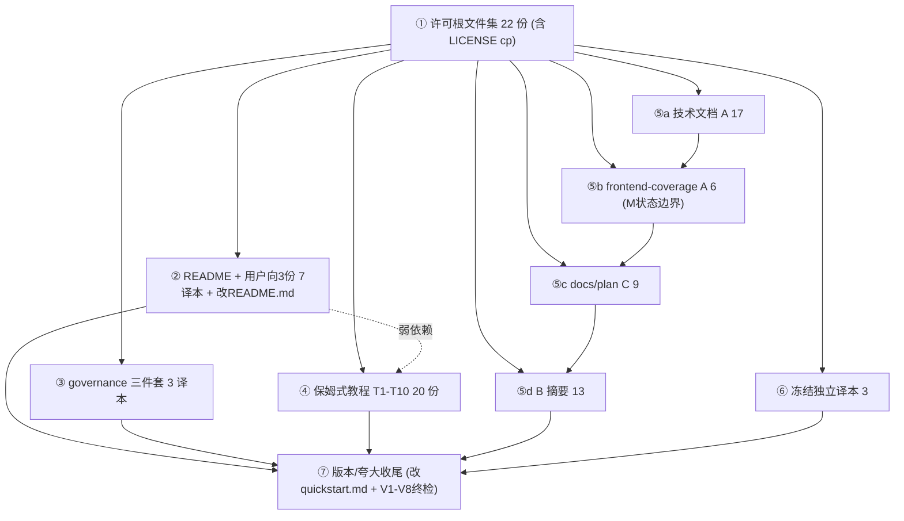

# DESIGN：Abate「AGPLv3 + 商业授权双许可」与「全量中英双语文档」体系设计 + 精确文件清单 + 有序任务分解

> 阶段 2/4 产物 · Architect（Bob）· 交给阶段 3 工程师的**唯一执行依据**
> 本文件是**设计文档**：只产出设计 / 清单 / 任务分解，不改任何产品文件，不写 `.go/.sh/.json/.yml`，不 `git add/commit/push`，不联网。
> 事实来源**仅**三份：`docs/i18n/PRD-dual-license-bilingual.md`（PRD）、主理人 `DOCS_FULL_INVENTORY.md`（56 份逐份清单，下称「清单」）、主理人 `HANDOFF_docs.md`（下称「交接件」，§n 指其章节）。凡三件未固化者一律标注待确认 / 由本设计定案，不虚构。
> 主理人已拍板的 6 项决策（本设计直接执行，**不再列为待确认**）：①命名定案方案 A；②README 主语言=中文；③法律 Q1–Q5 统一标注「需权利人或法务确认 / 本文件不构成法律意见」；④沿用既有真实署名；⑤`docs/i18n/` 为本轮中文过程文档、不计入 56 份、不建 `.en.md`；⑥SPDX 用 `AGPL-3.0-or-later` 但须标注待权利人确认。

---

## 0. 结论先行（定案摘要）

| 项 | 定案 |
|---|---|
| 命名 | **方案 A 同目录双文件**：中文原文 `X.md` 原名不动，并列新建 `X.en.md` |
| 56 份覆盖 | **100%（56/56）**：A 全量译本 34 / B 英文摘要 13 / C 目标语气译本 9 |
| 额外译本 | 冻结 `docs/class-diagram.mermaid` / `sequence-diagram.mermaid` → 2 份 `.en.mermaid`（不计入 56） |
| 本轮文件总数 | **新建 100 份 + 修改中文原文 2 份 = 102 份**（另本设计文件 1 份为阶段 2 产出，不计入工程师执行面） |
| 新建构成 | (a) 治理/许可根文件集 22 + (b) 译本 58（56 + 2 mermaid）+ (d) 教程 20 = 100 |
| 修改构成 | (c) `README.md`（重构 + 2 个精确改动点）、`docs/user/quickstart.md`（1 个精确改动点） |
| 不改原文 | 冻结 3 份、5 份 M 状态 frontend-coverage、其余 51 份中文原文，全部只新建译本 |
| 任务批次 | ①→②→③→④→⑤(5a→5b→5c→5d) / ⑥（⑤⑥可并行）→⑦（依赖全部） |
| 最高风险 | `LICENSE` 逐字一致；冻结件零改动；5 份 M 状态禁 `checkout HEAD`；教程逐字对齐 §6d；法律点不代断 |

---

## 1. 事实基线（只取三件已固化值，不再调研）

| 维度 | 固化值 | 来源 |
|---|---|---|
| 版本 | 真实 `Go 1.26.11`；`GOFLAGS=-mod=vendor`；wazero v1.12.0 / yaml.v3 v3.0.1 / x-sys v0.44.0；无 git remote | 交接件 §2 |
| 版本不实 | README `go1.27`、quickstart `Go 1.24+` 须纠正；README `golangci-lint v2.15.0` 未核实，禁照抄断言 | §2 / PRD V2 |
| 许可现状 | 仓库根**无 `LICENSE`/`COPYING`**；仅 `governance/{DUAL-LICENSE,HEADERS,THIRD-PARTY}.md` 三份纯中文，均带 6 行 HTML 注释版权头 | §2 |
| 版权主体 | 「小黎的部落 (www.qingdujian.com)」；商业联系 `xiaolibuluo@163.com`；来源 `https://github.com/xiaolibuluo/Abate`（**沿用，不扩写资质/认证/背书**） | §2 |
| AGPLv3 黄金基准 | `agpl-3.0.txt` GNU/FSF 官方：661 行 / 34523 字节；`sha256 = 0d96a4ff68ad6d4b6f1f30f713b18d5184912ba8dd389f86aa7710db079abcb0`；§13「Remote Network Interaction」在 line 540 | §4 |
| 文档总量 | 排除 `.git/vendor/third_party/.artifacts` 后 **56 份 `.md`，全中文、0 英文、0 双语** | §2 / 清单 |
| 诚实红线 | E2E `competitorAbsolute = NOT_MEASURED`；未真实对拍 tree-sitter/PIT/Stryker/cargo-mutants/mutmut/libFuzzer 前不写竞品绝对分数、不宣称「超过竞品 X%」；`docs/plan/` 129 处「验收目标 100%」为规划语气非既成事实 | §3 / PRD V1/V4 |
| 门禁纠偏 | `header-check.sh` **只扫 `*.go`、完全不扫 `.md`**；`license-check.sh` **不扫仓库根 `LICENSE`**；新建 `.md` 带 6 行版权头属**治理一致性要求、非门禁强制**；改动前基线两脚本均 PASSED | §6b（措辞必须精确） |
| CLI 证据 | T1–T10 全部命令/输出/退出码逐字取 §6d 源码实时构建证据；`ok.yaml` = `ctl/cli/testdata/ok.yaml`；`derive --help` 含「Killing is a static AIR-level approximation, **not a real go test execution**」 | §6d |
| 冻结 | `docs/system_design.md`(sha256 `f2c500f3…`)、两份 `.mermaid`、`ci/e2e_thresholds*.json`、`ci/e2e_plan.json`、`scripts/lint-gate.sh` 41–135 行、`.golangci.yml`、`go.mod/go.sum/vendor/`、`third_party/LICENSE-MANIFEST.md`、所有 `.go` | §5 / 主理人硬约束 |
| 工作树边界 | 当前 **52 个 M + 25 个 ??** 为上一任务 E2E 遗留、非本轮脏改动；其中 `docs/dev/frontend-coverage/{csharp,javascript,kotlin,python,rust}.md` 5 份 M 双语化**必须基于工作树当前内容**，禁 `git checkout HEAD`、禁基于 HEAD 旧版翻译、不得清理/提交遗留改动 | §6e / 主理人硬约束 |

---

## 2. 双语命名 / 目录规范定案（方案 A 精确规则）

### 2.1 机械映射规则（可脚本化，工程师直接套用 56 份清单）

```
对「清单」中每一行中文源 P = <dir>/<name>.md：
  1. 新建文件 E = <dir>/<name>.en.md
     —— <dir> 与 <name> 原样保留（含中文字符，如 `abate-m2-算法蓝本台账.en.md`），
        不重命名、不搬迁、不建 i18n 双树、不改中文原文相对链接目标。
  2. 分类 f(P) 仅由目录决定（不逐份人工判断）：
        <dir> ∈ { docs/reference, ces/schema/dist }  → B（英文摘要型译本）
        <dir> == docs/plan                            → C（目标语气译本）
        其它                                          → A（全量逐节译本）
  3. 骨架 = skeleton(f(P))，见 §4.6；头部统一 6 行 HTML 注释版权头 + 顶部中英互链（§5.1/§5.2）。
  4. 中文原文除 §3(c) 列明的 2 份外，一律不修改、不重命名、不搬迁。
  5. 冻结件额外规则：P ∈ { docs/system_design.md } ∪ { 2×.mermaid } → 原文一行不动，
     sha256 必须不变；只能新建并列译本。
```

分类计数校验：**A = 34**（root 4 + docs 3 + adr 1 + dev 9 + frontend-coverage 6 + spec 1 + user 3 + governance 3 + plugin 1 + security 1 + policy 2）、**B = 13**（reference 12 + fields 1）、**C = 9**（plan 9）；34 + 13 + 9 = **56 ✓**。

### 2.2 三类处置定义（定案，禁止自由裁量）

| 类 | 定义 | 落地物 | 语气约束 |
|---|---|---|---|
| **A 全量译本** | 完整英文译本，章节标题序列 / 数量 / 代码块数与中文原文逐节一一对应 | `X.en.md`（全量） | 不新增结论、不升级能力措辞；`NOT_MEASURED` / `competitorAbsolute` / `derive` 措辞原样保留 |
| **B 英文摘要** | **仅新建 `X.en.md` 摘要型译本**（英文 Scope 摘要 + 外部规范链接清单），中文全文仍在 `X.md`，**不全译、不改写外部规范内容** | `X.en.md`（摘要） | `ces/schema/dist/fields.md` 须标注「generated artifact / 生成物，摘要不与生成器输出冲突」 |
| **C 内部规划降级** | 新建 `X.en.md` 全量译本，但统一保留「设计目标 / 验收目标」目标语气 | `X.en.md`（全量 + 目标语气声明） | 「验收目标 100% 通过」→ `Acceptance target: 100% pass (design target, not a measured result)`；**禁**译成 `achieved`/`completed`/既成事实/营销语言；不删除、不弱化目标限定词 |

> B 类定案说明：主理人指定「`docs/reference` 12 份 + `ces/schema/dist/fields.md` 只加英文摘要」。为保持方案 A「新建文件 → 中文源」映射统一、且**不动中文原文**，本设计定案 B 类同样新建 `X.en.md`（内容为摘要而非全译），而非在中文原文里插入英文段落。这样 56 份一律 `X.md` → `X.en.md`，QA 可用同一套配对校验。`fields.md` 的「是否纳入」由主理人已通过「列入 B 类」定案为**纳入**。

### 2.3 例外（仅 4 项，其余一律按 2.1）

| 例外 | 规则 | 理由 |
|---|---|---|
| `LICENSE` | `cp` 黄金基准到仓库根，**单份英文官方全文**；**不建 `.en.md`、不加任何版权头或尾注** | 逐字一致 + sha256 硬约束优先于一切；任何增删都破坏 `0d96a4ff…` |
| `NOTICE` | 无扩展名**单文件内双语**（`## English` / `## 中文` 两节 + 顶部互链锚），不建 `.en.md` | NOTICE 为社区惯例无扩展名短文件，成对会产出不对称命名 `NOTICE.en.md` |
| 两份 `.mermaid` | 新建 `docs/class-diagram.en.mermaid`、`docs/sequence-diagram.en.mermaid`；版权信息用 mermaid `%%` 注释，不用 HTML 头 | 非 `.md`、不计入 56；HTML 注释会污染图语法 |
| `docs/i18n/*` | 中文工作文档（PRD 已存在、**本 DESIGN**、任务列表与 glossary 均内联于本 DESIGN、不单独落盘），**不计入 56 份、不建 `.en.md`** | 主理人定案：最终交付给用户的是「产品文档双语 + LICENSE + 治理文件集」 |

### 2.4 README 主语言（主理人已拍板）

`README.md` = **中文主门面（需重构）**；`README.en.md` = 英文译本（属 (b) 56 份 root 组 A 类）。二者逐节对应，顶部互链。

---

## 3. 精确文件清单（本轮全部新建 / 修改，共 102 份）

### 3(a) 许可 / 治理根文件集 —— 新建 22 份 + 1 份已存在说明

> 路径均相对仓库根 `/workspace/abate/`。「语言」列：ZH=中文 / EN=英文 / EN-OFFICIAL=官方英文全文逐字 / ZH+EN=单文件内双语。

| # | 相对路径 | 动作 | P | 语言 | 精确要点 |
|---:|---|---|:--:|---|---|
| 1 | `LICENSE` | **新建（cp）** | **P0** | EN-OFFICIAL | §6 逐字落地；661 行/34523B/sha256 `0d96a4ff…`；**无版权头、无译本** |
| 2 | `LICENSING.md` | 新建 | **P0** | ZH | 双许可两路径表（§4.2）+ SPDX `AGPL-3.0-or-later`（**标注待权利人确认**）+ 导航 |
| 3 | `LICENSING.en.md` | 新建 | **P0** | EN | 逐节对应 |
| 4 | `COMMERCIAL-LICENSE.md` | 新建 | **P0** | ZH | 8 项必备条款（§4.3），含「本文件不构成法律意见」 |
| 5 | `COMMERCIAL-LICENSE.en.md` | 新建 | **P0** | EN | 逐节对应 |
| 6 | `CONTRIBUTING.md` | 新建 | P1 | ZH | **根目录新建**；与已存在的 `docs/dev/contributing.md` 是不同路径，勿混 |
| 7 | `CONTRIBUTING.en.md` | 新建 | P1 | EN | DCO 1.1 + `git commit -s` + 依赖白名单 |
| 8 | `CLA.md` | 新建 | P1 | ZH | **草案**；标注「是否必需待权利人或法务确认」，不把 CLA 从可选改为必需 |
| 9 | `CLA.en.md` | 新建 | P1 | EN | 本设计补充定案双语（见下注） |
| 10 | `DCO.md` | 新建 | P1 | ZH + DCO 1.1 EN 官方全文附录 | 与 CONTRIBUTING 交叉链接 |
| 11 | `DCO.en.md` | 新建 | P1 | EN | 含同一 DCO 1.1 官方全文附录（逐节对应） |
| 12 | `NOTICE` | 新建 | P1 | ZH+EN | 无扩展名单文件双语例外（§2.3） |
| 13 | `THIRD-PARTY-NOTICES.md` | 新建 | P1 | ZH | wazero / x-sys / yaml.v3 许可逐项如实；与 `governance/THIRD-PARTY.md` 区分 |
| 14 | `THIRD-PARTY-NOTICES.en.md` | 新建 | P1 | EN | 逐节对应 |
| 15 | `TRADEMARK.md` | 新建 | P1 | ZH | 标注「商标政策是否存在待权利人或法务确认」，**不虚构名称/标识使用规则** |
| 16 | `TRADEMARK.en.md` | 新建 | P1 | EN | 逐节对应 |
| 17 | `CODE_OF_CONDUCT.md` | 新建 | P1 | ZH | 无 SLA / 无虚构响应时限 |
| 18 | `CODE_OF_CONDUCT.en.md` | 新建 | P1 | EN | 逐节对应 |
| 19 | `SECURITY.md` | **已存在 · 不新建 · 原文不改** | P1 | ZH | 属 56 份 root 组；本轮仅由 3(b) 新建 `SECURITY.en.md`；治理文件集成员，处置权归 A 类译本，不重复计数 |
| 20 | `FAQ-licensing.md` | 新建 | P1 | ZH | 决策树 + 7 问（§4.4）；「不构成法律意见」 |
| 21 | `FAQ-licensing.en.md` | 新建 | P1 | EN | 逐节对应 |
| 22 | `LICENSE-COMPATIBILITY.md` | 新建 | P1 | ZH | 「许可证兼容性说明」**文件名由本设计定案**；双许可语境下依赖白名单，不与 AGPLv3 条款冲突 |
| 23 | `LICENSE-COMPATIBILITY.en.md` | 新建 | P1 | EN | 逐节对应 |

**小计：新建 22 份**（第 19 行为已存在说明，不计入）。
**定案说明**：主理人清单仅对 `LICENSING`/`COMMERCIAL-LICENSE`/`CONTRIBUTING`/`FAQ-licensing` 显式写了 `.en.md`。本设计依用户「全量中英双语」硬要求与方案 A 机械核验一致性，**把 `CLA`/`DCO`/`THIRD-PARTY-NOTICES`/`TRADEMARK`/`CODE_OF_CONDUCT`/`LICENSE-COMPATIBILITY` 一并列为双语成对**；唯一两个非成对例外为 `LICENSE`（官方全文逐字）与 `NOTICE`（无扩展名单文件双语）。此定案落在架构师命名定案权内，工程师照表执行即可，无需再问。

### 3(b) 56 份产品文档 `X.en.md` 逐份对号入座（A/B/C）+ 2 份冻结 `.mermaid`

> 「中文源」列逐行取自 `DOCS_FULL_INVENTORY.md`（行数/hdr 一并保留以便核对）；「新建译本」按 §2.1 机械生成；**中文源一律不改名、不搬迁、除 3(c) 外不修改**。

**(root, 4)** — A

| # | 中文源（行数/hdr） | 新建译本 | 类 | P | 特殊约束 |
|---:|---|---|:--:|:--:|---|
| 1 | `README.md` (47/N) | `README.en.md` | A | **P0** | 中文源在 3(c) 重构；译本逐节对应重构后版本 |
| 2 | `CHANGELOG.md` (97/Y) | `CHANGELOG.en.md` | A | P1 | 门面优先 |
| 3 | `SECURITY.md` (72/Y) | `SECURITY.en.md` | A | P1 | **中文原文不改**；译本如实译，不新增 SLA/虚构时限；即 3(a)#19 的处置物 |
| 4 | `abate-m2-算法蓝本台账.md` (37/N) | `abate-m2-算法蓝本台账.en.md` | A | P1 | 中文文件名原样保留；台账「只读参考基线」如实译 |

**(ces/schema/dist, 1)** — B

| 5 | `ces/schema/dist/fields.md` (70/N) | `ces/schema/dist/fields.en.md` | **B** | P2 | 生成物；标注 `generated artifact`；仅英文摘要，不改中文原文、不与生成器输出冲突 |

**(docs, 3)** — A

| 6 | `docs/ARCHITECTURE.md` (258/N) | `docs/ARCHITECTURE.en.md` | A | P1 | 标题「超级架构」如实直译，**不升级**为 world-class / 既成能力宣称 |
| 7 | `docs/procurement.md` (84/N) | `docs/procurement.en.md` | A | P1 | 采购清单逐项如实 |
| 8 | `docs/system_design.md` (1366/N) **[冻结]** | `docs/system_design.en.md` | A | P1 | **仅新建译本、原文一行不动**（任务⑥）；`competitorAbsolute = NOT_MEASURED` 语义原样保留，禁「顺手补上」结论 |

**(docs/adr, 1)** — A

| 9 | `docs/adr/ADR-001-gvisor-sandbox.md` (83/N) | `docs/adr/ADR-001-gvisor-sandbox.en.md` | A | P1 | 保留 ADR 决策语境、不改结论 |

**(docs/dev, 9)** — A

| 10 | `docs/dev/abi-port-parity.md` (31/N) | `.en.md` 同目录并列 | A | P1 | — |
| 11 | `docs/dev/contributing.md` (57/Y) | `docs/dev/contributing.en.md` | A | P1 | 门面优先；与根 `CONTRIBUTING.md` 区分，二者均保留 |
| 12 | `docs/dev/incremental-parity.md` (196/N) | `docs/dev/incremental-parity.en.md` | A | P1 | 含 tree-sitter 对照，**禁竞品绝对断言/绝对分数** |
| 13 | `docs/dev/module-dev-guide.md` (54/Y) | `docs/dev/module-dev-guide.en.md` | A | P1 | — |
| 14 | `docs/dev/pending-work.md` (164/N) | `docs/dev/pending-work.en.md` | A | P1 | 保留「待办 / 规划」语气，不译成已完成 |
| 15 | `docs/dev/pit-parity-report.md` (119/Y) | `docs/dev/pit-parity-report.en.md` | A | P1 | PIT 对拍报告，禁竞品绝对分数 |
| 16 | `docs/dev/plugin-dev-guide.md` (54/Y) | `docs/dev/plugin-dev-guide.en.md` | A | P1 | — |
| 17 | `docs/dev/sandbox.md` (108/Y) | `docs/dev/sandbox.en.md` | A | P1 | — |
| 18 | `docs/dev/tla-verification.md` (96/N) | `docs/dev/tla-verification.en.md` | A | P1 | 形式化验证报告如实译，不升级为「已证明最优」 |

**(docs/dev/frontend-coverage, 6)** — A · **工作树边界重点**

| 19 | `docs/dev/frontend-coverage/c.md` (196/N) | `docs/dev/frontend-coverage/c.en.md` | A | P1 | 基于工作树当前内容 |
| 20 | `docs/dev/frontend-coverage/csharp.md` (368/N) | `…/csharp.en.md` | A | P1 | **M 状态**：基于工作树当前内容，**禁 `git checkout HEAD`**、禁基于 HEAD 旧版翻译；中文原文不改 |
| 21 | `docs/dev/frontend-coverage/javascript.md` (151/N) | `…/javascript.en.md` | A | P1 | 同上（M） |
| 22 | `docs/dev/frontend-coverage/kotlin.md` (235/N) | `…/kotlin.en.md` | A | P1 | 同上（M） |
| 23 | `docs/dev/frontend-coverage/python.md` (214/N) | `…/python.en.md` | A | P1 | 同上（M） |
| 24 | `docs/dev/frontend-coverage/rust.md` (221/N) | `…/rust.en.md` | A | P1 | 同上（M） |

**(docs/plan, 9)** — **C**（内部规划降级，逐节全译但保留目标语气）

| 25 | `docs/plan/00-MASTER-PLAN.md` (210) | `docs/plan/00-MASTER-PLAN.en.md` | **C** | P1 | 见下统一约束 |
| 26 | `docs/plan/01-kernel-hpov.md` (347) | `docs/plan/01-kernel-hpov.en.md` | **C** | P1 | 同上 |
| 27 | `docs/plan/02-wasm-runtime.md` (235) | `docs/plan/02-wasm-runtime.en.md` | **C** | P1 | 同上 |
| 28 | `docs/plan/03-ces-spec.md` (303) | `docs/plan/03-ces-spec.en.md` | **C** | P1 | 同上 |
| 29 | `docs/plan/04-simulator.md` (347) | `docs/plan/04-simulator.en.md` | **C** | P1 | 同上 |
| 30 | `docs/plan/05-language-frontend.md` (593) | `docs/plan/05-language-frontend.en.md` | **C** | P1 | 同上 |
| 31 | `docs/plan/06-adapter-reporter.md` (418) | `docs/plan/06-adapter-reporter.en.md` | **C** | P1 | 同上 |
| 32 | `docs/plan/07-control-plane.md` (267) | `docs/plan/07-control-plane.en.md` | **C** | P1 | 同上 |
| 33 | `docs/plan/08-crosscutting.md` (365) | `docs/plan/08-crosscutting.en.md` | **C** | P1 | 同上 |

> **C 类统一约束**：所有「100% / 通过 / 达成 / 唯一 / 绝对」类表述译文必须带 `Design target` / `Acceptance target` 限定，**非已实测达成结果**；禁 `achieved`/`completed`/`100% coverage reached`；中文原文**一行不改**（规划性表述保留目标语气，不删除）。

**(docs/reference, 12)** — **B**（英文摘要 + 外部规范链接清单，不全译）

| # | 中文源 | 新建译本 | 类 | P |
|---:|---|---|:--:|:--:|
| 34 | `docs/reference/c-cert.md` (23) | `docs/reference/c-cert.en.md` | B | P2 |
| 35 | `docs/reference/cpp-core.md` (20) | `docs/reference/cpp-core.en.md` | B | P2 |
| 36 | `docs/reference/csharp-design.md` (27) | `docs/reference/csharp-design.en.md` | B | P2 |
| 37 | `docs/reference/go-effective.md` (46) | `docs/reference/go-effective.en.md` | B | P2 |
| 38 | `docs/reference/go-uber.md` (42) | `docs/reference/go-uber.en.md` | B | P2 |
| 39 | `docs/reference/js-airbnb.md` (31) | `docs/reference/js-airbnb.en.md` | B | P2 |
| 40 | `docs/reference/js-ts-official.md` (23) | `docs/reference/js-ts-official.en.md` | B | P2 |
| 41 | `docs/reference/kotlin-conventions.md` (25) | `docs/reference/kotlin-conventions.en.md` | B | P2 |
| 42 | `docs/reference/kotlin-ktlint.md` (18) | `docs/reference/kotlin-ktlint.en.md` | B | P2 |
| 43 | `docs/reference/python-google.md` (29) | `docs/reference/python-google.en.md` | B | P2 |
| 44 | `docs/reference/python-pep8.md` (30) | `docs/reference/python-pep8.en.md` | B | P2 |
| 45 | `docs/reference/rust-api.md` (38) | `docs/reference/rust-api.en.md` | B | P2 |

> B 类统一约束：保留原始外部规范链接、不改写外部规范内容、中文原文不改。

**(docs/spec, 1)** — A ｜ 46 `docs/spec/ces-v1.md` (82/Y) → `docs/spec/ces-v1.en.md` (A/P1)

**(docs/user, 3)** — A · **P0**

| # | 中文源 | 新建译本 | 类 | P | 精确约束 |
|---:|---|---|:--:|:--:|---|
| 47 | `docs/user/quickstart.md` (94/Y) | `docs/user/quickstart.en.md` | A | **P0** | 译本版本写 `Go 1.26.11`；中文源 1 处版本改动归任务⑦ |
| 48 | `docs/user/cli-reference.md` (80/Y) | `docs/user/cli-reference.en.md` | A | **P0** | 命令/输出**逐字取 §6d**，禁照抄旧 `cli-reference.md` / 11-08 旧二进制结论；**中文原文不改**，若与 §6d 有出入在译本加注「以 §6d 实测为准」，不回改原文 |
| 49 | `docs/user/ces-guide.md` (100/Y) | `docs/user/ces-guide.en.md` | A | **P0** | 逐节对应；CES 字段名不臆造 |

**(governance, 3)** — A · **P0**

| # | 中文源 | 新建译本 | 类 | P | 精确约束 |
|---:|---|---|:--:|:--:|---|
| 50 | `governance/DUAL-LICENSE.md` (39/Y) | `governance/DUAL-LICENSE.en.md` | A | **P0** | 保留 6 行版权头；「CLA 可选 / DCO 强制」现状不改 + 显式标注「DCO 不授予再许可权，双许可下需 CLA 或明确再许可条款，**需权利人或法务确认**」 |
| 51 | `governance/HEADERS.md` (45/Y) | `governance/HEADERS.en.md` | A | **P0** | §2 治理约定 vs §6b 门禁纠偏措辞精确：`header-check.sh` 只扫 `*.go`、不扫 `.md` |
| 52 | `governance/THIRD-PARTY.md` (49/Y) | `governance/THIRD-PARTY.en.md` | A | **P0** | 与根 `THIRD-PARTY-NOTICES.md` 交叉链接，不冲突 |

**(plugin, 1)** — A ｜ 53 `plugin/CI-EVIDENCE.md` (170/N) → `plugin/CI-EVIDENCE.en.md` (A/P1)
> 定案为 **A 全量**（PRD §6.2 曾写 A/B 两可）：含门禁证据，逐节对应更利于 V6/V8 核验；标题 `commit → publish ≤ 1h` 如实译、不升级为能力宣称；证据须与 §6b/§6d 一致。

**(security, 1)** — A ｜ 54 `security/THREAT-MODEL.md` (57/Y) → `security/THREAT-MODEL.en.md` (A/P1)

**(security/policy, 2)** — A

| 55 | `security/policy/disclosure.md` (42/Y) | `security/policy/disclosure.en.md` | A | P1 | 无 SLA / 虚构响应时限 |
| 56 | `security/policy/key-policy.md` (44/Y) | `security/policy/key-policy.en.md` | A | P1 | 密钥策略如实译 |

**56 份校验**：4+1+3+1+9+6+9+12+1+3+3+1+1+2 = **56 ✓**；A 34 / B 13 / C 9 = **56 ✓**。

**冻结 `.mermaid` 独立译本（不计入 56，任务⑥）**

| 冻结原文（禁改） | 新建译本 | 规则 |
|---|---|---|
| `docs/class-diagram.mermaid` | `docs/class-diagram.en.mermaid` | 仅复制图结构、中文节点标签译英；原文 sha256 不变；版权信息用 `%%` 注释 |
| `docs/sequence-diagram.mermaid` | `docs/sequence-diagram.en.mermaid` | 同上 |

**(b) 小计：新建 58 份**（56 份 `.en.md` + 2 份 `.en.mermaid`）。

### 3(c) 需【修改中文原文】的少数文件 —— 精确改动点，仅 2 份，不得扩大

| 文件 | 精确改动点（逐点列出） | 归属批次 |
|---|---|---|
| `README.md` | ① 整体**重构**为中文主门面，章节序列严格按 §4.1 的 9 节（现状仅 CI/CD 门禁说明）；② `go1.27` → `Go 1.26.11`；③ 未核实的 `golangci-lint v2.15.0` 断言 → **删除**（不照抄、不改成别的版本号）；④ 顶部加 6 行 HTML 版权头 + `中文 \| English` 互链。**除以上 4 点外不得改动既有事实描述、不得新增夸大词** | ②（重构 + 版本 + 删断言），⑦（复验） |
| `docs/user/quickstart.md` | **仅 1 处**：`Go 1.24+` → `Go 1.26.11`。其余行、命令、章节一律不动 | ⑦ |

**规则型收尾（不预设固定文件集，不虚构逐处位置）**：P0-9 夸大措辞清理在⑦以 PRD V1 扫描规则机械执行 —— ① `docs/plan/` 9 份的规划性「验收目标 100% 通过」**保留不动**，仅确保译本带目标语气；② 冻结件、5 份 M 状态 frontend-coverage、上表 2 份之外的中文原文**一律不改**；③ 新建 100 份文档零夸大词；④ 若既有中文原文存在被判定为「既成事实式夸大 / 竞品绝对断言」的行，逐处做**最小改写 + 留痕**（改为事实陈述或标注 `NOT_MEASURED`），不重写整段、不顺带改其他内容。**本设计不臆造 129 处逐处位置**。

**明确不改原文清单**：`docs/system_design.md`、两份 `.mermaid`、5 份 M 状态 frontend-coverage、其余 51 份中文原文、`SECURITY.md`、`governance/*`、`docs/user/cli-reference.md`、所有冻结 `.go/.sh/.json/.yml`、`go.mod/go.sum/vendor/`。

### 3(d) 保姆式教程 T1–T10 —— 新建 20 份，统一放 `docs/i18n/tutorials/`

**命名定案**：沿用方案 A（中文 `Txx-slug.md` + 并列 `Txx-slug.en.md`），而非 `.zh.md`/`.en.md` 双显式后缀。理由：与 56 份译本、治理文件集命名**完全一致**，互链锚点与配对校验脚本可复用一套；中文为原文、英文为译本，语义与全仓统一。中英两份的**命令 / 输出代码块逐字相同（不翻译）**，仅说明性文字翻译。

| # | 中文 / 英文文件 | 主题 | 逐字对齐的 §6d 证据锚点 |
|---:|---|---|---|
| T1 | `T01-build.md` / `T01-build.en.md` | 从零离线安装与构建 | `go version`；`GOFLAGS=-mod=vendor go build -o /tmp/abate_verify .`；`abate version` 6 行输出 |
| T2 | `T02-first-run.md` / `T02-first-run.en.md` | 第一个混沌实验 | `abate run ctl/cli/testdata/ok.yaml` 报告头 10 行（含 `6444a24ed2…`、`health \| HELD \| …`） |
| T3 | `T03-dry-run.md` / `T03-dry-run.en.md` | 干跑校验 CES | `--dry-run` → `status: VALIDATED` / `exitCode: 0` / `events: 0` / `observations: 0` |
| T4 | `T04-seed-json.md` / `T04-seed-json.en.md` | 固定种子 + JSON 输出 | `--seed 42 --format json` → `"seed": 42` / `"status": "COMPLETED"` / `"runDigest": "32dbea3d9…"` |
| T5 | `T05-cli-help.md` / `T05-cli-help.en.md` | CLI 全命令逐个手把手 | 9 条 `--help` 命令；命令树 `run/verify/replay/check/derive/plugin/web/version`；退出码四态 `0/1/2/3`；6 个 flag；`derive --help` 原句 |
| T6 | `T06-exit-codes.md` / `T06-exit-codes.en.md` | 退出码四态逐个验证 | 6 条 `echo $?` → `0 / 1 / 3 / 3 / 3 / 0` |
| T7 | `T07-write-ces.md` / `T07-write-ces.en.md` | CES 文件从零写 | `cat`/`cp`/`--dry-run`/run；`ok.yaml` 36 行逐字段以真实文件为准（**不臆造字段名**） |
| T8 | `T08-contribute.md` / `T08-contribute.en.md` | 如何贡献（DCO/CLA） | `git commit -s -m "docs: add bilingual quickstart"`（**文档示例，本轮不执行**）；依赖白名单；再许可缺口标注 |
| T9 | `T09-license-decision.md` / `T09-license-decision.en.md` | 判断 AGPLv3 还是商业授权 | `abate version` 的 `license: AGPLv3 or commercial`；决策树 4 步；§13 line 540 |
| T10 | `T10-faq-gates.md` / `T10-faq-gates.en.md` | FAQ 导航 + 如何跑门禁 | 5 条门禁命令；两脚本 PASSED 基线；§6b 纠偏措辞 |

**教程编写纪律**（PRD §7，工程师必守）：① 所有命令/输出/退出码逐字引用 §6d，禁用 11-08 旧二进制、禁照抄旧 `cli-reference.md`；② §6d 未固化输出的 `verify`/`replay`/`check`/`plugin`/`web` 与 CES 逐字段内容，以 `abate <cmd> --help` 与 `ctl/cli/testdata/ok.yaml` 真实文件为准现场补写，**PRD 与教程均不臆造**；③ `ok.yaml` 须写明为 `ctl/cli/testdata/ok.yaml` 的简写；④ 凡宣称确定性须固定 `--seed`；⑤ `derive` 保留「static AIR-level approximation, not a real go test execution」；⑥ 每份带 6 行 HTML 版权头 + 顶部互链；⑦ 阶段 4 QA 须重跑 T1–T10 全部命令核对。

### 3.5 汇总（工程师据此核对文件总数）

| 类别 | 新建 | 修改 | 小计 |
|---|---:|---:|---:|
| (a) 许可 / 治理根文件集 | 22 | 0 | 22 |
| (b) 56 份 `X.en.md` + 2 份冻结 `.en.mermaid` | 58 | 0 | 58 |
| (c) 中文原文精确改动 | 0 | 2 | 2 |
| (d) 教程 T1–T10 中英各一 | 20 | 0 | 20 |
| **合计（工程师执行面）** | **100** | **2** | **102** |
| 阶段 2 产出（本设计文件，已落盘） | 1 | 0 | 不计入执行面 |

---

## 4. 每类文档的结构骨架

### 4.1 README 双语门面章节序列（`README.md` / `README.en.md` 逐节一一对应）

```
<!-- 6 行 HTML 版权头 -->
> 语言 / Language：[中文](README.md) | [English](README.en.md)      ← 中文版
> Language / 语言：[English](README.en.md) | [中文](README.md)      ← 英文版

# Abate                                    §1 一句话介绍（基于真实能力，零夸大）
## 1 许可 / License                        AGPLv3 / 商业双许可 → LICENSING.md；SPDX AGPL-3.0-or-later（待权利人确认）
## 2 环境要求 / Requirements               Go 1.26.11 + GOFLAGS=-mod=vendor 离线；无 git remote
## 3 快速开始 / Quick start                指向 T1 / T2（docs/i18n/tutorials/）
## 4 教程索引 / Tutorials                  T1–T10 表（中文 + English 双列链接）
## 5 文档导航 / Documentation              LICENSING / COMMERCIAL-LICENSE / FAQ-licensing /
                                          CONTRIBUTING / DCO / CLA / SECURITY / NOTICE /
                                          THIRD-PARTY-NOTICES / LICENSE-COMPATIBILITY / governance/
## 6 贡献 / Contributing                   git commit -s（DCO 1.1）；CLA 可选现状 +
                                          再许可缺口「需权利人或法务确认」
## 7 门禁 / Gates                          header-check 只扫 *.go；license-check 不扫根 LICENSE；
                                          lint-gate 冻结九段（措辞依 §6b）
## 8 语言与声明 / Language & Status        zh↔en 互链；本文件不构成法律意见；
                                          competitorAbsolute = NOT_MEASURED 原样保留
```

### 4.2 `LICENSING.md` 两路径表（必备）

| 维度 | 路径 A：AGPLv3 开源 | 路径 B：商业授权 |
|---|---|---|
| 适用 | 可履行 AGPLv3 全部义务，含 **§13 Remote Network Interaction**（官方全文 line 540：网络用户须能获得 Corresponding Source） | 闭源集成 / 不愿公开衍生作品源码 / 不愿承担 §13 源码提供义务 |
| 许可文本 | `LICENSE`（AGPLv3 官方全文，逐字 661 行） | `COMMERCIAL-LICENSE.md`（条款与联系方式，**需权利人确认**） |
| SPDX | `AGPL-3.0-or-later`（**需权利人确认，不写成已定**） | 专有许可，无 SPDX |
| 义务 | 同许可分发、Corresponding Source 提供、保留版权与许可声明 | 以双方另行书面协议为准；**不写定价 / 已签约 / 已支付** |
| 入口 | `CONTRIBUTING.md` / `DCO.md` / `CLA.md` | `xiaolibuluo@163.com` |
| 判断辅助 | `FAQ-licensing.md` 决策树（**仅信息导航，不构成法律意见**） | 同左 |
| 权利链缺口 | **DCO 不授予项目方再许可（relicense）权；双许可下需 CLA 或明确再许可条款 —— 需权利人或法务确认** | 同左 |

> 表下必须指向 `LICENSE` / `COMMERCIAL-LICENSE` / `FAQ-licensing` / `CONTRIBUTING` / `NOTICE` / `THIRD-PARTY-NOTICES` / `LICENSE-COMPATIBILITY`，并附「本文件不构成法律意见 / This document does not constitute legal advice」。

### 4.3 `COMMERCIAL-LICENSE.md` 必备条款（8 项，缺一不可）

1. 版权主体「小黎的部落 (www.qingdujian.com)」+ 来源 `https://github.com/xiaolibuluo/Abate`（**沿用，不扩写资质/认证/背书**）；
2. 商业联系 `xiaolibuluo@163.com`（沿用既有真实署名，**不新增未核实联系方式**）；
3. 双许可关系：AGPLv3 与商业授权为**两条可选路径**，不是「已授权 / 已签约」；
4. 适用情形（闭源集成 / §13 义务规避）**仅作信息导航**；
5. 授权范围以**双方另行书面协议**为准；本文件不授予任何权利，不含定价 / 已支付 / 已签约 / 用户案例 / 性能数字 / SLA；
6. 「**本文件不构成法律意见 / This document does not constitute legal advice**」+「**需权利人或法务确认 / Subject to confirmation by the rights holder or legal counsel**」；
7. SPDX `AGPL-3.0-or-later` 标注待权利人确认；`TRADEMARK.md` 标注商标政策是否存在待确认；
8. 第三方依赖声明指向 `THIRD-PARTY-NOTICES.md` / `NOTICE` / `LICENSE-COMPATIBILITY.md`。

### 4.4 `FAQ-licensing.md` 决策树 + 7 问

**决策树**（= T9 第 4 步，仅信息导航、不构成法律意见）：
```
① 能否履行 AGPLv3 全部义务（含 §13 Remote Network Interaction 向网络用户提供 Corresponding Source）？
    能 ──► 走 AGPLv3（LICENSE / CONTRIBUTING / DCO）
    否 ──► ② 闭源集成 / 不愿公开衍生作品源码 / 不愿承担 §13 义务？
              是 ──► 需商业授权，联系 xiaolibuluo@163.com（沿用待确认）
    ③ SPDX 采用 only 还是 or-later ──► 待权利人确认
    ④ 竞品许可只作性质区分陈述，不作对标超越断言
    ⑤ 任何「这样是否合法」的个别判断 ──► 统一答「需权利人或法务确认，本文档不构成法律意见」
```
**7 问**：选 AGPLv3 还是商业授权 / §13 是什么 / SPDX 是什么且本项目用哪个 / 为何要 THIRD-PARTY-NOTICES 与 NOTICE / DCO 够不够（再许可缺口待确认）/ 竞品许可如何看（Qt·Grafana·iText 双许可参考；MongoDB SSPL·Elastic·HashiCorp BUSL **非 OSI 认可开源许可**）/ 根 `LICENSE` 与新 `.md` 会不会触发门禁 FAIL（§6b 纠偏）。

### 4.5 保姆式教程 5 要素模板（T1–T10 中英各一，逐节对应）

```
<!-- 6 行 HTML 版权头 -->
> 语言 / Language：[中文](Txx-slug.md) | [English](Txx-slug.en.md)

# Txx · <标题>

## 1 目标读者 / Audience            角色 + US 编号
## 2 前置条件 / Prerequisites        T 依赖 + Go 1.26.11/vendor + 真实文件路径
## 3 可复制命令 / Commands          ```bash``` 代码块 —— 逐字对齐 §6d / PRD §7
## 4 预期输出 / Expected output     ``` ``` 代码块 —— 逐字对齐 §6d；确定性宣称处固定 --seed
## 5 失败排查 / Troubleshooting     逐条「现象 → 原因 → 动作」，含诚实限定
```
命令与输出代码块**中英逐字相同**；说明性文字翻译；`ok.yaml = ctl/cli/testdata/ok.yaml` 等价关系写在第 2 节。

### 4.6 `X.en.md` 译本骨架（按 A / B / C 三选一）

**A 类**：6 行版权头 → 顶部互链 → `# <英文标题>` → 状态声明（「English translation of `X.md`，方案 A 并列译本；章节序列与代码块逐节对应；不新增结论；本文件不构成法律意见」）→ 逐节译文 → 可选 `### Translation notes`（仅记译法，**不新增事实**）。

**B 类**：6 行版权头 → 顶部互链（`English (abstract)` / `中文全文`）→ `# <英文标题> — Abstract` → 声明「**abstract-only companion**，中文全文见 `X.md`，外部规范链接原样保留、不改写外部规范内容」→ `## Scope / 范围`（3–5 句英文摘要）→ `## Key links / 外部规范链接`（原样抄录）→ `## Notes`（归档 / `generated artifact` 状态）。

**C 类**：6 行版权头 → 顶部互链 → `# <英文标题> — Design Targets` → **强制声明**「本文件为内部规划文档译本；全文所有 `100%` / 通过 / 达成类表述均为 **Design target / Acceptance target（设计目标 / 验收目标）**，**非已实测达成结果**，不得理解为既成事实或能力宣称；译本逐节对应、不升级语气、不删除目标限定词」→ 逐节译文。

---

## 5. 共享知识（跨文件约定，工程师批量落地照此执行）

### 5.1 六行 HTML 注释版权头模板（统一，逐字套用）

```html
<!--
  Copyright (c) 小黎的部落 (www.qingdujian.com)
  Project: xiaolibuluo/Abate — https://github.com/xiaolibuluo/Abate
  SPDX-License-Identifier: AGPL-3.0-or-later (subject to confirmation by the rights holder / 需权利人确认)
  Abate dual-license (AGPLv3 or commercial) bilingual documentation.
  本文件不构成法律意见 / This document does not constitute legal advice.
-->
```
- 严格 **6 行**（`<!--` + 4 行内容 + `-->`）；含 `Copyright` + `xiaolibuluo/Abate` + `小黎的部落` 三要素。
- 适用范围：**所有新建 `.md`**（(a) 22 份中 21 份、(b) 56 份、(d) 20 份）+ `NOTICE`。
- **例外**：`LICENSE` **不加头**（逐字一致优先）；两份 `.en.mermaid` 改用 `%%` 注释带同等三要素。
- 定性（依 §6b，**措辞必须精确**）：`header-check.sh` **只扫 `*.go`、完全不扫 `.md`** → 新建双语 `.md` 缺头**不会**触发门禁 FAIL；带 6 行头属**治理一致性要求 + `governance/HEADERS.md` §2 约定**，**非门禁强制项**。`license-check.sh` **不扫仓库根 `LICENSE`** → 落地 AGPLv3 全文**不会**误报 FAIL。

### 5.2 中英互链锚点格式（每份顶部，版权头之后）

```
中文原文 X.md 顶部：  > 语言 / Language：[中文](X.md) | [English](X.en.md)
英文译本 X.en.md 顶部：> Language / 语言：[English](X.en.md) | [中文](X.md)
B 类译本：            > Language / 语言：[English (abstract)](X.en.md) | [中文全文](X.md)
```
链接目标为**同目录文件名原样书写**（含中文字符，如 `abate-m2-算法蓝本台账.en.md`），不做 URL 编码改写、不建 `i18n/zh`+`i18n/en` 双树。`LICENSE` 无互链；`NOTICE` 用文件内 `## English` / `## 中文` 分节 + 单行互链锚。

### 5.3 中英术语对照表（glossary 基线，内联于本设计，不单独落盘）

| 中文 | English（统一译法） | 约束 |
|---|---|---|
| CES | `CES`（保持缩写，不扩写全称；见 `ces.tencent.com/v1`） | 三件未固化全称，**禁虚构展开** |
| AIR / AIR-level | `AIR` / `AIR-level`（保持缩写） | 同上，`static AIR-level approximation` 逐字保留 |
| HELD | `HELD`（状态枚举值，原样保留） | 不译、不改大小写 |
| derive | `derive`（子命令名，原样） | 必须带「static AIR-level approximation, not a real go test execution」 |
| 混沌（测试） | chaos (testing) | — |
| 变异（测试） | mutation (testing) | 禁把 derive 说成真实 go test 变异测试 |
| 保真 / 源码保真度 | fidelity / source fidelity | — |
| 门禁 / 门禁段 | gate / lint gate (frozen sections) | 冻结九段 = frozen nine sections (lines 41–135) |
| 对拍 / 对照 | parity check / cross-check | **禁**写成 benchmark / surpass / 超越 |
| 前端构造 | frontend constructs | — |
| 干跑 | dry-run | — |
| 种子 / 固定种子 | seed / fixed `--seed` | 确定性宣称必须固定 `--seed` |
| 水印 | watermark | `小黎的部落` 原样保留 |
| 设计目标 / 验收目标 | **Design target / Acceptance target** | **禁** `achieved` / `completed` / `reached` / 既成事实 |
| 再许可（权） | relicensing / relicense right | DCO 不授予，缺口标注待确认 |
| 网络交互（§13） | Remote Network Interaction | AGPLv3 官方措辞，line 540 |
| Corresponding Source | Corresponding Source | AGPLv3 官方术语，保留 |
| 需权利人或法务确认 | Subject to confirmation by the rights holder or legal counsel | 全法律点统一 |
| 本文件不构成法律意见 | This document does not constitute legal advice | 全治理/许可文档统一 |
| `NOT_MEASURED` / `competitorAbsolute` | **`NOT_MEASURED` / `competitorAbsolute`**（原样，不译、不替换、不补结论） | `competitorAbsolute = NOT_MEASURED` 语义在译本中原样保留 |
| `AGPL-3.0-or-later` | `AGPL-3.0-or-later` | **必须附「待权利人确认」**，不写成已定 |

### 5.4 诚实措辞禁用词表 + 保留规则

**禁用词（中，V1）**：`国际超一线` / `世界级` / `超越竞品` / `超过竞品X%` / `行业领先` / `最先进` / `首创` / `第一` / `100%达成` / `已达到…水平`。
**禁用词（英，译本同禁）**：`world-class` / `industry-leading` / `most advanced` / `first-ever` / `No.1` / `surpasses competitors` / `exceeds X%` / `has achieved … level` / `100% achieved` / `reached 100%`。

**「设计目标 / 验收目标」保留规则**：`docs/plan/` 9 份的「验收目标：用例 100% 通过」等规划性表述 → 译本写 `Acceptance target: 100% pass (design target, not a measured result)`；中文原文**保留不改、不删除**；C 类译本顶部强制目标语气声明。设计目标与已实测事实严格分离。

**`derive` 强制措辞**（逐字，不 paraphrase）：`Killing is a static AIR-level approximation, not a real go test execution`。禁出现「真实执行 go test 的变异测试」类描述。

**竞品红线**：`competitorAbsolute = NOT_MEASURED`；`NOT_MEASURED` 语义在译本中原样保留；任何竞品绝对分数 / 「超过竞品 X%」/ 绝对优势断言 = 0；竞品许可仅作**客观性质区分**（Qt·Grafana·iText 为双许可参考；MongoDB SSPL·Elastic·HashiCorp BUSL **非 OSI 认可开源许可**），「国际开源标准」措辞严谨区分。

**零虚构**（V8）：`认证 / 背书 / 线上地址 / 已发布版本 / 已支付 / 用户案例 / 性能数字 / SLA` = 0；不扩写版权主体为不存在的资质。

### 5.5 法律待确认点统一处置（Q1–Q5，主理人已拍板）

所有治理 / 许可 / FAQ / 教程文档一律：如实标注「**需权利人或法务确认 / 本文件不构成法律意见**」；**不代下结论**、**不擅自把 CLA 从可选改为必需**、**不虚构商标政策 / 授权状态 / 定价 / 已签约**。具体：

| 原 Q | 统一处置 |
|---|---|
| Q1 CLA 是否改必需 | 保留「CLA 可选、DCO 强制」现状不改动 + 显式标注「DCO 不授予再许可权，双许可下需 CLA 或明确再许可条款，需权利人或法务确认」 |
| Q2 商业邮箱 | 沿用 `xiaolibuluo@163.com`，不新增 |
| Q3 SSPL 类表述 | 仅客观性质区分 + 「非 OSI 认可开源许可」严谨措辞，不与 AGPLv3 混为一谈 |
| Q4 only / or-later | 统一写 `AGPL-3.0-or-later`，**每处附「需权利人确认 / 不写成已定」** |
| Q5 商标政策 | `TRADEMARK.md` 标注「商标政策是否存在待权利人或法务确认」，**不虚构规则** |

---

## 6. AGPLv3 全文落地方式（P0-1，最高优先、零容错）

**唯一合法操作（工程师直接复制粘贴执行，禁止凭记忆重写、禁止改写、禁止格式化）**：

```bash
cp /root/.codebuddy/artifact/2f8a7d30-9c21-4f0b-1d69-acaaee0d6000/licensing_src/agpl-3.0.txt /workspace/abate/LICENSE
```

**逐字一致判据（阶段 3 自验 + 阶段 4 复核）**：
- `diff /workspace/abate/LICENSE /root/.codebuddy/artifact/2f8a7d30-9c21-4f0b-1d69-acaaee0d6000/licensing_src/agpl-3.0.txt` → **无差异**；
- `wc -l -c /workspace/abate/LICENSE` → `661` 行 / `34523` 字节；
- `sha256sum /workspace/abate/LICENSE` → `0d96a4ff68ad6d4b6f1f30f713b18d5184912ba8dd389f86aa7710db079abcb0`；
- 第 13 节「Remote Network Interaction; Use with the GNU General Public License」仍在 **line 540**；结尾「How to Apply」含 `either version 3 ... or (at your option) any later version`。

**绝对禁止**：加 6 行 HTML 版权头、加任何尾注 / 空行 / BOM、改行尾、翻译、另建 `LICENSE.en.md`、把 `LICENSE` 纳入逐节对应校验、把「AGPL-3.0-or-later」写进 `LICENSE` 正文。任何增删都会破坏 sha256。
`LICENSING.md` / `COMMERCIAL-LICENSE.md` / `FAQ-licensing.md` / T9 引用 §13 时，只**描述与链接**官方全文，不复制改写其条款。

---

## 7. 有序任务列表（阶段 3 工程师执行清单，7 组 / 每批可独立自验）

> 分组按主理人指定顺序 ①–⑦。每组列精确文件、依赖、验收点。⑤ 内部再分 5a–5d 小批，便于批量写、每批独立自验。所有批次**只新建/改文档**，不碰冻结段与产品代码。

### ① 许可根文件集 —— 新建 22 份（§3(a) 全部）

- **文件**：`LICENSE`(cp) · `LICENSING.md`/`.en.md` · `COMMERCIAL-LICENSE.md`/`.en.md` · `CONTRIBUTING.md`/`.en.md` · `CLA.md`/`.en.md` · `DCO.md`/`.en.md` · `NOTICE` · `THIRD-PARTY-NOTICES.md`/`.en.md` · `TRADEMARK.md`/`.en.md` · `CODE_OF_CONDUCT.md`/`.en.md` · `FAQ-licensing.md`/`.en.md` · `LICENSE-COMPATIBILITY.md`/`.en.md`（共 22；`SECURITY.md` 已存在、不动）。
- **依赖**：无（仅需黄金基准文件可读）。
- **落地依据**：§4.2 两路径表、§4.3 八项条款、§4.4 决策树、§5.1 版权头、§5.3 术语、§5.5 法律标注、§6 逐字一致。
- **验收点**：V3（LICENSE 逐字 + sha256 + 661/34523 + 无版权头）+ V5（其余 21 份 6 行头 + 三要素）+ V8（零虚构、无定价/已签约/SLA/认证）+ 全法律点均带「需权利人或法务确认 / 本文件不构成法律意见」+ SPDX 每处附待权利人确认 + `bash scripts/header-check.sh` / `license-check.sh` 仍 PASSED。

### ② README + 用户向 3 份 —— 新建 7 份译本 + 修改 `README.md`

- **文件**：新建 `README.en.md`、`CHANGELOG.en.md`、`SECURITY.en.md`、`abate-m2-算法蓝本台账.en.md`、`docs/user/{quickstart,cli-reference,ces-guide}.en.md`（7）；**修改** `README.md`（§3(c) 4 个精确改动点：重构为 §4.1 九节 / `go1.27`→`Go 1.26.11` / 删 `golangci-lint v2.15.0` 断言 / 加头+互链）。
- **依赖**：①（README 需链接 `LICENSING`/`COMMERCIAL-LICENSE`/`FAQ-licensing`/`CONTRIBUTING`/`DCO`/`CLA`）。
- **不动**：`docs/user/quickstart.md`、`docs/user/cli-reference.md`、`docs/user/ces-guide.md` 中文原文本批次一行不改；`quickstart` 的版本单处替换归⑦；译本直接写正确版本 `Go 1.26.11` 与 §6d 命令。
- **验收点**：V2（门面版本唯一 1.26.11）+ V5 + V6（README 中英 9 节逐节对应、user 3 份逐节对应）+ 顶部互链可点开 + 教程索引 T1–T10 链接齐全 + 无夸大词 + `cli-reference.en.md` 命令逐字取 §6d。

### ③ governance 三件套双语 —— 新建 3 份

- **文件**：`governance/DUAL-LICENSE.en.md`、`governance/HEADERS.en.md`、`governance/THIRD-PARTY.en.md`。
- **依赖**：①（措辞与 `LICENSING.md` / `CLA.md` / `THIRD-PARTY-NOTICES.md` 对齐）。
- **验收点**：V5（6 行头）+ V6（逐节对应）+ P0-3 缺口措辞与 ① 完全一致（「DCO 不授予再许可权…需权利人或法务确认」，**不把 CLA 改必需**）+ §6b 纠偏措辞精确（HEADERS 只扫 `*.go`）。

### ④ 保姆式教程 T1–T10 —— 新建 20 份（`docs/i18n/tutorials/`）

- **文件**：`T01-build` … `T10-faq-gates` 各 `.md` + `.en.md`（§3(d) 表，共 20）。
- **依赖**：①（教程引用 `LICENSING`/`COMMERCIAL-LICENSE`/`CONTRIBUTING`/`DCO`/`CLA`/`FAQ-licensing`）；②（README 教程索引）为弱依赖，可先写后对齐链接。
- **落地依据**：§4.5 五要素模板、PRD §7 编写纪律、§3(d) 逐篇证据锚点、§5.3/§5.4。
- **验收点**：V7（中英命令/输出代码块逐字相同且逐字对齐 §6d；`ok.yaml` 等价关系写明；确定性处固定 `--seed`；`derive` 原句保留；§6d 未固化者以 `--help`/真实文件现场补写、不臆造）+ V5 + V6 + 每篇 5 要素齐全 + `git commit -s` 仅为文档示例**不执行**。

### ⑤ 其余产品文档译本（A/B/C）—— 新建 45 份，分 4 小批

> 56 份译本中：② 占 7、③ 占 3、⑥ 占 1，余 **45** 归本组；A 23 + B 13 + C 9 = 45 ✓。

- **5a 技术文档 A 类 17 份**：`docs/ARCHITECTURE.en.md`、`docs/procurement.en.md`、`docs/adr/ADR-001-gvisor-sandbox.en.md`、`docs/spec/ces-v1.en.md`、`docs/dev/{abi-port-parity,contributing,incremental-parity,module-dev-guide,pending-work,pit-parity-report,plugin-dev-guide,sandbox,tla-verification}.en.md`（9）、`plugin/CI-EVIDENCE.en.md`、`security/THREAT-MODEL.en.md`、`security/policy/{disclosure,key-policy}.en.md`（2）。
- **5b frontend-coverage A 类 6 份**：`docs/dev/frontend-coverage/{c,csharp,javascript,kotlin,python,rust}.en.md`。**重点边界**：后 5 份为 M 状态，**必须基于工作树当前内容**，禁 `git checkout HEAD`、禁基于 HEAD 旧版、中文原文不改。
- **5c docs/plan C 类 9 份**：`docs/plan/{00-MASTER-PLAN,01-kernel-hpov,02-wasm-runtime,03-ces-spec,04-simulator,05-language-frontend,06-adapter-reporter,07-control-plane,08-crosscutting}.en.md`。
- **5d B 类 13 份**：`docs/reference/{c-cert,cpp-core,csharp-design,go-effective,go-uber,js-airbnb,js-ts-official,kotlin-conventions,kotlin-ktlint,python-google,python-pep8,rust-api}.en.md`（12）+ `ces/schema/dist/fields.en.md`（1）。
- **依赖**：①（版权头 / 术语 / 互链 / 法律标注模板成型后批量套用）；与 ②③④⑥ 无强依赖，可并行。
- **验收点**：V1（C 类目标语气、A 类无夸大升级、B 类不改写外部规范）+ V5 + V6（逐节对应；B 类明确标 `abstract-only`）+ V4（`NOT_MEASURED` 原样保留、竞品零绝对断言）+ 工作树边界（5b 中文原文 sha 与工作树一致、无 `checkout` 痕迹）+ 45 份逐一对号入座 §3(b)。

### ⑥ 冻结文件独立译本 —— 新建 3 份

- **文件**：`docs/system_design.en.md`、`docs/class-diagram.en.mermaid`、`docs/sequence-diagram.en.mermaid`。
- **依赖**：①（`NOT_MEASURED` / `competitorAbsolute` 术语与诚实约定）；与 ⑤ 可并行。
- **硬约束**：`docs/system_design.md`（sha256 `f2c500f3…`）、两份 `.mermaid` 原文**一行不动**；译本独立并列存在，不复制进 i18n 双树、不加 HTML 头（`.mermaid` 用 `%%` 注释）、不改图结论。
- **验收点**：V4（译本原样保留 `competitorAbsolute = NOT_MEASURED` 语义，**不补竞品结论**）+ V6（冻结 3 份原文 sha256 与基线一致）+ 译本逐节/逐节点对应 + 无造假断言。

### ⑦ 版本 / 夸大收尾 —— 修改 1 份 + 全仓机械终检

- **文件改动**：`docs/user/quickstart.md` **仅 1 处** `Go 1.24+` → `Go 1.26.11`；`README.md` 本批次**不再改动**，仅复验 ② 已完成的两处版本/删断言。
- **规则型动作**（不预设固定文件集）：按 §3(c) 规则执行 P0-9 —— `docs/plan/` 规划性表述保留不动；新建 100 份零夸大词；冻结件 / 5 份 M 状态 / 上表 2 份之外中文原文一律不改；命中「既成事实式夸大 / 竞品绝对断言」的行逐处最小改写 + 留痕，**不重写整段、不扩大**。
- **依赖**：①②③④⑤⑥（终检全部）。
- **验收点（V1–V8 全量复核）**：V1 禁用词命中 0（规划性保留项带目标语气）/ V2 全仓 Go 版本唯一 `1.26.11`、`golangci-lint v2.15.0` 断言已删 / V3 LICENSE 逐字+sha256 / V4 竞品绝对断言 0 且 `NOT_MEASURED` 保留 / V5 新建 `.md` 6 行头齐全 / V6 56 对逐节对应 + 冻结 sha 不变 / V7 T1–T10 命令重跑逐字一致 / V8 零虚构 + `header-check.sh`/`license-check.sh` PASSED + `go build ./...`/`go test ./...`/`lint-gate.sh` 未破坏 + `git diff --stat` 确认只新增/改文档、无 `probe`/`repro` 残留 + 5 份 M 状态内容未被回退。

### 7.1 任务依赖图



> ⑤⑥ 与 ②③④ 在 ① 完成后可并行；⑤ 内 5a→5d 按小批串行便于各自自验。⑦ 必须最后。

### 7.2 批次文件数对账

| 批次 | 新建 | 修改 | 译本归属 |
|---|---:|---:|---|
| ① | 22 | 0 | (a) 全量 |
| ② | 7 | 1 | (b) root 4 + user 3 |
| ③ | 3 | 0 | (b) governance 3 |
| ④ | 20 | 0 | (d) 教程 |
| ⑤ | 45 | 0 | (b) 其余 A23 + B13 + C9 |
| ⑥ | 3 | 0 | (b) system_design 1 + 2 mermaid |
| ⑦ | 0 | 1 | (c) quickstart.md |
| **合计** | **100** | **2** | 56 份译本 = 7+3+1+45 ✓；2 mermaid 归⑥ |

---

## 8. 风险与边界（工程师逐条守，违反作废）

1. **最高风险 · `LICENSE` 逐字一致**：只 `cp` 黄金基准，禁止重写 / 加头 / 加尾注 / 翻译 / 建译本；自验 sha256 `0d96a4ff…`。
2. **冻结件零改动**：`docs/system_design.md`（`f2c500f3…`）、两份 `.mermaid`、`ci/e2e_thresholds*.json`、`ci/e2e_plan.json`、`scripts/lint-gate.sh` 41–135 行、`.golangci.yml`、`go.mod/go.sum/vendor/`、`third_party/LICENSE-MANIFEST.md`、所有 `.go` —— **只能新建并列 `X.en.md` / `.en.mermaid`，原文一行不动**。
3. **工作树边界**：52 个 M + 25 个 ?? 是上一任务 E2E 遗留，**非本轮脏改动**，不得清理 / 回退 / 混提；5 份 `docs/dev/frontend-coverage/{csharp,javascript,kotlin,python,rust}.md` 双语化**基于工作树当前内容**，**禁 `git checkout HEAD`**、禁基于 HEAD 旧版翻译，中文原文不改。
4. **教程真实性**：命令 / 输出 / 退出码逐字对齐交接件 §6d 与 PRD §7；禁照抄 11-08 旧二进制与旧 `cli-reference.md`；`derive` 原句保留；§6d 未固化者现场以 `--help` / 真实文件补写、不臆造。
5. **法律不代断**：Q1–Q5 一律标注「需权利人或法务确认 / 本文件不构成法律意见」；不把 CLA 从可选改必需、不虚构商标政策 / 授权状态 / 资质 / 定价；SPDX `AGPL-3.0-or-later` 每处附待权利人确认。
6. **夸大红线**：`competitorAbsolute = NOT_MEASURED` 与 `NOT_MEASURED` 译本原样保留；竞品零绝对断言；`docs/plan` 9 份保留「设计目标 / 验收目标」语气；禁用词表命中 0（规划性保留项带限定）。
7. **门禁措辞精确**（§6b）：`header-check.sh` 只扫 `*.go` 不扫 `.md`；`license-check.sh` 不扫根 `LICENSE`；6 行版权头 = **治理一致性要求、非门禁强制项**，但统一带上；lint-gate 冻结九段不改。
8. **工程纪律**：只产出文档，不改任何 `.go/.sh/.json/.yml`；不 `git add/commit/push`；不联网；`docs/i18n/` 过程文档（PRD / 本 DESIGN）为中文工作文档，不计入 56 份、不建 `.en.md`；任务列表与 glossary 内联于本设计，不单独落盘。

---

## 9. 给工程师的关键执行摘要（≤250 字，同步回传主理人）

> 命名定案方案 A：中文 `X.md` 原名不动，同目录并列 `X.en.md`。本轮新建 100 份、改 2 份（`README.md`、`docs/user/quickstart.md`）：治理许可 22、译本 58（56 份 + 2 冻结 mermaid）、教程 20；56 份按 A 全量 34／B 摘要 13／C 目标语气 9 处置。批次①许可根文件集→②README+用户向→③governance 三件套→④教程→⑤其余译本(5a–5d)→⑥冻结译本→⑦版本/夸大收尾；⑤⑥可并行，⑦依赖全部。共享约定：6 行 HTML 版权头（治理一致性、非门禁）、顶部中英互链、术语表、禁用词表、「设计目标/验收目标」保留、`derive` 与 `NOT_MEASURED` 原样保留、`LICENSE` 逐字 cp 黄金基准且不加头。最高风险：冻结件与 5 份 M 状态 frontend-coverage 只新建译本、禁 `checkout HEAD`；教程命令逐字对齐 §6d；法律点一律标注需权利人或法务确认。

---

> **交付声明**：本设计为阶段 2 唯一产出，落盘于 `docs/i18n/DESIGN-dual-license-bilingual.md`。仅消费主理人指定的 3 份事实底座，未联网、未盘仓、未改动任何产品文件、未创建任何 `.go/.sh/.json/.yml`、未执行 git 写操作、未触碰冻结文件。全部法律不确定点按主理人拍板统一标注待确认，零夸大、零竞品绝对断言、零虚构文件名/命令/输出。
