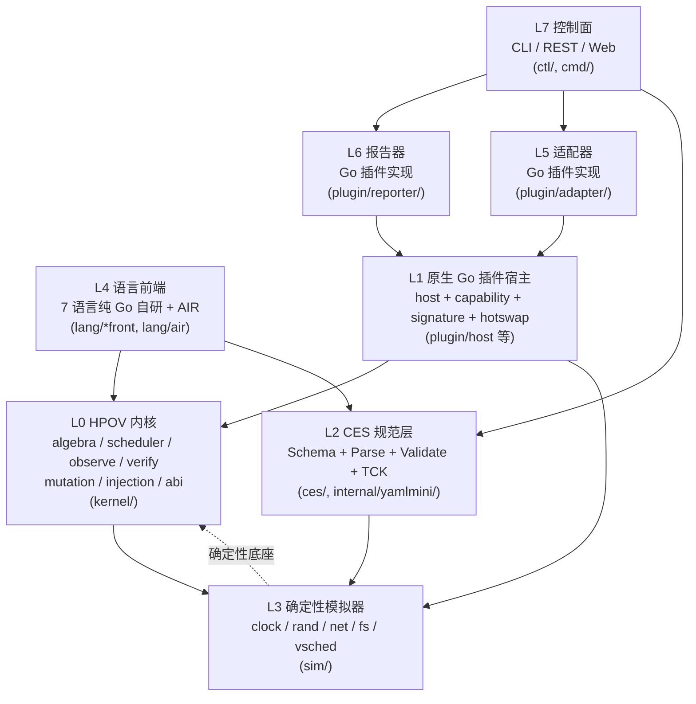
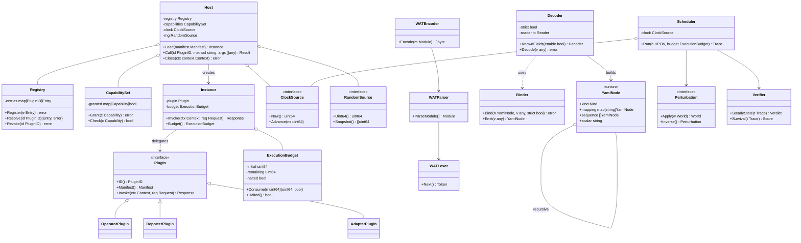
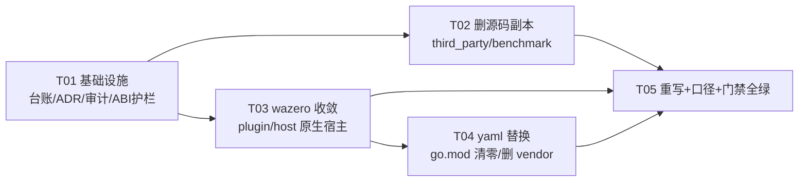

# Abate 彻底自研 + 清除全部开源接入 · 系统架构与实现方案（DESIGN）

> 文档编号：ABATE-REFACTOR-DESIGN-001　版本：v1.0　状态：待评审（合规驱动·紧急）
> 架构师：高见远（Gao）　上游依据：`docs/refactor/TODO.md`（ABATE-REFACTOR-TODO-001 v1.0）
> 执行对象：工程师（实现） / QA（核验）　适用仓库：`xiaolibuluo/Abate` @ `/workspace/abate`
> 现场基线：`main` HEAD = `eea27c0c`；工作树未跟踪 `docs/benchmark/`；Go 1.26.11；`GOFLAGS=-mod=vendor`
>
> **纪律声明**：本文只做架构决策与任务分解。不改产品代码、不改门禁、不 commit、不 push。
> 所有第三方能力判断均来自本文 §9 证据索引的实地读码；未核实项一律标注「实现阶段核实」，不编造。
> 涉及许可结论处标注 ⚖️，**AI 不出法律结论**。

---

## 0. 执行摘要：五个核心决策

| # | 决策 | 结论 | 依据（一句话） |
|---|---|---|---|
| D1 | **wazero 替换** | **废弃 `plugin/wasm/` 的 wazero 执行路径，收敛到已存在的自研原生宿主 `plugin/host/`**；不重写 WASM 规范 | `plugin/wasm` 全仓零引用（孤岛）；`plugin/host` 已被 25+ 文件实际使用且有冻结决策 WAS-HOST「原生 Go、不 vendor 第三方 WASM 运行时」 |
| D2 | **WASM 生态叙事** | **取消**。替换后不得继续声明「WASM 插件生态 / WASI Preview2 / 任意语言插件 / WASM AOT 近原生」 | 事实支撑被抽掉，对应 TODO S04 口径整改；改成「原生 Go 插件 + 确定性宿主 ABI」 |
| D3 | **yaml.v3 替换** | 自研 `internal/yamlmini/` 严格子集解析器（`Unmarshal`/`Marshal`/`KnownFields`），JSON 路径保留 `encoding/json` | CES 文档语法面很窄：缩进映射/块序列/标量/`omitempty`/`TextMarshaler`，无锚点/别名/合并键 |
| D4 | **x/sys 替换** | 产品代码零直接 import；随 wazero 删除后由 `go mod tidy` 自动消失，不写替代代码 | 实地扫描产品代码 `golang.org/x/sys` 命中数 = 0 |
| D5 | **门禁不删只改** | pit-parity 改「自研变异语义 golden」、m5 ③ 改「零依赖断言」、license-check 去 manifest SSOT、abi 测试脱钩上游 | 四个门禁在当前形态下**硬依赖待删文件**，直接删目录会 FAIL；伪造全绿违反 TODO §5 诚实性总纲 |

**任务数：5 个工程任务包（T01–T05）**，下挂 TODO 编号子项（见 §6）。
**诚实边界**：WASM 生态、双内核源码级并入、CES「开放标准」、PIT/ABI 对拍四项叙事在彻底自研后失去原支撑，落地方式见 §8。

---

## 1. 清除执行计划

### 1.1 判定总口径

沿用 TODO §3：「清除 = 产品仓库内不再存在任何第三方源码副本，且编译不依赖任何第三方模块」。本文进一步细化为三条可验证口径：

| 口径 | 可验证命令 | 通过标准 |
|---|---|---|
| C1 依赖面为零 | `go list -m all`（`-mod=mod`） | 仅 `abate` 自身 |
| C2 源码副本为零 | `bash scripts/audit-zero-third-party.sh`（T01 新建） | 报告结论 0，附原始输出 |
| C3 无隐藏运行依赖 | `go test -race -count=1 ./...` | 全绿，**且不读取任何已删路径** |

> ⚠️ **TODO 的一个盲区**：P0 出口门只要求 `go list ./...` 成功，但 `kernel/abi/syscall_test.go:21` 硬编码读取
> `../../third_party/_sources/gvisor/pkg/sentry/syscalls/linux/linux64.go`。
> 因此 P0 物理删除后 **编译过、测试挂**。T01 必须先做「ABI 对拍脱钩」护栏，再执行 P0 删除。

### 1.2 逐项处置矩阵

| 对象 | 实测体积 | 判定 | 处置策略 | 判定依据 | 对应 TODO |
|---|---|---|---|---|---|
| `third_party/_sources/` | 528M 合计 | 纯参考源码副本，`_` 前缀不参与编译 | **全删** | `_` 前缀 Go 工具链忽略；含 gvisor/llvm/roslyn/kotlin/pit/swc/syn/tree-sitter-*/wazero 等 14+ 上游 | P0-01/02 |
| `third_party/_references/` | 同上 | 纯参考副本 | **全删**（但有门禁前置，见 §7） | `go-cmp`/`toxiproxy`/`cobra`/`gremlins`/`_m5_algorithms.go.txt`/sarif schema | P0-01/03 |
| `third_party/LICENSE-MANIFEST.md` | 小 | 台账 | **改写**为「已清除（日期 + commit）」历史审计，保留文件本身 | license-check.sh:121-129 依赖其存在（见 §7） | P0-05 |
| `vendor/`（3 份模块源码） | 13M | vendored 编译依赖副本 | **最后删**（T04），先完成 T03/T04 代码替换 | `GOFLAGS=-mod=vendor`，提前删会立即中断构建 | P1-05 |
| `docs/benchmark/`（未跟踪残留） | 105M | lodash 4.17.21 + cJSON 1.7.16 源码与 node_modules | **删源码**；`audit/raw` 中无源码片段的测量数据保留并加「历史·未对拍」标注 | TODO §2.4；现场 `ls` 确认 `cases/`、`raw/`、`audit/`、`scripts/` | P0-04 |
| `scripts/corpus_fetch.sh` | 小 | 下载逻辑 | **停用 + 标注「已废弃」**，不直接物理删（保留审计痕迹） | TODO P0-04 明示 | P0-04 |
| `kernel/mutation/testdata/pit/` | 48K | **含 PIT 官方产物 + Java baseline 源码**（2 个 `.java` + `pom.xml`） | baseline 源码与 pom **删除**；`pit-mutations.json/xml` 为上游产物数据，按 ⚖️ 法务确认后改造成**自研冻结 golden** | 实地 `find` 见 §9；属「benchmark/语料副本」与「二次并入」交叉项 | P0-04/P2-01/P5-04 |
| `ci/corpus_manifest.json`、`THIRD-PARTY-NOTICES*.md`、`NOTICE`、`LICENSE-COMPATIBILITY*` | 小 | 台账/声明 | 条目改为「已清除」；⚖️ 争议点标注「待权利人/法务确认」，**不写「已合规」** | TODO §5/§8 | P0-05/P2-05/P4-02 |
| `docs/plan/02-wasm-runtime.md` | 小 | 旧计划文档 | **改写**：删除「wazero 源码级接入」计划，替换为 ADR-WASM-002 决策与 WAS-HOST 原生宿主事实 | 该文 L7/L58 仍写 wazero vendor 计划，与 `plugin/host/doc.go` 冻结决策冲突 | P1-01/P4-01 |

### 1.3 执行顺序（硬约束）

```
T01 前置护栏（台账 + ADR + 审计脚本 + ABI 脱钩）
   ├──→ T02 删不参与编译的副本（third_party / benchmark / 台账改写）
   └──→ T03 wazero 收敛（先改代码，vendor 暂留，保证每步可构建）
              └──→ T04 yaml.v3 替换 → go.mod/go.sum 清零 → 最后删 vendor
                          └──→ T05 融入代码重写 + 口径整改 + 门禁全绿 + 终审
```

> **为什么 vendor 最后删**：当前 `GOFLAGS=-mod=vendor`，任何第三方 import 未清零前删 vendor 等于自断构建。
> 每阶段出口须 `go build ./...` + `go test -race ./...` 双绿后才推送（TODO §4）。

---

## 2. 自研替换 ADR（核心）

### 2.1 ADR-WASM-002：移除 wazero，收敛到原生 Go 插件宿主

> 编号接续已有 `docs/adr/ADR-001-gvisor-sandbox.md`（本文不新建 ADR 文件，落盘动作归 T01）。

#### 2.1.1 实际调用面分析（读码事实，非推测）

`plugin/wasm/` 共 32 个 `.go` / 4440 行，但 **wazero 只出现在 5 个文件的薄层**。真实 API 面如下：

| 能力 | 具体 API | 出处 | 是否 WASI/全规范 |
|---|---|---|---|
| 运行时构建 | `wazero.NewRuntimeConfig().WithMemoryLimitPages(n)`、`NewRuntimeWithConfig`、`rt.Close` | `runtime.go:43,46,127` | 否，仅 1 个配置项 |
| 模块编译 | `rt.CompileModule(ctx, bytes)` | `runtime.go:75`、`loader.go:25,34` | 仅二进制编译；**WAT 由自研 `watToWasm` 先转换**（`wat_encode.go:15`） |
| 实例化 | `rt.InstantiateModule(ctx, compiled, wazero.NewModuleConfig())` | `runtime.go:79` | 默认配置，无 FS/网络 |
| 宿主函数 | `rt.NewHostModuleBuilder()` → `WithGoModuleFunction(fn, params, results)` → `WithName/Export` → `Instantiate` | `hostfunc.go:56-64` | 仅 Go 闭包，无 WASI 导入 |
| 调用与内存 | `api.Module.ExportedFunction(name).Call(...)`、`api.ValueType`、`api.GoModuleFunction` | `instance.go:35,42,56`、`runtime.go:103-109` | 仅 i64 时钟读写 |

**三个决定性事实**：

1. **孤岛包**：全仓排除 `vendor/`、`third_party/` 后，import `abate/plugin/wasm` 的产品代码 = **0 个文件**（`plugin/host` 则有 25+ 个引用文件：CLI、hotswap、adapter、reporter、sample、security 测试）。
2. **已有替代实现**：`plugin/host/doc.go:10-16` 记载冻结决策 WAS-HOST —— "does NOT vendor or embed a third-party WASM runtime…plugins are ordinary Go values…original plan called for wazero; the decision was to self-develop the host on the Go standard library"。确定性依赖已由 `sim/clock`（SIM-CLK）与 `sim/rand`（SIM-RNG）注入，无需 WASM host function。
3. **fuel 本就是合作式近似**：`fuel.go:19-21` 自述 "Wazero's stable API has no per-opcode fuel hook, so the meter is exact at the host-call granularity and over-approximates…pure guest loops"。即 wazero 提供的执行保障比对外叙事弱，且这部分语义可原样迁移到宿主层。

> 结论：Abate **不是**「用了 wazero 的全部能力」。它用的是「编译+实例化+Go 闭包宿主函数+导出调用」这一薄子集，
> 且这条链没有消费者。重写数万行 WASM 解释器在此场景下是**负收益工程**。

#### 2.1.2 方案对比

| 方案 | 工作量（量级） | 零第三方 | 能力保留 | 门禁/架构影响 | 评价 |
|---|---|---|---|---|---|
| **A. 自研极简 WASM 解释器**（binary decode + 验证 + i32/i64/f32/f64 + 控制流 + memory + import/export + host func） | 数千~上万行；数周~数月 | ✅ | 可继续加载 WASM 模块（子集）；无 WASI/无 AOT | 需新增 spec parity、fuzz、fuel 逐 opcode 测试；`SandboxFuel.tla` 可保留但要重做实现映射 | ❌ 无消费者，纯为叙事买单；确定性/安全边界重新变成风险面 |
| **B. 废弃 WASM 执行路径，收敛到 `plugin/host` 原生 Go 插件**（推荐） | 百行级语义迁移 + 目录删除 | ✅ | 保留全部**实际在用**能力：算子/注入器/前端/适配器/报告器插件、能力门控、验签、热替换、虚拟时钟/随机 | 最小；`plugin/host` 既有测试全绿；TLA+ 抽象状态机不变（仅实现映射更新） | ✅ 符合冻结决策、风险最低、诚实 |
| **C. 自研插件二进制 ABI（非 WASM）** | 中等（定义格式 + 编解码 + 注册表） | ✅ | 跨语言能力仍不具备；本质仍是 Go 插件 ABI | 需新规范与 TCK，增加维护面 | ⚠️ 可作为 B 的远期增强，**不纳入本次** |
| **D. Go 标准库 `plugin`（`.so` 动态加载）** | 小 | ✅（标准库） | 保留动态加载 | 依赖 CGO/平台、破坏气隙与确定性铁律；`m5-reference-scan` ① 段禁 `import "C"` | ❌ 直接否决 |

#### 2.1.3 推荐方案 B 的分步实施

| 步骤 | 动作 | 源文件 | 完成判据 |
|---|---|---|---|
| B1 | 冻结依赖面证据：固化「wazero 调用点清单 + `plugin/wasm` 零引用」证明 | `docs/adr/`（T01 落盘）、本 DESIGN §2.1.1 | ADR 有架构师签字；清单可复跑 |
| B2 | 语义迁移：把 `FuelMeter`/`VirtualClock`/`Config` 的**确定性语义**并入宿主层（放 `plugin/host/` 或 `internal/determinism/`，实现阶段定目录）；`SandboxFuel.tla` 抽象状态机保持不变 | `plugin/wasm/{fuel,clock,config,errors}.go` → 新宿主包 | 迁移后行为单测与迁移前 golden 逐点一致（golden 由 T01 在删除前生成） |
| B3 | 自研 WAT 工具链处置：`wat_*.go`（7 个源文件 + 9 个测试，约 1400 行，纯自研、不含 wazero）**不作为插件加载路径**；可原包保留为离线工具，或移入 `internal/wat/`（实现阶段二选一，须记录） | `plugin/wasm/wat_*.go` | 包内无任何第三方 import；`go test` 通过 |
| B4 | 删除 wazero 执行层：`runtime.go`、`loader.go`、`hostfunc.go`、`instance.go`、`doc.go` 及相关 6 个测试 | `plugin/wasm/` | 全仓 `grep -r wazero --include=*.go` 命中 = 0 |
| B5 | `plugin/host` 侧确认能力闭环：`Host.Load` 链路、capability 授予、signature 验签、hotswap 原子替换均由既有包覆盖，逐项跑测试 | `plugin/host/`、`plugin/capability/`、`plugin/signature/`、`plugin/hotswap/` | 插件加载/调用/hotswap/验签四类测试全绿，功能基线记录在案 |
| B6 | go.mod 清零（与 T04 合并执行） | `go.mod`、`go.sum` | 见 §2.4 |

#### 2.1.4 对门禁与架构叙事的影响

| 项目 | 影响 | 处置 |
|---|---|---|
| `SandboxFuel.tla` | 抽象状态机（非负、不超限、永久 halt）与实现无关，**spec 不需改**；但 spec 注释中的「WASM guest」需改为「guest plugin」 | T05 更新注释后重跑 `scripts/tla/check.sh` |
| `m5-reference-scan.sh` ① 段 | 禁用 import 列表含 `tree-sitter` 等，与 WASM 无关 | 保留；顺带加入 `wazero` 作为新增禁用项（零依赖断言） |
| `docs/plan/02-wasm-runtime.md` | 全篇 WASM 计划失效 | 改写为「原生插件宿主机（WAS-HOST 决策实录）」 |
| 架构 L1/L4/L5/L6 | 见 §3 | 叙事从「WASM 生态」改为「原生 Go 插件 + 确定性宿主 ABI」 |
| 九字质量定义 | 「快 = WASM AOT 近原生」「劲 = WASM 插件热加载」失去支撑 | 「快」改为「确定性调度 + 轻量原生调用」；「劲」改为「Go 插件 registry 热替换」（保留真实能力） |

#### 2.1.5 诚实边界（必须写进对外文档）

- ❌ **不能**再声明「WASM 插件生态」「WASI Preview2」「WASM AOT 近原生」「任意语言编写插件」。
- ❌ **不能**声称替换后性能与 wazero 等价——没有对拍数据，保持 `NOT_MEASURED`（TODO S03 口径）。
- ✅ **可以**如实声明「原生 Go 插件宿主，能力门控 + 确定性时钟/随机 + 验签 + 原子热替换；插件以 Go 接口实现」。
- ⚠️ 替换后 `plugin/wasm` 若保留 WAT 工具，它只是**确定性字节码编解码工具**，不是插件运行时；对外不得混称。

---

### 2.2 ADR-YAML-001：自研严格 YAML 子集解析器

#### 2.2.1 实际调用面

| 使用形态 | 代码位置 | 性质 |
|---|---|---|
| `yaml.NewDecoder(r).KnownFields(true).Decode(&exp)` | `ces/parse/parse.go:49-51` | **唯一生产解析路径**（CES 实验文档） |
| `yaml.Unmarshal` / `yaml.Marshal` | `cmd/gen-tck/{scenarios,emission}.go`、`ces/tck/{case,driver,tck_test}.go`、`ces/tck/example/builder.go`、`ces/schema/*_test.go` | 工具与测试；生成器/TCK/roundtrip |
| `encoding.TextMarshaler` / `TextUnmarshaler` | `ces/schema/duration.go`（`VirtualDuration`） | yaml.v3 通过 text 接口编解码 `1s`/`250ms` 等 |
| tag 形态 | `yaml:"name"` / `yaml:"name,omitempty"` | 仅这两种；无自定义 tag、无 `inline` |
| JSON 互操作 | `ces/schema/schema_test.go:165-195`：`yaml.Unmarshal(jsonBytes, &v)` | **关键**：JSON 是 YAML 子集，自研解析器须支持 flow `{}`/`[]`，或把该测试改走 `encoding/json`（推荐后者，见 B3） |

#### 2.2.2 支持的语法子集（白名单）

| 类别 | 支持 | 备注 |
|---|---|---|
| 结构 | 缩进映射（`key: value`）、块序列（`- item`）、嵌套组合、空值 `null`/空行、行注释 `#` | 与 `ces/parse/testdata/ok-*.yaml` 60 例一致 |
| 标量 | 双引号/单引号字符串、裸字符串（含 `:` 后带空格需引号）、整数、浮点、布尔 `true/false` | 严格 YAML 1.2 布尔；**`yes/no/on/off` 是否出现在 testdata：实现阶段核实**，若出现则按裸字符串处理并同步 golden |
| 组合值 | `map[string]string`（`selector`/`labels`/`params`）、`[]string`（`targets`）、`[]struct` | 见 `ces/schema/*.go` tag |
| 类型接口 | `encoding.TextUnmarshaler` / `TextMarshaler` | `VirtualDuration` 依赖 |
| 严格模式 | `KnownFields(true)`：未知字段报错，错误文本**包含 `unknown field`** | 保持 `ces/parse/decodeFailure()` 的 `RuleUnknownField` 分类不变 |
| 多文档 | 单次 `Decode`；`---` 分隔是否需支持：**实现阶段核实**（`parse.go` 只 Decode 一次，倾向拒绝并报 `RuleMalformedDocument`） | — |

#### 2.2.3 明确不支持（写进包注释）

锚点 `&a` / 别名 `*a` / 合并键 `<<`、块标量 `|` / `>`、自定义 tag `!!`、复杂/非字符串 key、流式多文档 Decode、YAML 1.1 隐式类型转换。
> 这些语法在 CES 语料中未出现；若后续需要，须走「扩展子集 + 新 golden」流程，不得静默放宽。

#### 2.2.4 实现方案与验收

- 新包 `internal/yamlmini/`：公开 `Unmarshal([]byte, any) error`、`Marshal(any) ([]byte, error)`、`NewDecoder(io.Reader) *Decoder` + `KnownFields(bool)`。
- 内部三段式：`lexer`（按行/缩进/引号切 token）→ `node`（`map[string]*Node` / `[]*Node` / scalar 的有序树）→ `bind`（reflect + tag + `TextUnmarshaler` 绑定，严格模式对未知 key 返回含 `unknown field` 的错误）。
- **Marshal 必须确定性**：按结构体字段声明顺序输出，map 键排序（复用现有 `sorted keys` 惯例），保证 roundtrip 逐字节稳定。
- 验收基线（不引入任何第三方源码）：
  1. `ces/parse/testdata/` 全部 `ok-*` 通过、`bad-*` 全部按预期规则拒绝（60+ / 90+ 例，天然回归集）；
  2. TCK parse 68 例 / roundtrip 50 例 / validate 46 例全绿；
  3. `schema_test.go` 的 JSON↔YAML roundtrip 通过（B3 改造后走 `encoding/json`）；
  4. 迁移前用 yaml.v3 **仅生成 golden 输出文本**作为历史观测值（不落地库源码），golden 标注「历史观测值，非当前依赖」。
- 工作量估计：约 600–1000 行核心 + 配套单测；**这是继 wazero 之后第二大模型化工作，但边界清晰、可用现有 testdata 强验证**。

---

### 2.3 ADR-XSYS-001：消除间接依赖

| 项 | 事实 | 决策 |
|---|---|---|
| 产品代码直接 import | 扫描 `cmd/ plugin/ kernel/ lang/ internal/ ctl/ ces/ sim/ security/` = **0 命中** | 不写替代代码 |
| 引入路径 | `go.mod` 中 `golang.org/x/sys v0.44.0 // indirect`，由 wazero 引入 | T03 删除 wazero → T04 `go mod tidy` 自动清除 |
| 残留兜底 | 若 tidy 后仍存在（**实现阶段核实**）：逐一检查使用点，优先 `os`/`syscall`/`os/user`；确缺的常量以本仓自有常量定义（syscall 编号属事实数据，⚖️ L05 确认） | 禁止从 `third_party` 拷贝任何片段 |
| 验收 | `GOFLAGS=-mod=mod go list -m all` 输出仅 `abate` | TODO P1-04 / DoD 9.1 |

---

### 2.4 go.mod / go.sum / vendor 清零（合并动作）

```bash
# T04 执行，顺序不可颠倒
grep -rn 'tetratelabs/wazero\|gopkg.in/yaml.v3\|golang.org/x/sys' --include='*.go' \
  cmd ctl ces kernel lang plugin sim internal security   # 期望：0 命中
go mod tidy
cat go.mod                       # 期望：无 require 段（或仅 go 1.26.11）
rm -rf vendor                    # 13M，最后删
unset GOFLAGS                    # 或改为 -mod=mod
go build ./... && go test -race -count=1 ./...
```

---

## 3. 目标架构：L0–L7 调整

### 3.1 分层调整对照

| 层 | 现状（ARCHITECTURE.md） | 目标 | 动作 |
|---|---|---|---|
| L7 控制面 | CLI / REST / Web | 不变；插件子命令语义从「加载 WASM」改为「注册 Go 插件」 | 改 `ctl/cli/cmd_plugin*.go` 文案与帮助 |
| L6 报告器 | WASM reporter 插件 | **Go 插件实现**（`plugin/reporter/` 已是自研 Go 实现，无需改结构） | 去 WASM 措辞 |
| L5 适配器 | WASM adapter 插件 | **Go 插件实现**（`plugin/adapter/` 已是自研） | 去 WASM 措辞 |
| L4 语言前端 | WASM frontend + 7 语言「源码级并入」 | **纯 Go 标准库自研前端**（`lang/*front` 已实现），规则基于官方规范 | 去「源码级并入」表述；删参考源码副本；改 doc.go 来源注释（见 §4） |
| L3 确定性模拟器 | 虚拟时钟/网络/FS/调度 + 录制回放 | 不变（`sim/` 全自研，SplitMix64 为公有领域算法） | 保留，补算法来源标注 |
| L2 CES 规范层 | YAML/JSON 实验描述 + TCK | 不变；解析器换 `internal/yamlmini/` | 「开放标准」改「项目自有规范，提供 TCK」（见 §8） |
| L1 插件宿主 | ~~WASM 运行时（WASI Preview2 / 能力沙箱 / 热加载 / 签名）~~ | **原生 Go 插件宿主**：`plugin/host` + `capability` + `signature` + `hotswap` + `sandbox`（纯数据策略） | 删 `plugin/wasm` 执行层；能力/验签/热替换能力保留 |
| L0 HPOV 内核 | 代数 + 调度 + 观测 + 验证 + PIT/chaosblade 源码级并入 | **全自研内核**：代数/调度/观测/验证 + 自研变异核/注入核/ABI 表 | 重写来源注释；ABI 测试脱钩上游；PIT testdata 改造 |

### 3.2 目标分层依赖图



**依赖铁律不变**：自上而下单向；L0–L3 内核（年轮）、L4–L7 生态（快迭代）物理分仓策略保持。
**变化**：跨层不再出现任何外部模块 import；L1 与 L3 的确定性注入关系由 `Host.Call` 显式完成（`plugin/host/doc.go:18-22`）。

### 3.3 价值支柱叙事重写

| 原支柱 | 自研后状态 | 新表述 |
|---|---|---|
| 双内核统一 | ✅ 内核逻辑保留；❌「PIT/chaosblade 源码级并入」失效 | 「M/C 双形态统一于 HPOV 代数，核心全自研」 |
| WASM 插件生态 | ❌ 完全失效 | 「原生 Go 插件宿主：能力门控 + 验签 + 原子热替换」 |
| 开放规范 CES | ⚠️ 规范仍在，但非外部标准组织发布 | 「项目自有实验规范 CES，提供 TCK，任何实现可对接」 |
| 确定性模拟器 | ✅ 完全保留 | 不变（最强、最可信的支柱） |

---

## 4. 融入代码甄别矩阵

> 判定口径：**开源改写** = 源码/结构曾参考上游，需重写或改写来源表述；**自研** = 纯自研实现；
> **公有领域算法** = 数学/事实数据，⚖️ 需法务确认保留边界。AI 只给事实与处置建议。

| 模块 | 证据（实地读码） | 判定 | 处置 | ⚖️ 法务 |
|---|---|---|---|---|
| `kernel/mutation/` | `doc.go:9,12`「JVM-free Go rewrite of four PITest algorithm lines…参考 PITest 四条算法线…no PIT-specific type」；`target.go:12,14`「参考 PITest 变异点发现…改进点=暴露语言无关」 | **开源改写（已 Go 自研重写）** | 代码保留（已无上游类型），**改写来源注释**为「依据公开变异测试研究自研的算子族/覆盖引导/最小化/优先级算法」；补独立 parity 测试 | L04：历史并入无遗留义务需法务确认 |
| `kernel/mutation/testdata/pit/` | 含 PITest 1.19.6 官方产物 `pit-mutations.{json,xml}`、console report、`baseline/pom.xml` + 2 个 Java 源码 | **上游产物 + 源码副本** | Java baseline + pom **删除**；产物数据改造为**自研 frozen golden**（格式自定、值由本仓算子生成），`pit-parity.sh` 同步重命名语义（见 §7） | L04 |
| `kernel/injection/` | `doc.go:9,11`「fully virtual rewrite of chaosblade fault-parameter model…参考 chaosblade…no chaosblade Model type enters public API」；`world.go:36,135`、`operators.go:19` 同类注释 | **开源改写（已全虚拟化重写）** | 代码保留，注释改为「依据公开故障分类模型自研的全虚拟注入算子」；跑 chaos/e2e 测试 | L04 |
| `kernel/abi/` | `doc.go:19-21` 列 gvisor 三处来源；`syscall_table.go:15,21`、`errno.go:12`、`addr*.go:12`、`arch_*.go:16` 均写 `Adapted from gvisor/... Apache-2.0`；`syscall_test.go:21` **运行时读取上游 linux64.go** | **开源改写（Fact data 移植）** | ①测试脱钩：用自研冻结 golden 替代上游读取（T01）；②注释改为「syscall 编号/errno 为操作系统 ABI 事实数据，本表由本仓生成器产出」；③若保留历史来源说明，加「已清除上游源码，仅保留事实数据」 | **L05：syscall 表是否属不受版权保护的事实数据，必须法务认定** |
| `lang/pyfront/` | `doc.go:11`「参考 ruff 的 rustpython-parser 与 tree-sitter-python 缩进/容错算法 + 改进点：纯 Go 自研」 | **开源改写（算法参考，代码自研）** | 注释改为「依据 Python 官方词法/语法规范自研缩进敏感词法与容错归约」；无上游源码痕迹则保留代码 | 法务确认「参考算法」表述边界 |
| `lang/jsfront/` | `doc.go:10`「参考 swc_ecma_parser 的词法与 AST 归约模型 + 改进点」 | 同上 | 改为「依据 ECMAScript 规范自研」 | 同上 |
| `lang/rsfront/` | `doc.go:11`「参考 syn 的 item/expr/stmt/pat/ty 归约与 quote 的 token 树思想 + 改进点」 | 同上 | 改为「依据 Rust Reference 自研」 | 同上 |
| `lang/ktfront/` | `doc.go:10-12`「参考 kotlin-compiler 的 lexer/parser/PSI 前端模型 + 改进点：纯 Go 标准库自研…无 kotlinc 进程调用」 | 同上 | 改为「依据 Kotlin 语法规范自研」 | 同上 |
| `lang/csfront/` | `doc.go:10`「参考 Roslyn SyntaxTree 的 trivia 与节点区间模型 + 改进点：纯 Go 标准库自研」 | 同上 | 改为「依据 C# 语言规范自研」 | 同上 |
| `lang/cfront/` | `doc.go:10`「参考 libclang…以 lexer/parser/AST 游标遍历模型为算法蓝本…纯 Go 标准库自研…不 import os、不启动子进程」 | 同上（另 `.artifacts/libclang-min` 产物已从索引移除） | 改为「依据 C/C++ 标准自研词法与预处理归约」；⚠️ 历史 commit 仍含构建产物，如需彻底瘦身须 `git filter-repo`（TODO pending-work §五.4，**本次不做**） | 同上 |
| `sim/rand/` | `splitmix.go:11-25` 明示 SplitMix64 常量与「public-domain (no license burden)」 | **公有领域算法** | 代码保留；在包注释固化「算法出处：S. L'Ecuyer 公开的 SplitMix64，属公有领域算法，本实现为独立 Go 编写」 | L05 类：公有领域认定需法务书面确认 |
| `sim/{clock,net,fs,vsched,record}/` | 全仓扫描无上游来源注释 | **自研** | 保留 | — |
| `plugin/{host,capability,signature,hotswap,sandbox,report,adapter}/` | 无第三方 import；`plugin/host/doc.go` 明确原生自研 | **自研** | 保留 | — |
| `plugin/wasm/wat_*.go` | 自研 WAT 词法/解析/编码（约 1400 行），无第三方 import | **自研** | 保留为离线工具或移 `internal/wat/`（B3） | — |

> 甄别台账落地要求：T05 产出 `docs/refactor/integration-audit.md`，逐文件覆盖上表并附扫描命令原始输出；
> header-check 的全仓扫描（`find *.go` 排除 vendor/third_party）可作为「无上游版权头」的机器证据。

---

## 5. 接口与数据结构（自研模块关键接口）



**接口迁移原则**：`ExecutionBudget` 承接原 `FuelMeter` 的 `Consume/Initial/Remaining/Used/Halted` 语义（逐点一致），
使 `SandboxFuel.tla` 无需改状态机；宿主函数闭包改为 Go 方法调用，去掉 `api.ValueType`/`api.GoModuleFunction` 依赖。

---

## 6. 任务列表（有序，含依赖）

> **颗粒度说明**：按工程可交付边界分为 **5 个任务包**（硬上限），每包下挂 TODO 编号子项；
> 每包含 ≥3 个源文件、映射明确的验收标准。T01 为基础设施包（台账 + ADR + 审计脚本 + 测试护栏）。

### T01　基础设施：证据台账 + ADR + 审计护栏

- **源文件**：`docs/refactor/assets-inventory.md`（新建）、`docs/refactor/integration-audit.md`（骨架）、
  `docs/refactor/zero-third-party-audit.md`（骨架）、`scripts/audit-zero-third-party.sh`（新建）、
  `docs/adr/ADR-WASM-002.md`、`ADR-YAML-001.md`、`ADR-XSYS-001.md`（新建）、
  `kernel/abi/syscall_test.go`（脱钩改造）、`kernel/mutation/testdata/pit/golden/`（新建自研 golden）。
- **依赖**：无（起始任务）。
- **TODO 映射**：P0-01、P1-01（ADR 部分）、P5-04（脚本部分）。
- **动作要点**：
  1. 逐目录记录路径/体积/来源 commit/许可证/sha256/处置决策（§1.2 矩阵为模板）；
  2. 落地本文 §2 三份 ADR（架构师签字）；
  3. 新建审计脚本：扫描 `third_party/`、`vendor/`、`docs/benchmark/`、`.go` import、上游版权头/URL/path 关键词；
  4. **护栏**：把 ABI 测试从读取上游 `linux64.go` 改为读取自研冻结 golden（先固化当前表为 golden 数据，再改测试）；
  5. 为 `FuelMeter`/`VirtualClock` 生成迁移前行为 golden（删除前一次性生成）。
- **验收**：台账覆盖 TODO §2.3–2.5 全项且每条有处置决策；审计脚本在清除前能正确报出「存在第三方」（证明非空跑）；
  ADR 三份齐全；`go test ./kernel/abi/...` 在不依赖 `third_party` 时通过。
- **优先级**：P0。

### T02　清除不参与编译的第三方源码副本

- **源文件**：`third_party/_sources/`（删）、`third_party/_references/`（删）、
  `docs/benchmark/cases/*/src/`、`docs/benchmark/config/node_modules/`、`scripts/corpus_fetch.sh`（停用标注）、
  `ci/corpus_manifest.json`、`THIRD-PARTY-NOTICES*.md`、`NOTICE`、`third_party/LICENSE-MANIFEST.md`（改写）。
- **依赖**：T01。
- **TODO 映射**：P0-02、P0-03、P0-04、P0-05。
- **验收**：三个目录不存在；`docs/benchmark/` 下无第三方源码文件（扩展名 + 版权头扫描为空）；
  台账无「当前接入」表述；`go list ./...` 与 `go test -race ./...` 仍通过（T01 护栏生效）。
- **优先级**：P0。

### T03　移除 wazero，收敛原生插件宿主

- **源文件**：`plugin/wasm/runtime.go`、`loader.go`、`hostfunc.go`、`instance.go`、`doc.go`（删）；
  `plugin/wasm/{fuel,clock,config,errors}.go`（迁宿主层）；`plugin/wasm/wat_*.go`（保留或迁 `internal/wat/`）；
  `plugin/host/host.go`、`hostfunc.go`、`plugin/sandbox/config.go`；`go.mod`、`go.sum`（wazero 行）。
- **依赖**：T01（可并行于 T02）。
- **TODO 映射**：P1-01（wazero ADR 执行）、P1-02、P1-04（wazero 侧）、P2-02（宿主侧确认）。
- **验收**：全仓产品代码 `wazero` 命中 = 0；插件加载/调用/hotswap/验签四类测试全绿；
  `FuelMeter` 行为与 T01 golden 逐点一致；功能与性能基线记录在 `docs/refactor/plugin-baseline.md`（性能未测量写 `NOT_MEASURED`）。
- **优先级**：P0（工作量最大）。

### T04　替换 yaml.v3、清零依赖面、删除 vendor

- **源文件**：`internal/yamlmini/`（新建：`lexer.go`、`node.go`、`binder.go`、`encode.go`、`api.go` + 测试）、
  `ces/parse/parse.go`（换解析器）、`ces/schema/virtualduration` 相关绑定适配、
  `cmd/gen-tck/{scenarios,emission}.go`、`ces/tck/{case,driver,tck_test}.go`、`ces/tck/example/builder.go`、
  `ces/schema/*_test.go`（JSON 互操作改 `encoding/json`）、`go.mod`、`go.sum`、`vendor/`（删）。
- **依赖**：T01、T03。
- **TODO 映射**：P1-01（yaml ADR 执行）、P1-03、P1-04、P1-05。
- **验收**：全仓产品代码 `yaml.v3` 命中 = 0；`go.mod` 无第三方 require；`go.sum` 无第三方校验行；
  `vendor/` 不存在；`go build ./...`、`go test -race -count=1 ./...` 通过；CES testdata 全部 ok/bad 用例通过；TCK 三套全绿。
- **优先级**：P0。

### T05　融入代码重写 + 口径整改 + 门禁全绿 + 终审

- **源文件**：`kernel/{mutation,injection,abi}/` 来源注释与 golden、`lang/*front/doc.go`、
  `sim/rand/splitmix.go`（算法来源标注）、`scripts/{pit-parity,m5-reference-scan,license-check,lint-gate}.sh`（改造，见 §7）、
  `README*.md`、`CHANGELOG*.md`、`TRADEMARK*.md`、`docs/plan/02-wasm-runtime.md`、
  `docs/refactor/{integration-audit,zero-third-party-audit}.md`（定稿）、`SHA256SUMS`、`WATERMARK.sha256`（工具重算）。
- **依赖**：T02、T03、T04。
- **TODO 映射**：P2-01..P2-05、P3-01..P3-03、P4-01..P4-03、P5-01..P5-05。
- **验收**：甄别台账 100% 覆盖且移植代码已重写/标注；`scripts/lint-gate.sh` 十段 + `coverage-gate.sh` 全绿；
  TLA+ 3 spec（PitParity 44 / SandboxFuel 61 / StreamDeterminism 4800）通过；
  watermark/hash/drift/determinism/m5/pit-parity 全 PASS；S01–S06 口径与实现一致；⚖️ L01–L05 逐项有状态与责任人且无 AI 法律结论；
  `zero-third-party-audit.md` 结论 = 0 并附原始输出。
- **优先级**：P0（门禁与法务清单）/ P1（口径整改）。

### 6.1 任务依赖图



---

## 7. 门禁适配（不删门禁，如实改造）

> 原则：**任何门禁不得为了「全绿」而删除检查或伪造数据**。检查项失效时，改为对「新事实」的更强断言，并在报告中标注口径变更。

| 门禁脚本 | 删除后的破坏点（实地证据） | 改造方案 | 改造后验收 |
|---|---|---|---|
| `scripts/pit-parity.sh` | 依赖 `kernel/mutation/testdata/pit/pit-mutations.json` + `baseline/*.java` + `pom.xml`；后两者属上游源码，必须删；`--rerun-pit` 还需 java/mvn | ①删除 baseline 源码；②保留的 `pit-mutations.json` 改造为**自研 frozen golden**（值由本仓算子生成，格式自定，标注「非 PIT 官方产物」）；③脚本更名/改 banner 为「变异语义 golden 回归」，阈值 `MIN_RATE=100.00%` 保留；④`--rerun-pit` 分支删除或明确标注「已废弃（零第三方，不再重跑上游）」 | 脚本 PASS；`pit-parity-report.md` 标题与 golden 来源一致；**不得再出现「PITest 1.19.6 官方对拍 100%」表述** |
| `scripts/m5-reference-scan.sh` | ② 段硬检查 `third_party/_references/_m5_algorithms.go.txt` **存在**（L: `if [ ! -f ... ] fail`）；③ 段依赖 `vendor/modules.txt` 存在 | ② 段改为「蓝本目录不存在 = PASS（零蓝本）」并保留 `go list ./...` 无 `.go.txt` 断言；③ 段改为**零依赖断言**：解析 `go.mod` require 必须为空 + 全仓 `.go` import 无 `github.com`/`gopkg.in`/`golang.org/x/*`；① 段禁用 import 列表新增 `wazero`/`yaml.v3` 关键词；④ 段不变 | 四段 PASS；输出打印「零第三方依赖面」；`GOFLAGS=-mod=vendor` 改为 `-mod=mod` 或清空 |
| `scripts/license-check.sh` | L121-129：`third_party/LICENSE-MANIFEST.md` 缺失即 FAIL；同时校验 manifest 中 GPL 字样 | 保留 `LICENSE-MANIFEST.md` 但内容改为「历史台账：全部组件已清除（日期+commit）」，校验逻辑改为「manifest 存在且无当前接入条目」；依赖扫描段在无 vendor 时改为读取 `go.mod` require（应为空 → PASS） | LICENSE GATE PASS；输出明确「零第三方依赖，项目自身 AGPLv3+商业双许可」；⚖️ 不写「已合规」 |
| `kernel/abi` 测试 | `syscall_test.go:21` 读取 `../../third_party/_sources/gvisor/.../linux64.go` | T01 已改读自研 golden；golden 与实现表逐条一致，生成器可复现 | `go test -race ./kernel/abi/...` PASS 且不访问 `third_party/` |
| `scripts/hash-check.sh` / `watermark-verify.sh` | 文件集变化 → `SHA256SUMS`/`WATERMARK.sha256` 条目失效 | **走正式流水线重算**，禁止手工编辑哈希（TODO P5-01 红线）；`CRITICAL_FILES` 列表若含已删路径须同步移除 | 两脚本 PASS，有生成日志 |
| `scripts/lint-gate.sh` 十段 | 源码删除/重写可能触发 gofmt/golangci-lint/单文件≤300 行/覆盖率水位下降 | 不改门禁阈值；修被检代码。若某文件删除后覆盖率分母变化导致不达标，补**自研**测试而非放宽阈值 | 0/1/2/3/4/5/5b/6/7/8/9 全 PASS |
| `scripts/tla/{check.sh}` 3 spec | `SandboxFuel` 注释中的「WASM guest」措辞失实；状态机本身不变 | 改注释与实现映射为「guest plugin / ExecutionBudget」，不动 spec 语义；重跑 | PitParity 44 / SandboxFuel 61 / StreamDeterminism 4800 全通过 |
| `scripts/{drift-check,determinism-check}.sh` | 预期无直接破坏；若引用已删路径则同步改 | 实现阶段核实；只改路径引用，不放宽判定 | PASS |

**命令片段（改造后自检）**：

```bash
# 零依赖断言（替代原 vendor 双向一致性）
test -z "$(sed -n -E '/^require \(/,/^\)/ s/.*(github\.com|gopkg\.in|golang\.org\/x).*/\1/p' go.mod)"
! grep -rEn '"(github\.com|gopkg\.in|golang\.org/x)/' --include='*.go' \
   cmd ctl ces kernel lang plugin sim internal security
GOFLAGS=-mod=mod go list -m all        # 只应输出 abate
```

---

## 8. 诚实边界与风险（对应 TODO S01–S06）

### 8.1 失去支撑的架构愿景 → 整改落地

| 愿景 | 自研后事实 | 对应 TODO | 落地动作 |
|---|---|---|---|
| **WASM 插件生态**（任意语言/小时级社区插件/WASI/AOT） | 执行路径已删；只剩原生 Go 插件 | S04 / P4-01 | README 中/英删除 WASM 生态段与「任意语言」「按小时发布」表述；ARCHITECTURE.md §0.1/§5 改为原生插件宿主；`docs/plan/02-wasm-runtime.md` 改写 |
| **双内核代差**（PIT + chaosblade 源码级并入形成认知壁垒） | 源码已清除，内核为自研重写；「源码级并入」是历史事实不再是能力 | S04 / P4-01、P2-01/02 | 表述改为「M/C 双形态统一于 HPOV 代数，核心全自研」；不得暗示仍持有上游引擎源码或回移能力；`pit-parity` 改 golden 后不再宣称官方对拍 |
| **CES 开放标准**（任何实现通过 TCK 即合规） | 规范与 TCK 是项目自有资产，未经外部标准组织发布 | S04 / P4-01 | 改为「项目自有实验规范，提供 TCK 供第三方对接」；禁止「开放标准/行业标准/中立组织发布」措辞 |
| **竞品绝对分数 / GA 成熟度** | 从未对拍；0 star/0 fork/0 watcher；强推将改写 commit 历史 | S03 / S04 | `competitorAbsolute = NOT_MEASURED` 原样保留；成熟度段明确「个人或小团队项目、早期阶段、社区采用数据有限」；不得用文档体量或 commit 数当证据 |
| **derive 杀死率 / 多语言保真度** | 静态近似；全语料六语超阈 | S01 / S02 | 保持 `NOT_MEASURED` 与「静态近似」标注；degrade 仅保留「冻结单文件（首 unit）口径」，禁止外推；提升方案 A 作为独立里程碑，不纳入本次 |
| **`ces.tencent.com/v1`** | 仅 API 组名，与腾讯无关 | S06 / P4-03 | 新增命名澄清段落，中英一致；版权主体「小黎的部落」 |
| **许可声明** | ⚖️ AGPL §13、DCO/CLA、SPDX、并入历史义务均未由法务确认 | S05 / P4-02 | AI 仅列 L01–L05 待确认清单与责任人，**不写「已合规/无侵权」**；SPDX 保持「需权利人确认」 |

### 8.2 风险登记册

| ID | 风险 | 等级 | 缓解 |
|---|---|---|---|
| R1 | 删除 `third_party` 后 ABI 测试/门禁连锁失败 | 高 | T01 护栏先行；每阶段出口跑 `go test -race ./...` 而不只是 `go list` |
| R2 | 自研 YAML 子集漏掉 testdata/TCK 中某种语法 | 中高 | 60 ok + 90 bad + TCK 164 例强回归；不支持语法白名单写进包注释；迁移前 golden 对拍 |
| R3 | wazero 删除后误以为「功能等价」 | 中 | 功能基线以 `plugin/host` 既有测试为准；性能不写数字，`NOT_MEASURED` |
| R4 | `git filter-repo` 历史瘦身冲动 | 中 | 本次明确**不做**；历史产物只从索引移除，如做须独立里程碑并评估强推影响 |
| R5 | 强推误操作 / Ruleset 未恢复 | 高 | 严格按 TODO §4 串行流程；每阶段回读 `git rev-parse main` 并记日志 |
| R6 | ⚖️ 法务未确认即改许可声明 | 高 | 所有争议点保持「待确认」占位；无书面确认不删不改法律结论 |

---

## 9. 证据索引（可复跑）

| 结论 | 证据命令 / 位置 |
|---|---|
| HEAD / 工作树 | `git rev-parse --short HEAD` → `eea27c0c`；`git status --short` → `?? docs/benchmark/` |
| 依赖 3 个 | `go.mod`；产品代码 import 扫描 `grep -rn 'tetratelabs/wazero\|yaml.v3\|golang.org/x/sys' --include='*.go' cmd ctl ces kernel lang plugin sim internal security` |
| wazero 调用面 | `plugin/wasm/{runtime,loader,hostfunc,instance}.go`；`wc -l plugin/wasm/*.go` → 32 文件 4440 行 |
| `plugin/wasm` 零引用 | `grep -rn 'abate/plugin/wasm' --include='*.go' . \| grep -v vendor/ \| grep -v third_party/` → 空；对照 `abate/plugin/host` 25+ 命中 |
| WAS-HOST 冻结决策 | `plugin/host/doc.go:10-22`；`docs/plan/02-wasm-runtime.md:7,58`（旧计划，需改写） |
| fuel 是近似 | `plugin/wasm/fuel.go:19-21` |
| YAML 语法面 | `ces/parse/testdata/ok-*.yaml`（60）、`bad-*`（90+）；`ces/schema/*.go` tag；`ces/schema/duration.go` TextMarshaler |
| JSON↔YAML 互操作 | `ces/schema/schema_test.go:165-195` |
| ABI 上游依赖 | `kernel/abi/syscall_test.go:21`；`kernel/abi/doc.go:19-21`、`syscall_table.go:15,21` 等 |
| PIT 产物/源码 | `find kernel/mutation/testdata/pit -type f`（6 文件，48K，含 2 个 `.java` + `pom.xml`）；`scripts/pit-parity.sh` |
| 门禁硬依赖 | `scripts/m5-reference-scan.sh`（蓝本存在性检查 + vendor/modules.txt）；`scripts/license-check.sh:121-129` |
| 融入代码来源注释 | `kernel/{mutation,injection,abi}/doc.go`、`lang/*front/doc.go`、`sim/rand/splitmix.go:11-25` |
| 体积 | `du -sh third_party vendor docs/benchmark` → 528M / 13M / 105M |

---

> **结语**：本方案的取舍是——**用「删掉一个无人调用的孤岛依赖」换取零第三方与诚实叙事**，
> 而不是「重写一个没人用的 WASM 运行时来维持一句口号」。
> 真正的合规来自证据（审计脚本输出、全绿门禁、与实现一致的口径），不来自声明。
> 任何「看起来清干净但无法验证」的改动，都违反 TODO §5 诚实性总纲。
