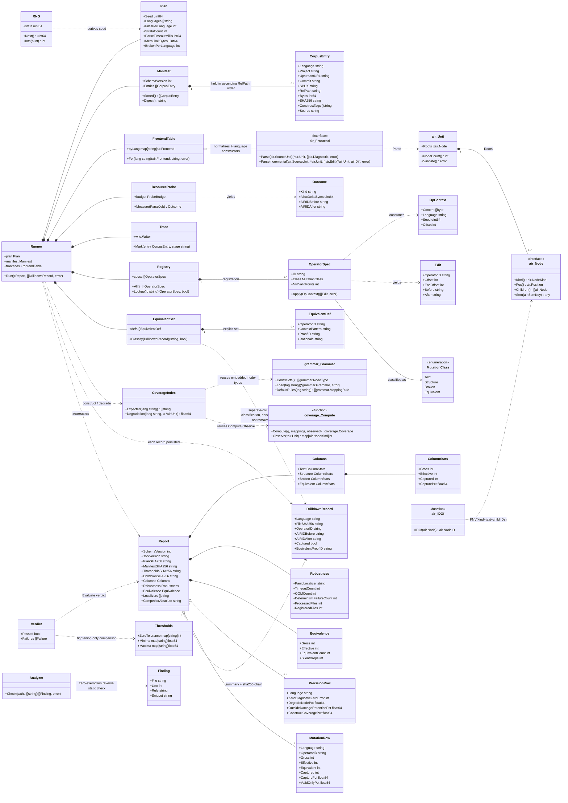
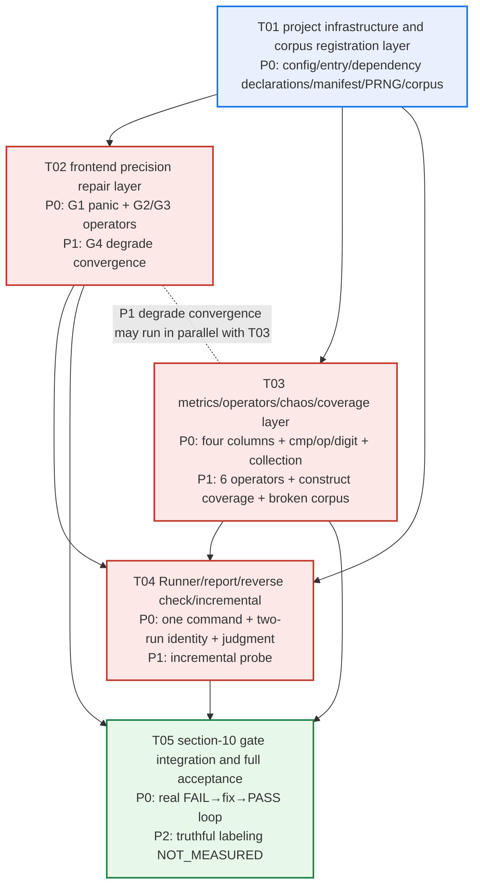

<!--
  Copyright (c) 小黎的部落 (www.qingdujian.com) — Project: xiaolibuluo/Abate (https://github.com/xiaolibuluo/Abate)
  SPDX-License-Identifier: AGPL-3.0-or-later (subject to confirmation by the rights holder / 需权利人确认)
  Abate dual-license (AGPLv3 or commercial) bilingual documentation.
  本文件不构成法律意见 / This document does not constitute legal advice.
-->

> Language / 语言：[English](system_design.en.md) | [中文](system_design.md)

# Abate End-to-End Real-Corpus Gate · System Architecture Design and Task Breakdown

English translation of `system_design.md`, the section-by-section companion
under the plan-A side-by-side naming scheme. The frozen Chinese source is not
modified; this translation adds no conclusions. `NOT_MEASURED` /
`competitorAbsolute` semantics are preserved verbatim, and the degrade-rate
caliber disclosure is translated in full without softening. This document does
not constitute legal advice.

| Item | Value |
|---|---|
| Project | `abate` (`/workspace/abate`, local progress, no remote, **push forbidden**) |
| Toolchain | Go 1.26.11, `GOFLAGS=-mod=vendor`, `GOPROXY=off` |
| Document roles | Architect Gao Jianyuan (Gao) → Lead → Engineer Kou Douma |
| Nature of output | **design document + Mermaid diagrams only**, no implementation code |
| Related files | `docs/class-diagram.mermaid`, `docs/sequence-diagram.mermaid` (same-source diagrams embedded in this file) |
| Upstream inputs | PRD (Xu Chuqing) + Lead's Q1–Q5 rulings + Lead's field-measured baseline |
| Design baseline | field reconnaissance performed on `/workspace/abate` (gate scripts, `lang/air`, `lang/frontkit/grammar`, `lang/gofront/sem.go`, etc.) |

---

## 0. Design baseline and alignment with measurements (correct first, then design)

The following are **hard facts obtained by reading code and scripts in the
field**; they diverge from the wording of the task book, and the design follows
the measurements. All subsequent file lists, API signatures and task
acceptance points converge on this basis.

| # | Task-book wording | Measured fact | Stricter caliber adopted by the design |
|---|---|---|---|
| 0-1 | Copyright header "6-line block comment" | `scripts/header-check.sh` takes the first 8 lines and greps `Copyright` / `xiaolibuluo/Abate` / `小黎的部落`; the repository's existing header is **exactly 6 lines** | Every new `.go` file reuses the existing 6-line header verbatim (see §8.1), no exceptions |
| 0-2 | `function-length ≤ 86` | `.golangci.yml` actually configures `function-length: [80, 0]` | **all functions ≤ 80 lines** |
| 0-3 | `argument-limit ≤ 5~6` | `.golangci.yml` does not configure it explicitly; under revive `enable-all-rules: true`, `argument-limit` uses the **default 3** | **all functions/methods ≤ 3 parameters** (receiver not counted); configuration always uses an option struct |
| 0-4 | `style-check` one type per file | The script only counts `^type [A-Z]` (exported **types**); exported functions are not counted | Still follow the stricter design: **each non-test file ≤1 exported type and ≤1 exported function group** |
| 0-5 | New source forbids `time.Now` / `math/rand` / `os.Environ` | `scripts/m5-reference-scan.sh`: `PATTERN_TIME` scans only `SCAN_DIRS` (default `lang/frontkit`); `PATTERN_IMPORT` scans **the whole repo's** `.go` import lines; `PATTERN_CALL` scans `http.(Get\|Post\|Do\|NewRequest)\(` and `net.Dial` within `SCAN_DIRS` | New Go source performs **no network I/O at all** (hence the fetcher must be shell, see §1.2); section 10 uses `M5_SCAN_DIRS` to point precisely at **directories containing only new files**, plus per-file grep of a few modified existing files (precisely bounded, not an exemption) |
| 0-6 | `m5-reference-scan` ④ | Forbids `os/exec`, `import "C"`, and seven blueprint package names (`tree-sitter`/`swc`/`clang`/`llvm`/`roslyn`/`codeanalysis`/`jetbrains`/`/syn`/`/quote`, etc.) | Zero `os/exec`, zero cgo, zero blueprint imports in new code; `go.mod`/`vendor/modules.txt` **zero changes** |
| 0-7 | AIR-ID = FNV(kind+text+child IDs) | `lang/air/id.go` `ComputeNodeID(kind, attribute, children)`; in `node.go`, the **`text`** of `NewNodeAt(kind,pos,end,text,children...)` **is the attribute**; the Sem set by `air.Annotate(...)` **does not enter NodeID** (source comment: *Annotations do not change the NodeID*) | G2/G3 root cause: `SemOperator` annotation **carries no discriminating power**; the **real token spelling** must be passed into `text` (see §1.8) |
| 0-8 | Competitor caliber "all syntax constructs explicitly modeled" | `lang/air/kinds.go`: `NodeKind` is a frozen wire enum, `kindLast = KindRegion`, `kindNames` is a `[...]string` index table, `CategoryName()` uses range checks | New AIR constructs **only append explicit numeric values after `KindRegion`**, extending `kindNames`/`kindLast`/`CategoryName()` in sync; **existing values are not renumbered** (preserving wire/version compatibility, `SchemaVersion` stays 2) |
| 0-9 | Reuse the 6-language node-types of `lang/frontkit/grammar/` | `grammar/embed.go` `languages` is in fact **6 languages — c / cs / js / kt / py / rs, missing `go`**; `grammar.Load/DefaultRules/Map` and `frontkit/coverage.Compute/Observe` are already usable | Reuse the 6 directly; **`go` uses `ci/constructs_go.json` as a self-built inventory and is truthfully labeled "needs cross-check against tree-sitter-go"**, no fabricated seventh dataset |
| 0-10 | Add one `*_fidelity_test.go` per language | `py/js/c/cs/rs/kt` **already have** `*_fidelity_test.go`; **only `gofront` lacks one** | Extend the 6, create 1 for `gofront`; do not duplicate files |
| 0-11 | Dialect defaults | `cfront` supports `c11`/`c++17`/`c++20`; `csfront` `cs8..cs12`; `ktfront` `kt1.6..kt2.1`; `jsfront` empty string uses the `jsSpec` default | Consistent with the task book: empty string for `py/rs/go/js`, `c=c11`, `cs=cs12`, `kt=kt2.1` |
| 0-12 | Go frontend constructor | `NewGoFrontend() GoFrontend` (default `typeCheck=true`), the other six are `New*Frontend() (air.Frontend, error)`; `GoFrontend.WithTypeCheck(bool)` exists | Normalize via `FrontendTable`; **the runner must use the default `typeCheck=true`**, any `WithTypeCheck(false)` call is judged FAIL by the reverse static check (prevents bypassing G1) |
| 0-13 | `constant-lint` | Catches only `0x100+` hex and `10000+` decimal; skips `const `/`var ` lines, skips the `name = literal` form, skips composite-literal data-table lines containing `{`/`}`, skips lines containing `//`/`"` | Named constants **must be written `name = 0x...` (without an explicit type)**; `name uint64 = 0x...` is judged a magic constant (see §8.2) |
| 0-14 | Third-party corpus directory | Existing subdirectory names under `third_party/_sources/` **do not start with `_`** (`gvisor/`, `llvm-project/`, etc.); they are ignored via the parent `_sources`; `header-check`/`style-check` explicitly exclude `./third_party/*` | **All new landing directories start with `_` at every level** (`_sources/_validation/_<lang>/_<project-tag>/`), double insurance; never place them in ordinary directories |
| 0-15 | Licenses of already-ingested corpus | `_sources/README.md` registers `llvm-project` as **Apache-2.0 + LLVM exception** and `pit` as decompiled restoration | Tension with Q2 "avoid boundary disputes"; see §5 open item 2, **no decision made on the Lead's behalf** |
| 0-16 | `recover` | Existing `*_chaos_test.go` comments state clearly "no panic is guaranteed by the Go test framework, no explicit recover needed" | **Zero `recover`** in new code; panic is proven by "process-level crash + deterministic progress trace + report left incomplete" (see §1.7) |

> Supplementary measurement: `revive` also activates `max-public-structs [10]`, `line-length-limit [300]`, `deep-exit`, `flag-parameter`, `unused-parameter`, `unexported-return`, `godot`, `exported`, `package-comments`. Therefore every new package must have a `doc.go`, every exported symbol must have a comment starting with its name and ending with a period, `os.Exit`/`log.Fatal` may appear only in `cmd/*/main.go`, and each package has ≤10 exported structs (this design uses 2–6 per package). `gosec G304` is avoided by "`os.DirFS` root + `fs.ReadFile`" (see §8.3).

---

# Part A · System Architecture Design

## 1. Implementation approach and framework selection

### 1.1 Core difficulty breakdown

| Difficulty | Essence | This design's solution |
|---|---|---|
| D1 **gate self-consistency** | ~90 new Go files; any one hitting 300 lines / one-type-per-file / copyright header / magic constant / flag-parameter / depth / parameter count fails everything | Structurally **pre-split into small units**: all files estimated ≤195 lines, ≤1 exported symbol group per file, ≤6 exported structs per package; all configuration pushed down to JSON, code contains only pure functions |
| D2 **determinism** | The report must be "byte-identical across two runs with the same seed + manifest", while timeouts, memory, concurrency, map iteration, wall clock and absolute paths are all nondeterminism sources | Sequential execution; in-house fixed PRNG `SplitMix64` (seed = sha256(seed‖manifestSha256‖label)); timeouts via `context.WithTimeout` + `ctx.Err()`; memory via `runtime.MemStats` deltas; zero wall clock / zero absolute paths / zero map output in the report; JSON struct fields in fixed order |
| D3 **contradiction between zero exemption and real panic detection** | Need to prove `panic=0` yet may not use `recover` to swallow exceptions | No capture-and-count: panic terminates the process directly and leaves the report incomplete → the gate localizes via **exit code + report completeness + last `Trace` line (file sha256 / path / stage)**. `panicLocalizer` in the report is an empty string only "when the report could be written to completion" |
| D4 **reverse proof of no source-based corpus exclusion** | Cannot rely on a verbal claim of "no exclusion" | `internal/e2e/neutrality` uses `go/ast` for **syntax-level invariant checks**: no `Source/Project/SPDX/...` selectors in conditional expressions, no `continue/break` inside corpus traversal loops, `processedFiles == registeredFiles` enters the zero-tolerance column; plus a **completeness reverse check** via `ci/e2e_sources.txt` (not a whitelist) |
| D5 **AIR modeling precision** | G2/G3 capture rates are low, but changing the hash caliber / adding annotations / enlarging mutation magnitude are forbidden | The only correct fix: write the **real token text** into the attribute of `NewNodeAt(..., text, ...)` (it enters `ComputeNodeID`); `SemOperator` serves only as auxiliary annotation; `ci/operator_kind_map.json` registers the "operator → AIR Kind/text" mapping |
| D6 **G4 degrade rate** | Too much fallback to `Region`+`ExprStmt` | Append explicit `NodeKind` (after `KindRegion`) + add `match` branches in each frontend's `*map.go`; **do not loosen the definition of "degraded"**; `Degradation` is computed with the existing `StatusDegraded` caliber of `frontkit/coverage` |
| D7 **corpus scale and representativeness** | js/rs/py have too few files with a single extension, but "padding" is forbidden | Dual-track merge + stratified equidistant sampling; **accept only real upstream files**, no copying/synthesizing/duplicate padding; if insufficient, truthfully report the gap and FAIL, never fabricate ≥200 |
| D8 **thresholds only tighten** | No loosening switches may appear | `ci/e2e_thresholds.json` and immutable `ci/e2e_thresholds_baseline.json` are compared monotonically: `minima` may only be ≥, `maxima` only ≤, zero-tolerance keys must be complete and constantly 0; no env switches, no skip fields |

### 1.2 Framework selection: zero new third-party dependencies

| Capability | Selection | Reason (why no new dependency) |
|---|---|---|
| Corpus download/extraction | **`scripts/corpus_fetch.sh` (shell + `curl` + `tar`), one-time offline tool** | `m5-reference-scan` ① explicitly forbids `http.Get/Post/Do/NewRequest(`, `net.Dial`, `os/exec` in new Go source, **a downloader written in Go would necessarily FAIL**; shell is outside the `.go` scan surface; and gates **never trigger downloads** (network is nondeterministic), they only verify the existing read-only tree |
| Corpus tree reading | `io/fs` + `os.DirFS` + `fs.WalkDir` + `fs.ReadFile` (stdlib) | Avoids `gosec G304` (`os.ReadFile(variable path)`); all paths are relative to the `fs.FS` root, zero absolute paths in the report |
| Checksums | `crypto/sha256` (stdlib), streaming `io.Copy` | `constant-lint` requires named constants such as `sha256.Size`; same caliber as `air.SourceFile.Digest()` and `determinism.HashState` |
| Deterministic PRNG | **in-house `SplitMix64`**, in `internal/determinism/rng.go` | `internal/determinism` currently has only `HashState` / `MustMatch100`, **no PRNG**; `m5` ④ forbids `math/rand` (even literal text in comments is grepped), so it is not imported at all; the algorithm is pure integer, no floating point, no global state |
| Canonical JSON | `encoding/json` (stdlib), struct fields in fixed order | `encoding/json` sorts map keys lexicographically, but the report still **only outputs structs/slices**, never maps directly |
| Timeouts/resources | `context.WithTimeout` + `runtime.ReadMemStats` (stdlib) | Source has zero `time.Now`/`time.Since` (`Duration` constants like `time.Second` are not forbidden); `ctx.Err()==context.DeadlineExceeded` determines timeout, no wall clock read |
| Construct coverage | **reuse `lang/frontkit/grammar` (`go:embed` 6-language node-types.json) + `lang/frontkit/coverage`** | Already embedded offline and already passing existing gates; `grammar.Load/DefaultRules/Map` and `coverage.Compute/Observe` are directly usable, zero new modules |
| Frontend invocation | **reuse `air.Frontend` / `air.SourceUnit` / `air.NewSourceFile` / `air.IDOf` / `air.Walk` / `air.CheckIntervals`** | Do not change the AIR public contract or the hash caliber; the seven `New*Frontend()` are normalized by `FrontendTable` |
| Incremental probe | `air.Frontend.ParseIncremental` + `air.ApplyEdits` + `air.Diff` | Existing APIs, directly reused for P1 |
| Reverse static check | **`go/parser` + `go/ast` + `go/token` (stdlib)** | Syntax-level judgments are more precise than grep; no `golang.org/x/tools` introduced |
| Report rendering/archiving | `encoding/json` + `strings.Builder` + sorted slices | No template engine, no timestamp library |
| Gates | `bash` + `go run` + `cmp` + `jq` (script layer) | Existing nine sections untouched, section 10 appended as `ci/gate_e2e.sh`; `go mod verify`, `m5`, and the nine sections are guaranteed by the Lead's existing scripts |

> **`go.mod` / `go.sum` / `vendor/modules.txt` have zero changes across the board**: the existing `wazero`, `yaml.v3`, `x/sys` are unrelated to this capability; adding any require would trigger the three-way consistency review of `m5-reference-scan` ③ and a `license-check` regression — an unnecessary expansion of the dependency surface.

### 1.3 Layered architecture

```
┌─ Gate layer ───────────────────────────────────────────────────────────────┐
│ scripts/lint-gate.sh [0..8] existing nine sections (unchanged)             │
│ + [9] ci/gate_e2e.sh (section 10) ← ci/e2e_thresholds{,_baseline}.json     │
└───────────────┬─────────────────────────────────────────────────────────────┘
                │ invokes
┌───────────────▼─────────────────────────────────────────────────────────────┐
│ Entry layer cmd/{corpusctl,e2e,neutralitycheck}/main.go                    │
│ argument parsing + invocation + os.Exit only (deep-exit allowed only here) │
└───────────────┬─────────────────────────────────────────────────────────────┘
                │
┌───────────────▼─────────────────────────────────────────────────────────────┐
│ Runtime layer internal/e2e: Plan / FrontendTable / Runner / ResourceProbe / │
│                            Trace / Outcome                                 │
│ Collection layer internal/e2e/{metrics,mutate,chaos,coverage,incremental,   │
│                            report,neutrality}                               │
│ Corpus layer internal/corpus: Manifest / Register / Verify / Sample / SPDX  │
│ Determinism internal/determinism: RNG (SplitMix64)                          │
└───────────────┬─────────────────────────────────────────────────────────────┘
                │ calls existing interfaces only
┌───────────────▼─────────────────────────────────────────────────────────────┐
│ Existing kernel lang/air + lang/frontkit/{grammar,coverage} + 7 frontends   │
│ Read-only corpus third_party/_sources/** (not scanned by Go tools or gates) │
└─────────────────────────────────────────────────────────────────────────────┘
```

Dependency direction is strictly one-way: gate → entry → runtime/collection/corpus → existing kernel; **lower layers never depend back on upper layers**; `internal/e2e/*` subpackages interact only through data contracts such as `metrics.DrilldownRecord`, never importing each other's concrete implementations.

### 1.4 Three competitor calibers implemented + 4 metric clarifications (mandatory in the collector)

| Category | Competitor-caliber analogue | Fields collected by this design | Landing point |
|---|---|---|---|
| Precision / construct coverage | tree-sitter `node-types.json` named-node list, error recovery (no crash / no hang / linear), `changed_ranges()`; go/parser, Roslyn "explicit modeling" | `ConstructCoveragePct`, `DegradeNodePct`, `OutsideDamageRetentionPct`, `ZeroDiagnosticZeroError`, `TimeoutCount`, `AllocDeltaBytes`, `IncrementalResult` | `PrecisionRow` / `Robustness` / `incremental.Probe` |
| Mutation testing | PIT status classification + `mutationThreshold`; Stryker `detected/valid×100`, CompileError excluded from denominator; cargo-mutants caught/missed/timeout/unviable; mutmut | Four classifications `Captured`/`Missed`/`Timeout`/`Unviable` + `air.IDOf(root)` before/after values; **all gross enters the denominator**, with Stryker-style `validOnlyPct` as **auxiliary observation** | `MutationRow` / `Equivalence` / `DrilldownRecord` |
| Chaos / robustness | libFuzzer `-max_len/-timeout/-rss_limit_mb/-runs/-merge=1`; OSS-Fuzz unique crash dedup | `TimeoutCount`/`OOMCount` (separate columns), `Merge` dedup by input sha256, crash localized by process exit code + `Trace` | `Robustness` / `chaos.Merge` / `Trace` |

**4 metric clarifications (written into `internal/e2e/metrics/columns.go` and `report.Markdown`, hard constraints)**

1. **AIR-ID is the primary capture criterion.** A low structural signature (Kind+Sem+Children, excluding text) ≠ failure to see a mutation; evidence: `c` structure 39.8% → AIR-ID 98.2%. The report uses **four separate columns: text mutation / structure mutation / broken mutation / equivalent mutation**, each with `Gross/Effective/Captured/CapturePct`; **merging into a single score is forbidden**; the four fields of the `Columns` struct are the type-level expression of this constraint.
2. **Comments are explicitly modeled as AIR nodes** (`air.KindComment` already exists), and adding a comment changes AIR-ID by 100%. `comment/whitespace/format changes` **must not enter the mutation operator set**; equivalent mutations are defined by an **explicit set** `EquivalentDef{OperatorID, ContextPattern, ProofID, Rationale}`, persisted item by item in `ci/equivalent_mutations.json`, counted in a separate column.
3. **Zero diagnostics and zero errors ≠ correct parsing.** `PrecisionRow` must simultaneously provide `ZeroDiagnosticZeroError` (trap count), `DegradeNodePct`, `OutsideDamageRetentionPct`; none may substitute for another.
4. **Zero determinism failures ≠ precision compliance.** `Evaluate` judges `DeterminismFailureCount` (zero tolerance) separately from `airID*CapturePct` (minima) and `Degrade*Pct` (maxima); no weighting/offsetting/composite-score function exists in the code.

> Q5 ruling applied: all mutations enter the `Gross` denominator (primary criterion); `Equivalent` is only labeled, **not removed, not exempted**; `Effective = Gross − EquivalentCount` is auxiliary observation only; `SilentDrops` is constantly 0 and enters the zero-tolerance column. Stryker's "CompileError excluded from denominator" is **downgraded to an auxiliary column** `ValidOnlyPct` in this project, with the report explicitly stating "the caliber is stricter than Stryker, per the Q5 ruling"; it is not silently applied.

### 1.5 Threshold table (current → target)

| Metric | Current measurement | Target | Criterion type | Report field |
|---|---|---|---|---|
| Go frontend panic | **2** (`hasSideEffect` typed-nil) | **0** | zero tolerance (process-level disproof) | `Robustness.PanicLocalizer == ""` |
| Determinism failures | 0 | 0 | zero tolerance | `DeterminismFailureCount` |
| `cmp ==→!=` AIR-ID capture rate | cs 5% / kt 20% / others 100% | **100% for all 7 languages** | minima | `airIDCmpCapturePct` |
| `op +→-` AIR-ID capture rate | js 45% / kt 43% / cs 57% / rs 89% / others 100% | **100% for all 7 languages** | minima | `airIDOpCapturePct` |
| `digit` AIR-ID capture rate | rs 94% / others 100% | **100% for all 7 languages** | minima | `airIDDigitCapturePct` |
| Degrade rate | cs 18.7% / kt 14.7% / rs 7.0% / py 4.0% / go 1.5% / c 1.3% / js 0.7% | cs ≤5% / kt ≤5% / rs ≤3% / py ≤3% (others do not regress) | maxima | `DegradeNodePct` |
| Parseable corpus per language | js 18 (G5), etc. | **≥200 / language** | minima | `ParseablePerLanguage` |
| Valid mutation points per operator | — | **≥30 / operator / language** | minima | `MutationRow.Gross` (valid points) |
| Broken corpus | — | **≥200 / language**〔P1〕 | minima | `BrokenPerLanguage` |
| Timeout / OOM rate | — | **0 / 0** | zero tolerance | `TimeoutCount` / `OOMCount` |
| SPDX compliance / sha256 recomputation | — | **100% / all 0 mismatches** | zero tolerance | `SPDXViolations` / `SHA256Mismatches` |
| Drilldown completeness / manifest embedding | — | **100%** | minima | `DrilldownSHA256` / `ManifestSHA256` |
| Competitor absolute scores | not run | **"needs measured cross-check"〔P2, truthfully labeled, no claim of exceeding X%〕** | — | report `competitorAbsolute` section marked `NOT_MEASURED` |

### Degrade-rate caliber statement (honest disclosure)

- **Statistical scope**: the report field `degrade*Pct` is computed by `firstUnitPerLanguage` at `internal/e2e/runner_coverage.go:28-33,52-58`, covering only each language's **first real parsed unit (single file)**; the frozen thresholds cs ≤5% / kt ≤5% / rs ≤3% / py ≤3% correspond to this single-file caliber.
- **Full-corpus measurement with the same formula** (QA audit report `docs/i18n/QA-ANTI-FRAUD-AUDIT.md`, dimension 7; the formula is exactly the same as `Degradation`, only the statistical scope differs): js **49.12%** / c **28.00%** / py **26.89%** / rs **42.33%** / kt **8.21%** / cs **6.98%** — all six languages are above threshold; go is **NOT_MEASURED**.
- **Conclusion qualifier**: the current "meets threshold" values cs 3.26% / kt 4.48% / py 0% / rs 0.61% are real, but **meeting the threshold holds only under the frozen single-file caliber** and does not represent full-corpus/corpus-level degrade-rate compliance; extrapolating a single-file conclusion to full-corpus compliance is forbidden.
- The numeric chain itself is real: drilldown really recomputes, and two runs with the same seed are byte-identical; this disclosure concerns only the statistical caliber and does not change any threshold, frozen artifact, or gate verdict.

### 1.6 Section-10 gate "real FAIL → fix → real PASS" closed loop

The closed loop must be **observable, recomputable and unfalsifiable**, designed as 7 deterministic steps:

| Step | `ci/gate_e2e.sh` action | Real behavior on failure | Archive |
|---|---|---|---|
| S1 | Compute `manifestSha256`; `corpusctl verify` recomputes sha256 + SPDX in full | Print the offending entries' `RelPath / expected sha256 / measured sha256 / SPDX` | `verify_result.json` |
| S2 | Load `thresholds` + `baseline`, perform **tightening-only** monotonic check | Print the loosened keys with "current value / baseline value / direction" | `threshold_check.json` |
| S3 | `neutralitycheck` + `e2e_sources.txt` completeness reverse check | Print `file:line:rule:snippet`; any "source-based exclusion" hit stops immediately | `neutrality.json` |
| S4 | `go run ./cmd/e2e` **twice** (same seed + same manifest), `cmp` the two `e2e_report.json` byte by byte | Print the `cmp` offset of the first difference | `run1/` + `run2/` |
| S5 | If panic: process exit code non-zero, `e2e_report.json` incomplete → read the **last line** of `e2e_trace.jsonl` for `file sha256 / RelPath / stage / operator` | Real crash stack + localization line (**no recover, no swallowing**) | `trace.tail` |
| S6 | `Recompute` recomputes every baseline current value from `e2e_drilldown.jsonl`, asserting error 0; `Evaluate` produces `Verdict` | Print `Localizers[]`: file sha256 + operator + `AIRIDBefore/After` + rule id | `verdict.json` |
| S7 | Archive `report + manifest + thresholds + plan + exit_code` to `.artifacts/e2e/<first 12 digits of manifestSha256>/` (**deterministic directory name, no timestamp**) | — | full archive, recomputable offline via `cmp` |

- **The red light is a real red light**: after T01 lands, `ci/gate_e2e.sh` exits 1 because `cmd/e2e` / `internal/e2e` are not ready and threshold items are unmet; the engineer refines precisely item by item per S1–S6 printouts (fixing mappers, adding explicit constructs, supplementing corpus), **without loosening thresholds or adding skips**; T05 goes all-green, i.e. `exit 0`.
- **Localization granularity**: every non-zero zero-tolerance item must be printed down to "file sha256 + operator + before/after AIR-ID values", not merely a total.
- The existing `scripts/lint-gate.sh` only appends the `[9]` section call **before** the "gate conclusion" block; the nine sections above are unchanged verbatim.

### 1.7 Implementation science of zero exemption (forbidden mechanisms → reverse checks)

| Forbidden mechanism | Corresponding countermeasure in this design (all **tightening**, not exemptions) |
|---|---|
| `skip` / whitelist | No `skip` field; `ci/e2e_sources.txt` is a **source list that must be complete**, the gate runs `find(new roots) \| sort` and `cmp`s it against the list — one missing file means FAIL (a completeness constraint, not an exclusion list) |
| Branches excluding corpus by source | `neutrality.Analyzer` asserts with `go/ast`: zero `Source/Project/Commit/SPDX/SPDXEvidence/ConstructTags` selectors in conditional expressions; zero `continue/break` inside corpus traversal loops; `processedFiles == registeredFiles` enters zero tolerance |
| Threshold-loosening switches | No env switches; `thresholds` are compared monotonically against the immutable baseline; missing keys / direction regression means FAIL |
| `recover` swallowing panic | Zero `recover`; panic disproved by process exit code + report completeness + last `Trace` line; `neutrality` explicitly scans for the builtin `recover(` |
| Bypassing the G1 path | `neutrality` explicitly scans `WithTypeCheck(false)`; `FrontendTable` uses only `NewGoFrontend()` with default `typeCheck=true` |
| Inflating capture rates | Adding comments / changing hashes / enlarging mutation magnitude are forbidden; `ci/operator_kind_map.json` registers mappings, `*_fidelity_test.go` asserts "changing only the operator → AIR-ID must change", and comment/whitespace/format operators are **not in the Registry** |
| Falsifying corpus counts | Only real upstream files are accepted; `Manifest` records `RelPath + sha256`, `Verify` recomputes in full; copying/synthesizing/duplicate padding forbidden; insufficiency → `ParseablePerLanguage` fails minima → FAIL |
| Falsifying a green light | The report embeds four chains — `manifestSha256`/`planSha256`/`thresholdsSha256`/`drilldownSha256`; archives are recomputable offline via `cmp` |

### 1.8 G1–G5 gaps → precise repair landing points

| Gap | Root cause (measured) | Repair structure (minimal change + no gate violation) |
|---|---|---|
| **G1** Go panic | `lang/gofront/sem.go:141-160` `hasSideEffect(body ast.Node)`: truncated source produces `(*ast.BlockStmt)(nil)`; once loaded into an interface, `body == nil` **fails for typed-nil**, and `ast.Inspect → go/ast.Walk` dereferences `n.List` and crashes. Call chain `Parse → annotateTypes → annotatePurity → hasSideEffect`. The repo's second `ast.Inspect` is at `mapdecl_extra.go:151` | ① Add `lang/gofront/astnil.go` (one unexported function group `isNilASTNode`, using `reflect.ValueOf(n).IsNil()` to test ptr/slice/map/chan/func/interface for nil, **checking at the source**; AIR semantics unchanged: a nil body counts as "no side effects", consistent with the 633-node / 4-diagnostic path of `WithTypeCheck(false)`); ② `annotatePurity` passes `fn.Body` through `isNilASTNode` first; ③ the same guard in `mapdecl_extra.go`; ④ global checklist (table below) reviews every `ast.Inspect/Walk` call site one by one. **Zero recover, zero file exceptions** |
| **G2** comparison operators | `== → !=` changed only the `SemOperator` annotation or the static `rule.text`, **not the `text` of `NewNodeAt`**, and `air.Annotate` does not participate in `ComputeNodeID` | `lang/frontkit/opbind.go` provides a single `BindOperator(kind, pos, end, tok, children...)`: passes `tok.Text` as the attribute into `air.NewNodeAt`, while also calling `air.Annotate(n, air.SemOperator, tok.Text)`. Binary/unary/assignment/inc-dec nodes in 7 `*map.go` / `*expr*.go` files uniformly switch to this entry point |
| **G3** arithmetic / digits | Same as above (js `jsMapper.binary` uses `rule.text` while `rule.operator` is Sem only; rs `digit` text not fully preserved) | Same as above; for the `digit` class ensure the `text` of `KindNumLit` is the **complete literal original** (not normalized, not truncated). `VerifyTokenFidelity` already performs bidirectional text checks on lexical nodes, so the change is naturally compatible (`KindBinary/KindUnary` are not in the `isLexicalNode` set) |
| **G4** degrade rate | Insufficient `match` branch coverage → fallback `KindRegion` + `KindExprStmt` | ① `lang/air/kinds.go` **appends explicit numeric** new Kinds after `KindRegion` (e.g. `KindPropertyDecl`/`KindWhenBranch`/`KindInterpolation`/`KindAttributeArg`…), extending `kindNames`, `kindLast`, `CategoryName()` ranges in sync; ② `csfront/ktfront/rsfront/pyfront` each add one `*map_extra.go` (≤150 lines) carrying the new `match` branches; ③ the corresponding language rule tables in `grammar.DefaultRules` gain exact mappings (**without loosening the `StatusDegraded` definition**) |
| **G5** JS corpus | Only 18 samples, AIR-ID sensitivity 80.7% | Dual-track merge: `_sources` 23 `.js` + `_validation` lodash 54 `.js` = 77; **still short of 200** → see §1.9 and §5 open item 1 (add a conforming project or truthfully report the gap and FAIL). After supplementing, `StratifiedSample` stratified equidistant sampling improves representativeness |

**G1 global typed-nil checklist (engineers must review line by line, no exceptions)**

| Call site | Current state | Handling |
|---|---|---|
| `lang/gofront/sem.go:146` `ast.Inspect(body, ...)` | crash point | `isNilASTNode` source-level nil check |
| `lang/gofront/mapdecl_extra.go:151` `ast.Inspect(value, ...)` | same-class risk | same guard |
| `go/types` result traversals in `annotateTypes` / `annotateTypeFacts` | not `ast.Walk`, but `expr`/`ident` may be nil | review `v.lookup(nil)` behavior and add explicit nil checks |
| Type assertions in `gofront/view.go` / `mapexpr.go` / `mapstmt.go` | `decl.(*ast.FuncDecl)` then `fn.Body` | uniformly route through `isNilASTNode` |

### 1.9 Corpus dual-track, ≥200 parseable samples, and the "padding vs representativeness" boundary

**Dual track (Q1)**: `CorpusEntry.Source` has only two constant values, `in_tree` / `validation`, **used only for report labeling and column separation**, never entering any control flow.

| Language | Already ingested `_sources` (main) | Independent validation set `_validation` (downloaded and measured) | After merge | Path to ≥200 |
|---|---|---|---|---|
| go | 3284 `.go` | gin v1.9.1 / MIT / 92 `.go` | 3376 | directly satisfies |
| py | 260 `.py` | requests v2.31.0 / Apache-2.0 / few main-repo `.py` | 260+ | **uses the ingested 260 as the main body** (explicitly recorded, not shrunk) |
| js | 23 `.js` | lodash 4.17.21 / MIT / 54 `.js` | **77** | **insufficient**; needs one more conforming project or an honest FAIL (§5-1) |
| c | 70 `.c` + 3179 `.h` | cJSON v1.7.16 / MIT / 76 `.c` + 23 `.h` | 3348 | `.c`+`.h` merged (registered by extension, **not pre-judged and discarded by content**; diagnostics from C++ headers parsed with `c11` are counted truthfully, not treated as exclusions) |
| cs | 1637 `.cs` | Newtonsoft.Json 13.0.3 / MIT / 933 `.cs` | 2570 | directly satisfies |
| rs | 136 `.rs` | serde v1.0.193 / `MIT OR Apache-2.0` / 163 `.rs` | 299 | merge satisfies; parseability must be measured, supplement if insufficient |
| kt | 5669 `.kt` | okhttp parent-4.12.0 / Apache-2.0 / 251 `.kt` | 5920 | directly satisfies |

**Sampling**: `256B ~ 180KB` is divided into `StrataCount` strata (equidistant byte boundaries); within each stratum, files are sorted by `sha256(RelPath)` ascending and sampled with a deterministic equidistant step `k`; `rng` is used **only** for selecting mutation points / broken points, not for deciding "which file to sample", guaranteeing "same seed + manifest → exactly identical file set". Q4 ruling: section 10 runs a **fixed-seed minimum credible set** (`FilesPerLanguage=200`); nightly full runs are P2, and this round **introduces no `sampleMode` switch** (to avoid any scope-loosening knob).

**Hard boundary of "padding vs real representativeness" (zero exemption)**

- ✅ Allowed: merging files from two **real upstream projects**; registering `.c`+`.h` in two tracks by extension; stratified equidistant sampling to guarantee size-distribution representativeness.
- ❌ Forbidden: copying the same file under a different path, synthesizing/concatenating fragments, duplicate padding, pre-filtering files by "whether they can be parsed", running fewer files based on a `source` branch.
- Boundary determination: `Verify` outputs `ParseablePerLanguage`; if a language < 200 → minima unmet → **gate genuinely FAILs and prints the gap count**; the Lead decides on supplementing per §5-1; **insufficiency is never written as 200**.
- Definition of "parseable": calling `Frontend.Parse` returns `err == nil` and `unit.Validate() == nil`; diagnostic/error counts are recorded truthfully and are not exclusion conditions.

### 1.10 Parameter alignment with libFuzzer semantics

| libFuzzer parameter | This design's counterpart | Implementation (no wall clock, no subprocess) |
|---|---|---|
| `-max_len` | `Plan.MaxFileBytes = 180 * Kib` | `Bytes` recorded at registration; stratum boundaries hard-bounded; over-limit files are **still registered and still processed**, they simply do not enter the minimum credible set (a stratification rule, not an exclusion) |
| `-timeout` | `Plan.ParseTimeoutMillis` (named-constant-derived `time.Duration`) | `context.WithTimeout(ctx, d)`; `ctx.Err()==context.DeadlineExceeded` → `Outcome.Kind="Timeout"`, **counted separately**; source has zero `time.Now`/`time.Since` |
| `-rss_limit_mb` | `Plan.MemLimitBytes = 256 * Mib` | `runtime.ReadMemStats` `TotalAlloc` **delta** `AllocDeltaBytes`; over budget → `Outcome.Kind="MemExceeded"`, **counted separately**. Honest note: this is a platform-independent allocation proxy, not real RSS; the report field is named `AllocDeltaBytes`, and P2 marks it "needs measured cross-check against libFuzzer RSS caliber" (§5-5) |
| `-runs` | `Plan.MaxRuns` | total parse-count budget; exceeding is a contract error (not a skip) |
| `-merge=1` | `chaos.Merge` | broken/crash inputs deduplicated by `sha256(input bytes ‖ operator ‖ offset ‖ toolVersion)`, merged into the deterministic corpus set |
| `-artifact_prefix` | `Plan.ReportDir = .artifacts/e2e` | archive directory named with the first 12 digits of `manifestSha256` (no timestamp) |
| `-print_final_stats` | `e2e_report.json` + `e2e_report.md` | four columns + drilldown + localization |
| unique crash dedup (OSS-Fuzz) | input-level dedup + process-level crash localization | **no recover introduced**; stack-signature dedup see §5-4 |

---

## 2. Complete file list (relative to `/workspace/abate`)

> Column notes: **line count** is the design's estimated upper bound (all ≤195, hard red line 300); **export count** = number of exported types/function groups in that non-test `.go` file (target ≤1); `0` = unexported helpers only or `package main`. Data files (`.json`/`.sh`/`.txt`/`.md`) are not scanned by the header/style gates (the scripts only `find -name '*.go'` and exclude `./third_party/*`). Every new Go package has a `doc.go` (`revive package-comments`).

### 2.1 Corpus layer (read-only landing + manifest + registration tool)

| Path | Type | Lines | Exports | Notes |
|---|---|---:|---:|---|
| `third_party/_sources/_validation/_go/_gin_v1_9_1/` | dir | — | — | read-only; **directory names start with `_` at every level** |
| `third_party/_sources/_validation/_py/_requests_v2_31_0/` | dir | — | — | same |
| `third_party/_sources/_validation/_js/_lodash_4_17_21/` | dir | — | — | same |
| `third_party/_sources/_validation/_c/_cjson_v1_7_16/` | dir | — | — | same |
| `third_party/_sources/_validation/_cs/_newtonsoft_13_0_3/` | dir | — | — | same |
| `third_party/_sources/_validation/_rs/_serde_v1_0_193/` | dir | — | — | same; dual-license files complete |
| `third_party/_sources/_validation/_kt/_okhttp_4_12_0/` | dir | — | — | same |
| `third_party/_sources/README.md` | edit | +30 | — | append registration of 7 projects (upstream URL / tag / SPDX / sha256 / file count) |
| `third_party/LICENSE-MANIFEST.md` | edit | +12 | — | append SPDX provenance; `license-check.sh` already tolerates its own AGPL wording (WARN only) |
| `ci/corpus_manifest.json` | generated | data | — | full registration, `Entries` in ascending `RelPath`; no timestamps/absolute paths |
| `ci/corpus_manifest.sha256` | generated | 1 | — | manifest digest, embedded in report for comparison |
| `ci/e2e_sources.txt` | data | ~90 | — | **complete list of new source** (anchor for reverse checks, not a whitelist) |
| `scripts/corpus_fetch.sh` | shell | 140 | — | idempotent re-fetch of 7 pinned `URL + tag + sha256`; **not invoked by gates, no network**; recomputes each tarball sha256, `exit 1` on mismatch |
| `internal/determinism/rng.go` | new | 95 | 1 | `RNG` (SplitMix64, pure integer, zero global state) |
| `internal/determinism/rng_select.go` | new | 130 | 1 | `Stride` (deterministic equidistant step, generic ordered-sequence helper, does not depend on corpus/e2e packages) |
| `internal/determinism/rng_test.go` | test | 95 | — | two runs with same seed + known-vector assertions |
| `internal/corpus/doc.go` | new | 14 | 0 | package comment |
| `internal/corpus/consts.go` | new | 60 | 0 | named constants `Kib`/`Mib`/`minFileBytes`/`maxFileBytes`/`strataCount`/`defaultSeed`, etc. |
| `internal/corpus/source.go` | new | 70 | 1 | `type Source string` + `SourceInTree`/`SourceValidation` |
| `internal/corpus/entry.go` | new | 105 | 1 | `CorpusEntry` |
| `internal/corpus/manifest.go` | new | 150 | 1 | `Manifest` + `Load`/`Digest`/`Sorted` |
| `internal/corpus/register.go` | new | 185 | 1 | `Register(fsys, projects)`: `fs.WalkDir` ascending, per-file sha256 |
| `internal/corpus/verify.go` | new | 165 | 1 | `Verify`: full sha256 recomputation + `VerifyResult` aggregation (split into `verifyresult.go` below) |
| `internal/corpus/verifyresult.go` | new | 75 | 1 | `VerifyResult` |
| `internal/corpus/spdx.go` | new | 120 | 1 | `ClassifySPDX`: allowlist / boundary / GPL / UNKNOWN |
| `internal/corpus/sample.go` | new | 150 | 1 | `Sample(m, p, rng)` stratified equidistant (calls `determinism.Stride`) |
| `internal/corpus/manifest_test.go` | test | 120 | — | registration/recomputation/determinism assertions |
| `cmd/corpusctl/main.go` | new | 110 | 0 | `register` / `verify` subcommands; `os.Exit` only in this layer |

### 2.2 Tool layer (runtime / collection / mutation / chaos / coverage / report / reverse check)

| Path | Lines | Exports | Notes |
|---|---:|---:|---|
| `internal/e2e/doc.go` | 14 | 0 | package comment |
| `internal/e2e/consts.go` | 70 | 0 | libFuzzer-aligned named constants, dialect table, language table (composite-literal data table, structurally skipped by constant-lint) |
| `internal/e2e/plan.go` | 135 | 1 | `Plan` + `LoadPlan` |
| `internal/e2e/frontends.go` | 110 | 1 | `FrontendTable`; normalizes 7 constructors, Go uses default `typeCheck=true` |
| `internal/e2e/outcome.go` | 95 | 1 | `Outcome` + `ProbeBudget` |
| `internal/e2e/probe.go` | 140 | 1 | `ResourceProbe`: `context.WithTimeout` + `runtime.ReadMemStats` |
| `internal/e2e/trace.go` | 85 | 1 | `Trace`: writes a deterministic progress line before every parse (**zero recover**) |
| `internal/e2e/runner.go` | 185 | 1 | `Runner` + `Run()` orchestration skeleton |
| `internal/e2e/runner_parse.go` | 150 | 1 | single-file Parse + `IDOf` + `CheckIntervals` flow |
| `internal/e2e/runner_mutate.go` | 160 | 1 | mutation loop (`Registry` → in-memory replacement → re-parse → drilldown) |
| `internal/e2e/runner_chaos.go` | 140 | 1 | broken-corpus loop + out-of-region structure retention rate |
| `internal/e2e/runner_coverage.go` | 130 | 1 | construct coverage / degrade-rate loop |
| `internal/e2e/e2e_endtoend_test.go` | 155 | — | end-to-end: two-run consistency, four columns, drilldown chain, zero tolerance |
| `cmd/e2e/main.go` | 95 | 0 | CLI: `-plan -manifest -out`; `os.Exit` only in this layer |
| `internal/e2e/metrics/doc.go` | 14 | 0 | package comment |
| `internal/e2e/metrics/columns.go` | 85 | 1 | `Columns` + `ColumnStats` (**four fields, merging forbidden at type level**) |
| `internal/e2e/metrics/precision.go` | 155 | 1 | `PrecisionRow` |
| `internal/e2e/metrics/mutation.go` | 175 | 1 | `MutationRow` (four categories + gross/effective + validOnly auxiliary column) |
| `internal/e2e/metrics/robustness.go` | 120 | 1 | `Robustness` (timeout/OOM/determinism separate columns + panic localization) |
| `internal/e2e/metrics/drilldown.go` | 105 | 1 | `DrilldownRecord` |
| `internal/e2e/metrics/aggregate.go` | 170 | 1 | `Aggregate`: four-column aggregation, pure function |
| `internal/e2e/mutate/doc.go` | 14 | 0 | package comment |
| `internal/e2e/mutate/class.go` | 75 | 1 | `MutationClass` enum (Text/Structure/Broken/Equivalent) |
| `internal/e2e/mutate/context.go` | 80 | 1 | `OpContext` |
| `internal/e2e/mutate/edit.go` | 85 | 1 | `Edit` |
| `internal/e2e/mutate/spec.go` | 95 | 1 | `OperatorSpec` |
| `internal/e2e/mutate/registry.go` | 115 | 1 | `Registry` |
| `internal/e2e/mutate/equivalent.go` | 135 | 1 | `EquivalentSet` + `EquivalentDef` (split `equivalentdef.go` below) |
| `internal/e2e/mutate/equivalentdef.go` | 65 | 1 | `EquivalentDef` |
| `internal/e2e/mutate/apply.go` | 120 | 1 | `Apply(edits, content)` in-memory replacement, never writes back to the read-only tree |
| `internal/e2e/mutate/ops_cmp.go` | 145 | 1 | `RegisterComparison` (**P0** `==/!=/</>` family) |
| `internal/e2e/mutate/ops_op.go` | 150 | 1 | `RegisterArithmetic` (**P0** `+ - * / %` family) |
| `internal/e2e/mutate/ops_digit.go` | 135 | 1 | `RegisterDigit` (**P0** numeric literals) |
| `internal/e2e/mutate/ops_cond.go` | 130 | 1 | `RegisterCondition`〔P1〕condition inversion |
| `internal/e2e/mutate/ops_literal.go` | 125 | 1 | `RegisterLiteral`〔P1〕literal replacement |
| `internal/e2e/mutate/ops_return.go` | 120 | 1 | `RegisterReturn`〔P1〕return-value replacement |
| `internal/e2e/mutate/ops_block.go` | 125 | 1 | `RegisterBlock`〔P1〕statement-block deletion |
| `internal/e2e/mutate/ops_call.go` | 120 | 1 | `RegisterCall`〔P1〕call deletion |
| `internal/e2e/mutate/registry_test.go` | 110 | — | operator count, ≥30 valid points per operator per language, no comment/whitespace/format operators |
| `internal/e2e/chaos/doc.go` | 14 | 0 | package comment |
| `internal/e2e/chaos/damage.go` | 80 | 1 | `DamageKind` |
| `internal/e2e/chaos/generator.go` | 155 | 1 | `Generator` |
| `internal/e2e/chaos/truncate.go` | 110 | 1 | `TruncateHalf` (**corpus source of the two G1 minimal reproductions**) |
| `internal/e2e/chaos/splice.go` | 110 | 1 | byte splice / token drop |
| `internal/e2e/chaos/merge.go` | 120 | 1 | `Merge` (`-merge=1` input dedup) |
| `internal/e2e/coverage/doc.go` | 14 | 0 | package comment |
| `internal/e2e/coverage/index.go` | 150 | 1 | `CoverageIndex` (reuses `grammar.Load` + `coverage.Compute/Observe`) |
| `internal/e2e/coverage/go_inventory.go` | 105 | 1 | `LoadGoInventory` (self-built inventory, marked `NOT_MEASURED`) |
| `internal/e2e/coverage/degrade.go` | 125 | 1 | `Degradation` (follows the existing `StatusDegraded` caliber, definition not loosened) |
| `internal/e2e/incremental/doc.go` | 14 | 0 | 〔P1〕package comment |
| `internal/e2e/incremental/probe.go` | 155 | 1 | 〔P1〕`Probe`: `ParseIncremental` edit-region consistency |
| `internal/e2e/report/doc.go` | 14 | 0 | package comment |
| `internal/e2e/report/report.go` | 120 | 1 | `Report` (struct fields in fixed order, zero wall clock/zero absolute paths) |
| `internal/e2e/report/writer.go` | 145 | 1 | `Write`: json + jsonl + md; four sha256 chains |
| `internal/e2e/report/render.go` | 135 | 1 | `Markdown`: four columns + threshold table + `NOT_MEASURED` labeling |
| `internal/e2e/report/checksum.go` | 80 | 1 | `DigestFile` / `DigestBytes` |
| `internal/e2e/report/evaluate.go` | 165 | 1 | `Verdict` + `Evaluate` (tightening only + zero tolerance, no offsetting) |
| `internal/e2e/report/recompute.go` | 140 | 1 | `Recompute`: recompute every baseline current value from drilldown records, error 0 |
| `internal/e2e/neutrality/doc.go` | 14 | 0 | package comment |
| `internal/e2e/neutrality/finding.go` | 70 | 1 | `Finding` |
| `internal/e2e/neutrality/analyzer.go` | 195 | 1 | `Analyzer`: `go/ast` syntax-level invariants |
| `internal/e2e/neutrality/analyzer_test.go` | 120 | — | positive/negative fixtures (the "exclusion by source" negative case must be caught) |
| `cmd/neutralitycheck/main.go` | 85 | 0 | CLI; `os.Exit` only in this layer |

### 2.3 Repair layer (G1–G4 landing points)

| Path | Type | Lines | Exports | Notes |
|---|---|---:|---:|---|
| `lang/gofront/sem.go` | edit | +18 | 0 | `annotatePurity` passes `fn.Body` through `isNilASTNode`; second guard at `hasSideEffect` entry |
| `lang/gofront/astnil.go` | new | 65 | 0 | `isNilASTNode(ast.Node)`: reflect-based typed-nil check (unexported, 0 exports) |
| `lang/gofront/mapdecl_extra.go` | edit | +12 | 0 | same-class guard for the second `ast.Inspect` |
| `lang/frontkit/opbind.go` | new | 75 | 1 | `BindOperator(kind,pos,end,tok,children...)`: real token text into attribute + `SemOperator` annotation |
| `lang/air/kinds.go` | edit | +24 | 0 | append explicit Kind values after `KindRegion`; extend `kindNames`/`kindLast`/`CategoryName()`; **existing values not renumbered** |
| `lang/gofront/mapexpr.go` | edit | +20 | 0 | binary/unary/assignment nodes route through `opbind.BindOperator` |
| `lang/pyfront/pymap.go` | edit | +20 | 0 | same |
| `lang/jsfront/jsmap_node.go` | edit | +25 | 0 | `jsMapper.binary/unary/wrap` use real `tok.Text` |
| `lang/cfront/cmap.go` | edit | +20 | 0 | same |
| `lang/csfront/csmap.go` | edit | +25 | 0 | same |
| `lang/rsfront/rsmap.go` | edit | +20 | 0 | same + full literal text for `digit` |
| `lang/ktfront/ktmap.go` | edit | +25 | 0 | same |
| `lang/csfront/csmap_extra.go` | new | 150 | 0 | 〔P1〕new explicit-construct `match` branches (reduce cs 18.7%→≤5%) |
| `lang/ktfront/ktmap_extra.go` | new | 145 | 0 | 〔P1〕same (kt 14.7%→≤5%) |
| `lang/rsfront/rsmap_extra.go` | new | 120 | 0 | 〔P1〕same (rs 7%→≤3%) |
| `lang/pyfront/pymap_extra.go` | new | 105 | 0 | 〔P1〕same (py 4%→≤3%) |
| `lang/frontkit/grammar/rules_csharp.go` / `rules_kotlin.go` / `rules_rust.go` / `rules_python.go` | edit | +8 each | 0 | 〔P1〕add exact mappings (without loosening `StatusDegraded`) |
| `ci/operator_kind_map.json` | data | — | — | "operator → AIR Kind / text / frontend file" mapping registry (**P0-5 deliverable**) |

### 2.4 Test layer

| Path | Lines | Notes |
|---|---:|---|
| `lang/gofront/gofront_panic_regression_test.go` | 120 | **2 minimal reproductions** (truncated bodies of `replica.go` / `stats_test.go`), wired into `go test -race`; asserts `Parse` returns rather than panicking |
| `lang/gofront/gofront_fidelity_test.go` | 130 | new; operator text → AIR-ID must change |
| `lang/{py,js,c,cs,rs,kt}front/*_fidelity_test.go` | 6×+60 | extend existing files; add `cmp/op/digit` fidelity cases (**do not create same-named new files**) |
| `internal/determinism/rng_test.go` / `internal/corpus/manifest_test.go` / `internal/e2e/mutate/registry_test.go` / `internal/e2e/neutrality/analyzer_test.go` / `internal/e2e/e2e_endtoend_test.go` | see above | unit tests + end-to-end |

### 2.5 Gate layer and documentation

| Path | Type | Lines | Notes |
|---|---|---:|---|
| `ci/e2e_plan.json` | data | 55 | fixed seed, 7 languages, `FilesPerLanguage=200`, stratum boundaries, libFuzzer-aligned budgets, report dir, baseline sha256 |
| `ci/e2e_thresholds.json` | data | 65 | external thresholds; `tightenOnly: true`; zero-tolerance keys complete and constantly 0 |
| `ci/e2e_thresholds_baseline.json` | data | 65 | immutable monotonic baseline (anchor for tightening-only comparison) |
| `ci/operator_kind_map.json` | data | — | operator mapping registry |
| `ci/constructs_go.json` | data | — | `go` self-built construct inventory, marked `NOT_MEASURED` |
| `ci/equivalent_mutations.json` | data | — | explicit set of equivalent mutations (operator + context + equivalence rationale) |
| `ci/e2e_sources.txt` | data | ~90 | complete list of new source |
| `ci/e2e_new_roots.txt` | data | ~10 | list of new source root directories (`find` input for the completeness reverse check, **not an exclusion list**) |
| `ci/gate_e2e.sh` | shell | 195 | **section 10**: S1–S7 seven-step loop, real localization printouts, archiving, exit code |
| `scripts/lint-gate.sh` | edit | +12 | **only** appends the `[9]` section before the "gate conclusion"; the nine sections 0–8 above are unchanged verbatim |
| `docs/system_design.md` | doc | this file | system architecture + task breakdown |
| `docs/class-diagram.mermaid` | diagram | — | complete class diagram (authoritative version) |
| `docs/sequence-diagram.mermaid` | diagram | — | complete sequence diagram (authoritative version) |

### 2.6 ">250-line pre-split" ledger

This design **has no file estimated above 250 lines**; the following are logical units that "would exceed 250 lines if written as a conventional monolith" and their pre-split results; engineers land at this granularity and must not merge them back:

| Logical monolith (conventional estimate) | Pre-split result (per-file upper bound) |
|---|---|
| Runner monolith ~760 lines | `runner.go` 185 + `runner_parse.go` 150 + `runner_mutate.go` 160 + `runner_chaos.go` 140 + `runner_coverage.go` 130 |
| Metrics collection monolith ~610 lines | `columns.go` 85 + `precision.go` 155 + `mutation.go` 175 + `robustness.go` 120 + `drilldown.go` 105 + `aggregate.go` 170 |
| Mutation operators monolith ~1000 lines | 8 files `class/context/edit/spec/registry/equivalent/equivalentdef/apply` + 8 `ops_*.go` files (each ≤150) |
| Corpus registration monolith ~620 lines | 9 files `consts/source/entry/manifest/register/verify/verifyresult/spdx/sample` (each ≤185) |
| Report monolith ~480 lines | 6 files `report/writer/render/checksum/evaluate/recompute` (each ≤165) |
| Gate script monolith ~335 lines | `ci/gate_e2e.sh` 195 + `scripts/corpus_fetch.sh` 140 + `lint-gate.sh` +12 |
| Reverse static check monolith ~290 lines | `finding.go` 70 + `analyzer.go` 195 + `cmd/neutralitycheck/main.go` 85 |

### 2.7 New-file "naturally compliant" self-check list (one-to-one with red lines)

| Red line | Structural guarantee |
|---|---|
| ≤300 lines | all estimates ≤195; §2.6 split ledger is a hard constraint |
| one type per file | each non-test file ≤1 exported type/function group; `*_extra.go` all unexported (0) |
| 6-line copyright header | unified template (§8.1), `doc.go` is no exception |
| gofmt / go vet | purely sequential code, no cgo, no unsafe conversions |
| cyclomatic ≤25 / cognitive ≤40 / function ≤80 | orchestration functions only dispatch; each `ops_*.go` single responsibility; small functions extracted from loops |
| argument-limit ≤3 / no flag-parameter / no unused-parameter | all configuration through structs (`Plan`/`OpContext`/`ProbeBudget`); no bool control parameters; no empty placeholder parameters |
| constant-lint | all ≥0x100 / ≥10000 literals written in `consts.go` as `name = 0x...`; data tables are composite literals (structurally skipped) |
| m5 ④ / ① | zero `time.Now`/`time.Since`/`math/rand`/`os.Environ`/`os/exec`/`net.Dial`/`http.*(`; zero network on the Go side; zero blueprint imports |
| license-check | `go.mod`/`vendor` zero changes; corpus SPDX limited to the Q2 three classes (boundary items see §5-2) |
| corpus directories | `third_party/_sources/_validation/_*/_*`, `_` prefix at every level |

---

## 3. Data structures and interfaces

### 3.1 Go type signatures (pseudocode, all ≤3 parameters)

```go
// ---------- internal/corpus ----------
type Source string
const (
    SourceInTree   Source = "in_tree"    // Q1 main read-only tree
    SourceValidation Source = "validation" // Q1 independent validation set
)

type CorpusEntry struct {
    Language, Project, UpstreamURL, Commit string
    SPDX, SPDXEvidence, RelPath          string
    Bytes                                int64
    SHA256                               string
    ConstructTags                        []string
    Source                               Source // report labeling only; forbidden in conditional expressions
}

type Manifest struct {
    SchemaVersion int
    Entries       []CorpusEntry // ascending RelPath
}
func Load(path string) (Manifest, error)
func (m Manifest) Sorted() []CorpusEntry
func (m Manifest) Digest() string

type ProjectRef struct { Language, RelDir, UpstreamURL, Commit, SPDX, LicenseRelPath string }
func Register(fsys fs.FS, projects []ProjectRef) (Manifest, error)

type VerifyResult struct {
    Registered, Recomputed, SHA256Mismatches, SPDXViolations int
    ParseablePerLanguage map[string]int
    BoundarySPDXCount    int
}
func Verify(fsys fs.FS, m Manifest) (VerifyResult, error)
func ClassifySPDX(expr string) string // "allowlisted" | "boundary" | "GPL" | "UNKNOWN"
func Sample(m Manifest, p Plan, rng *determinism.RNG) []CorpusEntry

// ---------- internal/determinism ----------
type RNG struct{ state uint64 }
func NewRNG(seed uint64, manifestSHA256, label string) RNG // sha256-derived, pure integer
func (r *RNG) Next() uint64
func (r *RNG) Intn(n int) int
func Stride(total, want int) []int // deterministic equidistant step, independent of corpus/e2e packages

// ---------- internal/e2e ----------
type Plan struct {
    Seed uint64
    Languages []string
    FilesPerLanguage, StrataCount, MaxRuns, BrokenPerLanguage int
    MinFileBytes, MaxFileBytes, ParseTimeoutMillis int64
    MemLimitBytes uint64
    Operators []string
    ReportDir, ThresholdsBaselineSHA256 string
}
func LoadPlan(path string) (Plan, error)

type FrontendTable struct {
    byLang  map[string]air.Frontend
    dialect map[string]string
}
func NewFrontendTable() (FrontendTable, error)
func (t FrontendTable) For(lang string) (air.Frontend, string, error)
func (t FrontendTable) Languages() []string

type Outcome struct {
    Kind string // "OK" | "Timeout" | "MemExceeded" | "ContractError"
    AllocDeltaBytes uint64
    Diagnostics, Errors int
    AIRIDBefore, AIRIDAfter string
}
type ProbeBudget struct { TimeoutMillis int64; MemLimitBytes uint64 }
type ResourceProbe struct{ budget ProbeBudget }
func (p ResourceProbe) Measure(job ParseJob) Outcome

type Trace struct{ w io.Writer }
func (t Trace) Mark(entry CorpusEntry, stage string) // last line for crash localization; zero recover

type Runner struct {
    plan Plan; manifest Manifest; frontends FrontendTable
    registry mutate.Registry; equivalents mutate.EquivalentSet
    probe ResourceProbe; trace Trace
}
func NewRunner(p Plan, m Manifest) (*Runner, error)
func (r *Runner) Run() (report.Report, []metrics.DrilldownRecord, error)

// ---------- internal/e2e/mutate ----------
type MutationClass string
const (
    ClassText MutationClass = "text"
    ClassStructure MutationClass = "structure"
    ClassBroken MutationClass = "broken"
    ClassEquivalent MutationClass = "equivalent"
)
type OpContext struct { Content []byte; Language string; Seed uint64; Offset int }
type Edit struct { OperatorID string; Offset, EndOffset int; Before, After string }
type OperatorSpec struct {
    ID string
    Class MutationClass
    MinValidPoints int
    Apply func(OpContext) ([]Edit, error) // 1 parameter, not a flag-parameter
}
type Registry struct{ specs []OperatorSpec }
func (g Registry) All() []OperatorSpec
func (g Registry) Lookup(id string) (OperatorSpec, bool)

type EquivalentDef struct { OperatorID, ContextPattern, ProofID, Rationale string }
type EquivalentSet struct{ defs []EquivalentDef }
func (s EquivalentSet) Classify(rec metrics.DrilldownRecord) (string, bool)
func Apply(edits []Edit, content []byte) ([]byte, error) // in-memory replacement, does not write the read-only tree

// ---------- internal/e2e/metrics ----------
type ColumnStats struct { Gross, Effective, Captured int; CapturePct float64 }
type Columns struct { Text, Structure, Broken, Equivalent ColumnStats } // four columns, merging forbidden
type PrecisionRow struct {
    Language string
    ZeroDiagnosticZeroError, Diagnostics int
    DegradeNodePct, OutsideDamageRetentionPct, ConstructCoveragePct float64
}
type MutationRow struct {
    Language, OperatorID, Class string
    Gross, Effective, Equivalent, Captured, Missed, Timeout, Unviable int
    CapturePct, ValidOnlyPct float64
}
type Robustness struct {
    PanicLocalizer string // "" means the report was written completely (no panic)
    TimeoutCount, OOMCount, DeterminismFailureCount int
    ProcessedFiles, RegisteredFiles int
}
type Equivalence struct { Gross, Effective, EquivalentCount, SilentDrops int }
type DrilldownRecord struct {
    Language, FileSHA256, RelPath, OperatorID, Class string
    Offset, EndOffset int
    BeforeText, AfterText string
    AIRIDBefore, AIRIDAfter string
    Captured bool
    EquivalentProofID, OutcomeKind string
    AllocDeltaBytes uint64
}
func Aggregate(recs []DrilldownRecord) (Columns, []MutationRow, Robustness, Equivalence)

// ---------- internal/e2e/report ----------
type Report struct {
    SchemaVersion int
    ToolVersion string // fixed constant, not the runtime version
    PlanSHA256, ManifestSHA256, ThresholdsSHA256, DrilldownSHA256 string
    Seed uint64
    Languages []string
    Columns metrics.Columns
    Precision []metrics.PrecisionRow
    Mutation []metrics.MutationRow
    Robustness metrics.Robustness
    Equivalence metrics.Equivalence
    Localizers []string
    CompetitorAbsolute string // "NOT_MEASURED" (P2 truthful labeling)
}
type Failure struct { Key, Rule, Localizer string; Actual, Expected float64 }
type Verdict struct { Passed bool; Failures []Failure }
func Write(r Report, recs []DrilldownRecord, dir string) error
func Markdown(r Report) string
func Recompute(r Report, recs []DrilldownRecord) (Report, error) // error-0 assertion
func Evaluate(t, baseline Thresholds, r Report) Verdict

type Thresholds struct {
    SchemaVersion int
    ZeroTolerance map[string]int
    Minima, Maxima map[string]float64
}

// ---------- internal/e2e/neutrality ----------
type Finding struct { File string; Line int; Rule, Snippet string }
type Analyzer struct{}
func (a Analyzer) Check(paths []string) ([]Finding, error)

// ---------- internal/e2e/coverage / incremental ----------
type CoverageIndex struct{ /* grammars + go inventory */ }
func NewCoverageIndex(goInventoryPath string) (CoverageIndex, error)
func (c CoverageIndex) Expected(lang string) []string
func (c CoverageIndex) Degradation(lang string, u *air.Unit) float64
func Degradation(mappings []grammar.Mapping, observed map[air.NodeKind]int) float64
type IncrementalResult struct { ChangedRanges int; Consistent bool }
func Check(u *air.Unit, edits []air.Edit) (IncrementalResult, error) // P1

// ---------- lang/frontkit/opbind.go (new, sole shared entry point) ----------
func BindOperator(kind air.NodeKind, pos, end air.Position, tok Token,
    children ...air.Node) air.Node
// internal: air.NewNodeAt(kind, pos, end, tok.Text, children...)
//        + air.Annotate(n, air.SemOperator, tok.Text)
// note: variadic children do not count toward argument-limit; tok.Text is the sole attribute entering NodeID
```

### 3.2 Class diagram (Mermaid `classDiagram`)

> The authoritative complete version is `docs/class-diagram.mermaid`; a same-source condensed version is embedded here (data model + service classes + relationship labels). Its English counterpart is `docs/class-diagram.en.mermaid`.



### 3.3 Schemas of the three registration/configuration JSON files

**`ci/corpus_manifest.json`** (P0-1)

```json
{
  "schemaVersion": 1,
  "entries": [
    {
      "language": "cs", "project": "Newtonsoft.Json",
      "upstreamURL": "https://github.com/JamesNK/Newtonsoft.Json",
      "commit": "13.0.3", "spdx": "MIT",
      "spdxEvidence": "_sources/_validation/_cs/_newtonsoft_13_0_3/LICENSE.md:<sha256>",
      "relPath": "_sources/_validation/_cs/_newtonsoft_13_0_3/Src/…/JsonReader.cs",
      "bytes": 12345, "sha256": "<64 hex lowercase>",
      "constructTags": ["class", "method", "binary_expression"],
      "source": "validation"
    }
  ]
}
```

- `entries` are in ascending `relPath`; `sha256` = lowercase hex SHA-256 of the raw file bytes; `spdxEvidence` = upstream LICENSE relative path + its sha256, for provenance recomputation.
- **Q2 applied**: the 7 newly downloaded projects must be `MIT` / `Apache-2.0` / `MIT OR Apache-2.0`; `GPL`/`UNKNOWN` → `Verify` hard FAIL; `boundary` (including LLVM-exception, etc.) **registered truthfully, counted separately in `BoundarySPDXCount`, not deleted, not exempted** (§5-2 pending ruling).
- `source` has only the two values `in_tree` / `validation`, **used only for report column separation**.

**`ci/e2e_plan.json`** (Q4 fixed minimum credible set)

```json
{
  "seed": 20261114,
  "languages": ["go", "py", "js", "c", "cs", "rs", "kt"],
  "filesPerLanguage": 200,
  "minFileBytes": 256,
  "maxFileBytes": 184320,
  "strataCount": 8,
  "parseTimeoutMillis": 5000,
  "memLimitBytes": 268435456,
  "maxRuns": 200000,
  "brokenPerLanguage": 200,
  "operators": ["cmp", "op", "digit", "cond", "literal", "return", "block", "call"],
  "reportDir": ".artifacts/e2e",
  "thresholdsBaselineSha256": "<sha256 of ci/e2e_thresholds_baseline.json>"
}
```

> Note: `seed` and all `≥10000` values are data in JSON, not Go literals; the Go side reads them all through `Plan` fields, and only named `const` constants appear in code.

**`ci/e2e_thresholds.json`** (external, tightening only)

```json
{
  "schemaVersion": 1,
  "tightenOnly": true,
  "zeroTolerance": {
    "panicLocalizerEmpty": 0, "timeoutCount": 0, "oomCount": 0,
    "determinismFailureCount": 0, "spdxViolations": 0,
    "sha256Mismatches": 0, "sourceNeutralityHits": 0,
    "recoverUsageCount": 0, "equivalenceSilentDrops": 0,
    "corpusExclusionCount": 0, "typeCheckBypassCount": 0
  },
  "minima": {
    "airIDCmpCapturePct": 100, "airIDOpCapturePct": 100, "airIDDigitCapturePct": 100,
    "parseableFilesPerLanguage": 200, "validMutationPointsPerOperator": 30,
    "brokenCorpusPerLanguage": 200, "spdxCoveragePct": 100,
    "drilldownCoveragePct": 100, "manifestCoveragePct": 100
  },
  "maxima": {
    "degradeCsPct": 5, "degradeKtPct": 5, "degradeRsPct": 3, "degradePyPct": 3,
    "timeoutRatePct": 0, "oomRatePct": 0
  }
}
```

`Evaluate` invariants: zero-tolerance keys must be **complete and valued 0**; `minima[k] >= baseline.minima[k]`, `maxima[k] <= baseline.maxima[k]`; a missing key / direction regression / newly added key not registered in baseline → FAIL. When a zero-tolerance item is non-zero, print `Localizers[]` item by item.

---

## 4. Program call flow (Mermaid `sequenceDiagram`)

> The authoritative complete version is `docs/sequence-diagram.mermaid`; a same-source condensed version is embedded here. Its English counterpart is `docs/sequence-diagram.en.mermaid`.

```mermaid
sequenceDiagram
    autonumber
    actor ENG as Engineer / Lead
    participant FETCH as scripts/corpus_fetch.sh
    participant FS as third_party/_sources (read-only fs.FS)
    participant CTL as cmd/corpusctl
    participant MAN as ci/corpus_manifest.json
    participant LINT as scripts/lint-gate.sh
    participant GATE as ci/gate_e2e.sh
    participant NEU as neutrality.Analyzer
    participant E2E as cmd/e2e
    participant RUN as e2e.Runner
    participant SMP as corpus.Sample + RNG
    participant FT as FrontendTable
    participant AIR as lang/air
    participant MUT as mutate.Registry
    participant MET as metrics
    participant REP as report.Write/Evaluate
    participant ART as .artifacts/e2e/&lt;sha&gt;/

    rect rgb(235,244,252)
    Note over ENG,FS: Phase 0 · offline corpus landing (gates never access the network)
    ENG->>FETCH: bash corpus_fetch.sh (7 pinned URLs + sha256)
    FETCH->>FS: extract to _sources/_validation/_&lt;lang&gt;/_&lt;tag&gt;/
    FETCH->>FETCH: recompute tarball sha256 per package, exit 1 on mismatch
    end

    rect rgb(240,248,240)
    Note over ENG,MAN: Phase 1 · registration / verification (Create + Read + Verify)
    ENG->>CTL: corpusctl register
    CTL->>FS: fs.WalkDir ascending
    loop Each file (no skips, no branching on source)
        CTL->>FS: fs.ReadFile(fsys, relPath)
        CTL->>CTL: sha256 / bytes / SPDX / evidence / construct tags / source tag
    end
    CTL->>MAN: write Entries (ascending RelPath, no timestamps/absolute paths)
    ENG->>CTL: corpusctl verify
    CTL->>FS: recompute sha256 in full
    CTL->>CTL: SPDX classification + ParseablePerLanguage (≥200 assertion)
    CTL-->>GATE: VerifyResult{mismatches=0, spdxViolations=0}
    end

    rect rgb(255,248,232)
    Note over LINT,NEU: Phase 2 · section-10 entry (nine sections unchanged)
    ENG->>LINT: bash lint-gate.sh
    LINT->>LINT: [0..8] existing nine sections
    LINT->>GATE: [9] bash ci/gate_e2e.sh
    GATE->>MAN: manifestSha256
    GATE->>GATE: tightening-only monotonic check
    GATE->>NEU: Check(ci/e2e_sources.txt)
    NEU->>NEU: go/ast: Source selectors in conditions / corpus-loop continue / WithTypeCheck(false) / recover / time.Now / http.Do / net.Dial
    NEU->>NEU: completeness reverse check find(new roots) vs e2e_sources.txt
    NEU-->>GATE: Findings (continue only on zero hits)
    end

    rect rgb(245,240,255)
    Note over GATE,ART: Phase 3 · two runs with same seed + same manifest
    loop runIndex ∈ {1,2}
        GATE->>E2E: go run ./cmd/e2e -plan -manifest -out
        E2E->>RUN: NewRunner(plan, manifest)
        RUN->>SMP: StratifiedSample
        SMP->>SMP: SplitMix64(sha256(seed‖manifestSha256‖label))
        SMP-->>RUN: 200 samples per language (zero exclusions)
        RUN->>FT: For(lang) → (air.Frontend, dialect)
        Note over FT: NewGoFrontend() defaults to typeCheck=true
        loop Each registered sample (deterministic order)
            RUN->>RUN: Trace.Mark(file sha256 / path / stage)
            RUN->>RUN: ResourceProbe prepares context + MemStats baseline
            RUN->>FT: Parse(air.SourceUnit{Language, Dialect, Files})
            FT->>AIR: NewNodeAt(kind,pos,end,text=real token text,…)
            AIR->>AIR: ComputeNodeID(kind,text,child IDs) → NodeID
            FT-->>RUN: (*Unit, []Diagnostic, error)
            RUN->>AIR: air.IDOf(root) → AIRIDBefore
            RUN->>AIR: air.CheckIntervals(root, size) / Unit.Validate()
            RUN->>MUT: Registry.All() → Apply(OpContext)
            loop Each valid mutation point
                RUN->>RUN: replace bytes in memory (never write back to read-only tree)
                RUN->>FT: Parse(mutated SourceUnit)
                RUN->>AIR: air.IDOf(root) → AIRIDAfter
                RUN->>MUT: EquivalentSet.Classify only labels, gross not reduced
                RUN->>MET: DrilldownRecord{sha256, operator, before/after AIR-ID, Captured}
            end
            RUN->>RUN: chaos.Generate (incl. truncate-half reproducing G1) + Merge dedup
            loop Each damaged sample (≥200/language)
                RUN->>FT: Parse(damaged SourceUnit)
                RUN->>AIR: node-ID set outside damaged region → structure retention rate
                RUN->>MET: Timeout / MemExceeded counted separately
            end
            RUN->>RUN: CoverageIndex.Degradation (6-language grammar / go self-built inventory)
            RUN->>MET: PrecisionRow{zero-diag-zero-err, degrade share, out-of-region retention}
        end
        RUN->>MET: Aggregate → Columns four columns (not merged)
        RUN->>REP: Write(Report, []DrilldownRecord)
        REP->>REP: embed four sha256 chains: manifest/plan/thresholds/drilldown
        REP->>ART: e2e_report.json + e2e_drilldown.jsonl + e2e_report.md
        Note over REP,ART: On panic: process terminates, report left incomplete → locate via last Trace line (no recover)
        E2E-->>GATE: exit code
    end
    GATE->>GATE: cmp run1/report.json run2/report.json (byte by byte)
    end

    rect rgb(252,238,238)
    Note over GATE,ART: Phase 4 · real FAIL → fix → real PASS
    GATE->>REP: Recompute(report, drilldown) recomputes every baseline current value
    REP-->>GATE: error-0 assertion
    GATE->>REP: Evaluate(thresholds, baseline, report)
    REP-->>GATE: Verdict
    alt zero-tolerance non-zero / minima unmet / maxima exceeded
        GATE->>ART: print localization (file sha256 + operator + before/after AIR-ID + rule id)
        GATE->>ART: archive exit_code=1 + report + manifest + thresholds + plan
        GATE-->>LINT: exit 1
        LINT-->>ENG: CI GATE: FAILED (real red light, precise refinement, no loosening)
    else all zero / all 100% / information complete
        GATE->>ART: archive exit_code=0 (directory name from manifestSha256 prefix, no timestamp)
        GATE-->>LINT: exit 0
        LINT-->>ENG: CI GATE: PASSED (recomputable offline)
    end
    end
```

**Key flow notes**

1. **Download decoupled from gates**: `corpus_fetch.sh` is an offline preparation tool; gates only read `fs.FS` + manifest, eliminating network nondeterminism.
2. **Complete CRUD**: `Register`(Create) → `Load`(Read) → `Verify`(full recomputation = Update validation) → report embeds `manifestSha256` (archived recomputation); the corpus tree is **never written back to**.
3. **`Trace` must be written before every Parse**: this is the only reliable crash-localization means under the zero-recover condition.
4. **Every mutation produces a `DrilldownRecord`**: every number in the report can be drilled down to "file sha256 + operator + before/after AIR-ID values".
5. **Two-run `cmp`**: determinism-zero-failures and precision compliance are **judged separately**, not offset against each other.
6. **P2 honest labeling**: the report sets `CompetitorAbsolute = "NOT_MEASURED"`; before running tree-sitter CLI / PIT / Stryker / cargo-mutants / mutmut / libFuzzer, no competitor absolute score is written, still less any claim of "exceeding competitor by X%" (Q3).

---

## 5. Open items (design-level decisions required from the Lead, ≤5, not decided on their behalf)

| # | Item | Current facts | This design's default behavior (changeable) | Point requiring a ruling |
|---|---|---|---|---|
| **5-1** | **JS / RS corpus supplementation path** | Measured: js ingested 23 `.js` + lodash 54 `.js` = **77**, 123 short of ≥200; rs ingested 136 + serde 163 = 299, but the parseability of macro-heavy files has not been measured; py relies on the ingested 260 as the main body | Accept only real upstream files; `ParseablePerLanguage` < 200 → minima unmet → **gate genuinely FAILs and prints the gap count**, no padding | May we introduce 1–2 more mature MIT/Apache-2.0 JS (and, if needed, RS) projects? If allowed, who specifies the concrete project/tag? If not, do we accept "truthfully reporting the gap" as this round's conclusion? |
| **5-2** | **Boundary licenses of already-ingested main corpus** | `_sources/README.md` registers `llvm-project` = Apache-2.0 **+ LLVM exception**; `pit` is bytecode-decompilation restoration; Q2 requires "avoiding boundary disputes such as PSF / MPL / LLVM-exception", while Q1 names LLVM as main corpus | All files are **registered and processed, zero exclusions**; `spdx` recorded verbatim; `ClassifySPDX` marks boundary items `boundary` and counts them separately in `BoundarySPDXCount` (not deleted, not exempted); only `GPL`/`UNKNOWN` hard-FAIL; **the 7 newly downloaded projects** are strictly limited to the Q2 three classes | Are already-ingested boundary items acceptable as "truthful registration + separate count"? Or must they be replaced with pure MIT/Apache-2.0 corpus? This ruling affects the caliber definition of `spdxCoveragePct=100` |
| **5-3** | **Source of the `go` construct-coverage baseline** | `lang/frontkit/grammar` embeds only 6 languages' node-types.json, **no `go`** | `ci/constructs_go.json` self-built explicit inventory (derived from `go/ast` node types), report labeled `NOT_MEASURED` / "needs measured cross-check against tree-sitter-go" | Add a 7th `tree-sitter-go` node-types.json (would modify `go:embed` and the existing grammar package, enlarging the change surface), or keep the self-built inventory and cross-check in P2? |
| **5-4** | **Obtaining stack signatures for OSS-Fuzz "unique crash dedup"** | Under the zero-recover rule, panic terminates the process directly; one process run produces at most one crash, so multiple stacks cannot be collected within the same process | Use "process-level crash + last `Trace` line localization + input sha256 dedup" (`chaos.Merge`), with P2 cross-nightly archive input-level dedup | If P2 competitor cross-check strictly requires dedup by **stack signature**, may we allow "record then rethrow" crash collection at the top level of `cmd/*/main.go` (the current design forbids any `recover` by default)? |
| **5-5** | **Caliber of the `-rss_limit_mb` criterion** | The Go standard library has no platform-independent process RSS read; reading `/proc` introduces platform branches, and `syscall` enlarges the dependency surface | Use the `runtime.MemStats.TotalAlloc` **delta** `AllocDeltaBytes` as the proxy, named truthfully, report marked "needs measured cross-check against libFuzzer RSS caliber" | Accept this proxy as this round's zero-OOM criterion with a P2 note? Or require a platform RSS read (accepting new platform branches and corresponding gate review)? |

> The above 5 are all **design-level** open items; this design gives each a directly implementable default behavior (with corresponding fields and acceptance calibers), T01–T04 can land per the default behavior, and the ruling only changes the final value of the corresponding field.

---

# Part B · Task Breakdown

## 6. Dependency package list (standard library + packages already in the project, `go.mod` zero changes)

| Package | Source | Purpose | Why no new go.mod dependency is needed |
|---|---|---|---|
| `crypto/sha256` | standard library | corpus/report/manifest full digests | standard library; `constant-lint` requires the named constant `sha256.Size` |
| `encoding/json` | standard library | manifest / plan / thresholds / report / drilldown | standard library; map keys are naturally lexicographically deterministic |
| `io/fs`, `os`, `path/filepath`, `io`, `sort`/`slices` | standard library | `os.DirFS` root + `fs.WalkDir`/`fs.ReadFile` (avoids G304), deterministic sorting | standard library |
| `context`, `runtime`, `time` (`time.Duration` constants only) | standard library | timeout judgment, `TotalAlloc` delta | source has zero `time.Now`/`time.Since`; `time.Second` is not forbidden |
| `go/parser`, `go/ast`, `go/token` | standard library | reverse static check (syntax-level invariants) | standard library; avoids introducing `golang.org/x/tools` |
| `strings`, `strconv`, `fmt`, `errors`, `bytes` | standard library | report rendering, error wrapping, in-memory replacement | standard library |
| `testing` | standard library | regression / fidelity / end-to-end tests | standard library |
| `abate/internal/determinism` | **already in project** | extends `RNG` (new file, same package) | existing package, no require needed |
| `abate/lang/air` | **already in project** | `Frontend`/`SourceUnit`/`NewSourceFile`/`Unit`/`Node`/`IDOf`/`Walk`/`CheckIntervals`/`ApplyEdits`/`Edit`/`Diff`/`SemKey` | existing package |
| `abate/lang/frontkit` | **already in project** | `Token`, `BindOperator` (new) | existing package |
| `abate/lang/frontkit/grammar` | **already in project** | `Load`/`DefaultRules`/`Map`/`Constructs` (6 languages `go:embed`) | already embedded offline, no external CLI needed |
| `abate/lang/frontkit/coverage` | **already in project** | `Compute`/`Observe`/`StatusDegraded` | existing package |
| `abate/lang/{go,py,js,c,cs,rs,kt}front` | **already in project** | 7 `New*Frontend()` | existing packages |
| `curl` / `tar` / `bash` / `cmp` / `jq` | system tools (**shell layer only**) | offline download, extraction, gate comparison | not Go modules, do not enter `go.mod`/`vendor`; `m5` scans only `.go` |

**Explicitly not introduced**: any new `require`, `golang.org/x/tools`, `golang.org/x/sync`, tree-sitter Go binding, Go wrappers for PIT/Stryker/cargo-mutants/mutmut/libFuzzer, any CI/report framework. Competitor CLI cross-check belongs to **P2 external-process measurement** (arranged separately by the Lead), it does not enter this project's dependency surface; this round's reports are all marked `NOT_MEASURED` (Q3).

---

## 7. Ordered task list (T01–T05, covering all P0, P1 marked parallelizable)

> Hard constraints: **at most 5 tasks**; each task ≥3 related files; ordered by dependency; **T01 is the project infrastructure** (config files + entry files + dependency declarations normalized). Engineer Kou Douma lands in one batch T01→T05, with final acceptance via T05's `go build ./...` + nine sections + section 10.

### T01 · Project infrastructure and corpus registration layer (P0)

- **Files involved**: `ci/e2e_plan.json`, `ci/e2e_thresholds.json`, `ci/e2e_thresholds_baseline.json`, `ci/operator_kind_map.json` (skeleton), `ci/constructs_go.json` (skeleton), `ci/equivalent_mutations.json` (skeleton), `ci/corpus_manifest.json` (generated), `ci/corpus_manifest.sha256`, `ci/e2e_sources.txt`, `ci/gate_e2e.sh` (skeleton, S1/S2 runnable), `scripts/corpus_fetch.sh`, `scripts/lint-gate.sh` (append `[9]` section only), `third_party/_sources/_validation/_*/_*` (7 read-only landing dirs), `third_party/_sources/README.md`, `third_party/LICENSE-MANIFEST.md`, **`go.mod` / `go.sum` / `vendor/modules.txt` (explicitly zero changes, recorded for description only)**, `internal/determinism/{rng.go,rng_select.go,rng_test.go}`, `internal/corpus/{doc.go,consts.go,source.go,entry.go,manifest.go,register.go,verify.go,verifyresult.go,spdx.go,sample.go,manifest_test.go}`, `cmd/corpusctl/main.go`.
- **Dependencies**: none (starting point).
- **Priority**: **P0** (P0-1, P0-6 skeleton).
- **Acceptance points**:
  1. `corpusctl verify` **recomputes sha256 item by item** for all entries, output `SHA256Mismatches=0`; `SPDXViolations=0` (GPL/UNKNOWN hard FAIL).
  2. `ParseablePerLanguage ≥ 200` for 7 languages; `source` dual-track labels complete; `StratifiedSample` two runs with the same seed byte-identical.
  3. All new `.go` files pass `header-check` / `style-check` (≤300 lines, one type per file, no placeholder comments) / `constant-lint` / `gofmt` / `go vet` / `golangci-lint`; `m5-reference-scan` uses `M5_SCAN_DIRS` to point precisely at new directories and is all-green.
  4. `go.mod`/`vendor/modules.txt` byte-identical to baseline; `go mod verify` passes.
  5. The nine sections above `scripts/lint-gate.sh` are unchanged verbatim; section 10 at this point **genuinely FAILs** because `cmd/e2e` is not ready (the starting red light of the loop, no fake green).
  6. All downloaded source is in `_`-prefixed directories, not appearing in `go list ./...` or gate scan surfaces.

> Note: `cmd/corpusctl/main.go` is T01's Go **entry file**, depends only on `internal/corpus` + `internal/determinism` within the same task, and compiles independently; `cmd/e2e/main.go` and `cmd/neutralitycheck/main.go` depend on T03/T04 packages and are grouped into T04/T05 integration, avoiding a "half-finished, non-compilable" T01.

### T02 · Frontend precision repair layer: G1 panic + G2/G3 operators + G4 degrade convergence (P0 core + part of P1)

- **Files involved**: `lang/gofront/sem.go`, `lang/gofront/astnil.go`, `lang/gofront/mapdecl_extra.go`, `lang/frontkit/opbind.go`, `lang/air/kinds.go`, `lang/gofront/mapexpr.go`, `lang/pyfront/pymap.go`, `lang/jsfront/jsmap_node.go`, `lang/cfront/cmap.go`, `lang/csfront/csmap.go`, `lang/rsfront/rsmap.go`, `lang/ktfront/ktmap.go`, `ci/operator_kind_map.json` (populated), `lang/gofront/gofront_panic_regression_test.go`, `lang/gofront/gofront_fidelity_test.go`, `lang/{py,js,c,cs,rs,kt}front/*_fidelity_test.go` (6 extensions); **〔P1〕** `lang/csfront/csmap_extra.go`, `lang/ktfront/ktmap_extra.go`, `lang/rsfront/rsmap_extra.go`, `lang/pyfront/pymap_extra.go`, `lang/frontkit/grammar/rules_{csharp,kotlin,rust,python}.go`.
- **Dependencies**: T01 (`operator_kind_map.json` / `e2e_thresholds.json` skeleton and threshold anchor).
- **Priority**: **P0** (G1/G2/G3 + P0-4/P0-5); of these, the 4 `*_extra.go` and 4 `rules_*.go` for degrade convergence are marked **〔P1, may run in parallel with T03〕**.
- **Acceptance points**:
  1. **P0-4**: 2 minimal-reproduction regression tests wired into `go test -race` and passing; 7 languages × full broken corpus `panic=0`; **zero `recover`, zero file/project exceptions**; `isNilASTNode` covers every call site in the §1.8 checklist; AIR semantics unchanged (existing roundtrip / fidelity / determinism cases all green).
  2. **P0-5**: `cmp`/`op`/`digit` AIR-ID capture rates **100% across all 7 languages**; `ci/operator_kind_map.json` completely registered; real token text sent into the attribute via `BindOperator` (**without changing `ComputeNodeID`, without adding annotations, without enlarging mutation magnitude**); 7 `*_fidelity_test.go` assert "changing only the operator → AIR-ID must change".
  3. **P1**: cs ≤5% / kt ≤5% / rs ≤3% / py ≤3%, with the `StatusDegraded` definition not loosened; new `NodeKind`s only appended, not renumbered; `SchemaVersion` stays 2; existing AIR wire/roundtrip tests all green.
  4. Existing `scripts/pit-parity.sh`, `determinism-check.sh`, `drift-check.sh`, `m5-reference-scan.sh`, `vuln-scan.sh`, `go mod verify` and the nine CI sections **all remain passing**.

### T03 · Metrics collector / mutation operators / chaos corpus / construct coverage layer (P0 + P1, parallelizable with T02)

- **Files involved**: `internal/e2e/metrics/{doc.go,columns.go,precision.go,mutation.go,robustness.go,drilldown.go,aggregate.go}`, `internal/e2e/mutate/{doc.go,class.go,context.go,edit.go,spec.go,registry.go,equivalent.go,equivalentdef.go,apply.go,ops_cmp.go,ops_op.go,ops_digit.go,registry_test.go}`; **〔P1〕** `ops_{cond,literal,return,block,call}.go`, `internal/e2e/chaos/{doc.go,damage.go,generator.go,truncate.go,splice.go,merge.go}`, `internal/e2e/coverage/{doc.go,index.go,go_inventory.go,degrade.go}`, `ci/equivalent_mutations.json` (populated), `ci/constructs_go.json` (populated).
- **Dependencies**: T01 (Plan/constants/manifest); **parallelizable with T02** (depends only on the `air` public contract and existing `frontkit/grammar` APIs, not on T02's modified mapper source).
- **Priority**: **P0** (four columns, `cmp/op/digit` operators, broken corpus, construct coverage); 6 extended operators, ≥200 broken corpus, and the pre-incremental coverage tooling are marked **〔P1〕**.
- **Acceptance points**:
  1. **P0-3**: `Columns`' four fields (text/structure/broken/equivalent) **reported in separate columns, no composite score**; `Equivalence{Gross,Effective,SilentDrops=0}`, equivalent mutations do not reduce the denominator; `PrecisionRow` simultaneously contains `ZeroDiagnosticZeroError` + `DegradeNodePct` + `OutsideDamageRetentionPct`; determinism and precision judged separately, not offset.
  2. Every baseline current value can be **recomputed with error 0** by `Recompute` from `e2e_drilldown.jsonl`; every value drillable down to "file sha256 + operator + AIRIDBefore/After".
  3. `Registry` contains the three classes `cmp/op/digit` with **≥30 valid points per operator per language**; **no comment/whitespace/format operators** (`registry_test.go` explicitly asserts).
  4. `chaos.TruncateHalf` can generate the two truncated bodies reproducing G1; `Merge` dedups by input sha256 (`-merge=1`).
  5. `CoverageIndex` reuses `grammar.Load` + `coverage.Compute` for 6 languages; `go` uses the self-built inventory and is marked `NOT_MEASURED`.

### T04 · End-to-end Runner / report / reverse static check / incremental probe (P0 + P1)

- **Files involved**: `internal/e2e/{doc.go,consts.go,plan.go,frontends.go,outcome.go,probe.go,trace.go,runner.go,runner_parse.go,runner_mutate.go,runner_chaos.go,runner_coverage.go,e2e_endtoend_test.go}`, `internal/e2e/report/{doc.go,report.go,writer.go,render.go,checksum.go,evaluate.go,recompute.go}`, `internal/e2e/neutrality/{doc.go,finding.go,analyzer.go,analyzer_test.go}`, `cmd/e2e/main.go`, `cmd/neutralitycheck/main.go`, `ci/e2e_sources.txt` (finalized), **〔P1〕** `internal/e2e/incremental/{doc.go,probe.go}`.
- **Dependencies**: T01 (manifest/plan/thresholds), T02 (post-repair behavior of 7 frontends), T03 (metrics/mutate/chaos/coverage).
- **Priority**: **P0** (P0-2, P0-3 report and archive, P0-6 judgment logic); incremental probe marked **〔P1〕**.
- **Acceptance points**:
  1. **P0-2**: one command (`go run ./cmd/e2e -plan -manifest -out`) produces the full 7-language report; **two runs with the same seed + same manifest produce byte-identical `e2e_report.json`**; timeouts / memory overruns **counted separately** (`TimeoutCount` / `OOMCount` two columns); parameters aligned with §1.10 libFuzzer semantics.
  2. `FrontendTable` uses `NewGoFrontend()` default `typeCheck=true`; **no `WithTypeCheck(false)`**; zero `recover`.
  3. Report embeds `manifestSha256` / `planSha256` / `thresholdsSha256` / `drilldownSha256`; zero wall clock, zero absolute paths, no map output; `CompetitorAbsolute = "NOT_MEASURED"` (P2 truthful labeling).
  4. `neutrality.Analyzer` negative fixtures catch "branches excluding corpus by `source`", "corpus-loop `continue`", "`WithTypeCheck(false)`", "`recover`", "`time.Now`", "`http.Do`"; `ci/e2e_sources.txt` completeness reverse check passes; `ProcessedFiles == RegisteredFiles` enters zero tolerance.
  5. `Evaluate` implements "tightening-only" monotonic check + zero-tolerance non-zero localization printout; `Recompute` error 0.
  6. **〔P1〕** `incremental.Probe` uses `ParseIncremental` to verify edit-region consistency and output `ChangedRanges`.

### T05 · Section-10 gate integration, real closed loop and full acceptance (P0 wrap-up + P1 wrap-up + P2 labeling)

- **Files involved**: `ci/gate_e2e.sh` (S1–S7 finalized), `scripts/lint-gate.sh` (`[9]` section finalized), `ci/e2e_thresholds.json` (finalized), `ci/e2e_thresholds_baseline.json` (finalized and locked), `ci/e2e_plan.json` (finalized), `ci/operator_kind_map.json` (reviewed), `ci/equivalent_mutations.json` (reviewed), `ci/constructs_go.json` (reviewed), `ci/e2e_sources.txt` (reviewed), `.artifacts/e2e/<first 12 digits of manifestSha256>/` (archive), `docs/system_design.md`, `docs/class-diagram.mermaid`, `docs/sequence-diagram.mermaid`; plus integration fixes of all T02/T03/T04 `*_test.go`.
- **Dependencies**: T02, T03, T04 (overall judgment only after all are ready).
- **Priority**: **P0** (P0-6 wrap-up, P0-1~P0-5 full regression).
- **Acceptance points**:
  1. **Real FAIL → fix → real PASS closed loop verifiable**: the archive retains one red light (`exit_code=1` + localization printout) and the final green light (`exit_code=0`), both manifest sha256 recomputable; **no threshold loosening / skip / whitelist commit may appear in between**.
  2. Zero-tolerance items **all 0** (panic / timeout / OOM / determinism / spdx / sha256 / neutrality / recover / silentDrops / corpusExclusion / typeCheckBypass); `cmp`/`op`/`digit` **all 100%**; information completeness **all 100%**; report embeds manifest sha256.
  3. `ci/gate_e2e.sh` uses no skip/whitelist/loosening switches; zero-tolerance non-zero immediately FAILs and prints "file sha256 + operator + before/after AIR-ID"; report + manifest + exit code archivable and recomputable offline.
  4. Existing nine sections (header/style/license/gofmt/vet/golangci-lint/constant-lint/`go test -race`/coverage/build) + `pit-parity` / `determinism` / `drift` / `m5` / `vuln` / `tla/check.sh` (3 specs) / `go mod verify` **all remain passing**; `go build ./...` passes.
  5. **〔P1〕** cs/kt ≤5% / rs/py ≤3%; ≥30 valid points per operator; broken corpus ≥200/language; incremental edit-region consistency probe has measured output.
  6. **〔P2〕** competitor absolute scores all marked `NOT_MEASURED` / "needs measured cross-check"; trend visualization, minimum corpus coverage set, nightly full runs **truthfully labeled, not claimed compliant**; **no external claim of "exceeding competitor by X%"** (Q3).

### 7.1 P0 requirement → task / file coverage matrix

| P0 | Content | Main task | Key files | Acceptance task |
|---|---|---|---|---|
| P0-1 | 7-language real-project download + manifest (language/project/URL/commit/SPDX/path/bytes/sha256/construct tags; ≥200 parseable; full recomputation; stratified equidistant; read-only) | T01 | `scripts/corpus_fetch.sh`, `ci/corpus_manifest.json`, `internal/corpus/*`, `_sources/_validation/_*` | T01 / T05 |
| P0-2 | end-to-end batch runner (one command, 7-language report; two-run byte identity; timeout/memory counted separately; reverse static check; libFuzzer parameters) | T04 | `internal/e2e/*`, `cmd/e2e/main.go`, `internal/e2e/neutrality/*` | T04 / T05 |
| P0-3 | three-class metric collection + four-column report (baseline recomputation error 0; per-value drilldown; equivalent mutations gross/effective; report embeds manifest sha256) | T03 + T04 | `internal/e2e/metrics/*`, `mutate/*`, `report/*` | T03 / T04 / T05 |
| P0-4 | Go panic fix (2 minimal reproductions into `-race`; 7 languages × full broken panic=0; zero recover/zero exceptions; existing gates all green) | T02 | `lang/gofront/sem.go`, `astnil.go`, `mapdecl_extra.go`, `gofront_panic_regression_test.go` | T02 / T05 |
| P0-5 | Operator discernibility in AIR (`cmp/op/digit` all 100%; mapping registration; via improved modeling precision; 7 `*_fidelity_test.go`) | T02 | `lang/frontkit/opbind.go`, 7 `*map*.go`, `ci/operator_kind_map.json`, 7 fidelity tests | T02 / T05 |
| P0-6 | Section-10 `ci/gate_e2e.sh` + external `e2e_thresholds.json` (tightening only; zero-tolerance non-zero FAILs and localizes; no skip/whitelist/loosening; archivable and recomputable) | T01 (skeleton) + T05 (wrap-up) | `ci/gate_e2e.sh`, `scripts/lint-gate.sh`, `ci/e2e_thresholds{,_baseline}.json` | T05 |

### 7.2 P1 parallelizable items

| P1 item | Owning task | Parallelizable with | Notes |
|---|---|---|---|
| 6 extended operators (cond/literal/return/block/call) | T03 | T02 | do not depend on mapper changes |
| Construct coverage tooling (reuse 6-language node-types) | T03 | T02 | `go` self-built inventory see §5-3 |
| Degrade-rate convergence cs/kt/rs/py | T02 | T03 | needs new explicit AIR constructs, without changing the "degraded" definition |
| Broken corpus ≥200/language | T03 | T02 | `chaos.Generate` + `Merge` |
| Incremental edit-region consistency probe | T04 | — | depends on Runner readiness |

### 7.3 Task dependency graph (Mermaid)



---

## 8. Shared knowledge (cross-file conventions, engineers must follow item by item)

### 8.1 Unified copyright header (**verbatim reuse, 6 lines**)

```go
/*
Copyright (c) 2026 小黎的部落 (www.qingdujian.com). All rights reserved.
Abate is dual-licensed under AGPLv3 and a commercial license.
For commercial licensing, contact xiaolibuluo@163.com.
Source: https://github.com/xiaolibuluo/Abate
*/
```

- Must be the **first 6 lines** of every `.go` file (`header-check.sh` takes the first 8 lines and greps the three markers).
- The project's own AGPL dual licensing **does not** imply GPL-family dependencies may be introduced; `license-check.sh` has zero tolerance for `go.mod`/`vendor` dependencies (Q2).
- Comment convention: every exported symbol's doc comment starts with the symbol name and ends with a period (Chinese comments also end with `。` to satisfy `godot`); `TODO/FIXME/BUG/XXX/HACK` forbidden (double-scanned by `godox` + `style-check`).

### 8.2 Deterministic random algorithm and magic-constant notation

**SplitMix64** (`internal/determinism/rng.go`, zero `math/rand`, zero global state):

```
seedBytes = sha256("ABATE-E2E" || uint64BE(seed) || manifestSHA256 || label)
state     = uint64BE(seedBytes[0:8])
Next():   state += splitMixGamma
          z = state
          z = (z ^ (z >> 30)) * splitMixMulA
          z = (z ^ (z >> 27)) * splitMixMulB
          return z ^ (z >> 31)
```

- `splitMixGamma = 0x9E3779B97F4A7C15`, `splitMixMulA = 0xBF58476D1CE4E5B9`, `splitMixMulB = 0x94D049BB133111EB` are all written in `consts.go` and **must be written `name = 0x...` (without an explicit type)** to hit `constant-lint.sh`'s "named-constant skip" regex; `name uint64 = 0x...` is judged a magic constant (measured script behavior, see §0-13).
- `Intn(n)` uses `Next() % uint64(n)` (rejection sampling unnecessary, since `n` is always ≤ corpus size and distribution uniformity is not a criterion); no floating point.
- Sampling sort key: ascending `sha256(RelPath)` → equidistant step `k`; **the RNG does not participate in "which file to sample"**, only in mutation-point / broken-point selection, guaranteeing `seed + manifest` uniquely determines the file set.
- `Kib = 1024`, `Mib = 1024 * Kib`; `180 * Kib` / `256 * Mib`, etc. all use named constants; bare `184320` / `268435456` are forbidden in code lines (the `constant-lint` `10000+` regex would catch them).

### 8.3 sha256 / SPDX provenance format

- File digest: `sha256.Sum256(raw bytes)` → **64-digit lowercase hex**; streamed via `io.Copy`, bytes never modified, never written back to the read-only tree.
- `corpus_manifest.sha256` = `sha256(raw bytes of manifest.json)`; embedded in the report, recomputed and compared by `gate_e2e.sh`.
- Archive chain: `report ⊃ {manifestSha256, planSha256, thresholdsSha256, drilldownSha256}`; `drilldownSha256` = `sha256(raw bytes of e2e_drilldown.jsonl)`.
- SPDX provenance: `spdx` is the upstream-declared SPDX expression **recorded verbatim**; `spdxEvidence = "<upstream LICENSE relative path>:<its sha256>"`; the `upstreamURL + commit` pair locks the version.
- Q2 allowed set (**newly downloaded projects**): `MIT` / `Apache-2.0` / `MIT OR Apache-2.0`; `GPL*` → hard FAIL; `UNKNOWN` → hard FAIL; `boundary` → truthful registration + `BoundarySPDXCount` separate column (§5-2 pending ruling).
- Paths: all relative to the `os.DirFS("third_party")` root, **zero absolute paths in the report** (using `fs.ReadFile(fsys, relPath)` avoids `gosec G304`).

### 8.4 AIR-ID criterion (sole primary capture criterion)

- `captured := air.IDOf(rootBefore).String() != air.IDOf(rootAfter).String()`.
- `air.IDOf` = `FNV-1a(kind + len(text) + text + child count + child IDs in order)`; **`air.Annotate` (including `SemOperator`) does not enter NodeID**.
- Therefore the only correct fix for "operator discernibility" is to pass the **real token original** as the attribute of `NewNodeAt(..., text, ...)`; changing `ComputeNodeID`, adding annotations, and enlarging mutation magnitude are all forbidden.
- Structural signature (Kind+Sem+Children) serves **only as auxiliary observation**, never as a capture criterion (evidence `c`: structure 39.8% → AIR-ID 98.2%).
- Every mutation must persist a `DrilldownRecord{AIRIDBefore, AIRIDAfter, FileSHA256, OperatorID}`; `Recompute` recomputes all aggregate values from these records, error 0.

### 8.5 Equivalent mutation set definition (Q5 stricter caliber)

- Definition unit: `EquivalentDef{OperatorID, ContextPattern, ProofID, Rationale}` — all three elements **operator + context + equivalence rationale** present, persisted item by item in `ci/equivalent_mutations.json`.
- All mutations **enter the `Gross` denominator** (primary criterion); `Equivalent` is only labeled, **not deleted, not exempted**; `Effective = Gross − EquivalentCount` is auxiliary observation only; `SilentDrops` is constantly 0 and enters zero tolerance.
- `Equivalent` is the **fourth column** (alongside text/structure/broken), counted separately with `Gross/Effective/Captured/CapturePct`.
- **Comment/whitespace/format changes must not enter the `Registry`** (`registry_test.go` explicitly asserts); `air.KindComment` is explicitly modeled, and adding a comment changes AIR-ID by 100% — a trap, not an equivalent mutation.
- Stryker's `CompileError excluded from denominator` and cargo-mutants' `unviable` serve in this project only as **auxiliary columns** `ValidOnlyPct` / `Unviable` counts, with the report explicitly noting "Q5 ruling: stricter caliber, not removed from the main denominator".

### 8.6 Zero-exemption reverse static check (`internal/e2e/neutrality`)

Use `go/parser` + `go/ast` to parse **every** new/modified `.go` file listed in `ci/e2e_sources.txt`, asserting item by item (a hit produces `Finding{File,Line,Rule,Snippet}` and FAIL):

| Rule id | Syntax-level invariant |
|---|---|
| `source-discriminating-branch` | No `Source`/`Project`/`Commit`/`SPDX`/`SPDXEvidence`/`ConstructTags`/`UpstreamURL` selectors or identifiers in the **conditional expressions** of `ast.IfStmt` / `ast.SwitchStmt` / `ast.ForStmt` |
| `corpus-loop-skip` | No `continue`/`break` in the bodies of `ast.RangeStmt`/`ast.ForStmt` traversing `Manifest.Entries` / `Sample` results |
| `typecheck-bypass` | No `WithTypeCheck(false)` call |
| `recover-swallow` | No builtin `recover(` |
| `determinism-redline` | No `time.Now` / `time.Since` / `math/rand` / `os.Environ` / `os/exec` / `net.Dial` / `http.Get\|Post\|Do\|NewRequest(` |
| `deep-exit-outside-main` | `os.Exit` / `log.Fatal` only in `cmd/*/main.go` |
| `flag-parameter` | `bool` parameters in function signatures (configuration always through structs) |
| `corpus-exclusion` | `ProcessedFiles != RegisteredFiles` (runtime zero-tolerance column; static side checks for any early return) |

**Completeness reverse check (not a whitelist)**: `gate_e2e.sh` runs `find ... -name '*.go' | sort` on each new root registered in `ci/e2e_new_roots.txt` and `cmp`s it line by line against `ci/e2e_sources.txt`; **one missing file means FAIL**, mechanically preventing "excluding some file from the scan". `scripts/m5-reference-scan.sh` ①'s whole-repo import-line scan still serves as a backstop, and section 10 additionally re-scans the new directories precisely with `M5_SCAN_DIRS="lang/frontkit internal/determinism internal/corpus internal/e2e cmd/corpusctl cmd/e2e cmd/neutralitycheck"` (these directories contain only new files, avoiding false positives from `math/rand` comments in existing tests), plus per-file `grep -nE` review of the few existing files modified by T02.

### 8.7 Gate threshold JSON schema and "tightening only"

- Three top-level keys must be complete: `zeroTolerance` (`map[string]int`), `minima` / `maxima` (`map[string]float64`); `schemaVersion`, `tightenOnly: true`.
- `Evaluate` invariants: ① the zero-tolerance key set is **exactly identical** to baseline and all current values are 0; ② `minima[k] >= baseline.minima[k]`; ③ `maxima[k] <= baseline.maxima[k]`; ④ no new key unregistered in baseline is allowed (prevents "adding a loose key to bypass").
- `ci/e2e_thresholds_baseline.json` is the immutable anchor, whose sha256 is written in `ci/e2e_plan.json`'s `thresholdsBaselineSha256`; changing baseline requires an explicit Lead ruling and re-archiving red/green lights.
- No environment-variable switches, no `relax`/`skip`/`allow` fields; `gate_e2e.sh` uses no `E2E_*` environment variables (except `M5_SCAN_DIRS`, an existing script's own **precise scan-range** parameter, which raises rule precision rather than loosening).
- On a non-zero zero-tolerance item, print `Failure{Key, Rule, Localizer, Actual, Expected}`, where `Localizer` must contain "file sha256 + operator + AIRIDBefore/After".

### 8.8 Dialect table, execution order and report determinism

| Language | dialect | Constructor |
|---|---|---|
| go | `""` | `NewGoFrontend()` (default `typeCheck=true`, **`WithTypeCheck(false)` forbidden**) |
| py | `""` | `NewPyFrontend()` |
| js | `""` | `NewJsFrontend()` (empty string uses `jsSpec` defaults flavor=js / module=auto / target=es2022) |
| c | `c11` | `NewCFrontend()` |
| cs | `cs12` | `NewCsFrontend()` |
| rs | `""` | `NewRsFrontend()` |
| kt | `kt2.1` | `NewKtFrontend()` |

- **Sequential execution** (`Runner` traverses in a single goroutine in order), results aggregated ascending by `(Language, RelPath, OperatorID, Offset)`; parallelism is not enabled, to eliminate scheduling nondeterminism; the `Workers` concept is not introduced this round.
- The report must not contain: wall-clock time, host/environment-derived values, `GOROOT`/absolute paths, Go runtime version strings, unsorted map output.
- `ToolVersion` is a fixed `const` string; if environment details (Go version, platform) need recording, write them to a separate sidecar `environment.json`, **not into the report bytes that are `cmp`ed**.
- Archive directory name = `.artifacts/e2e/<first 12 digits of manifestSha256>/`, no timestamp, guaranteeing identical archive paths across two runs and offline recomputability.

### 8.9 Cross-file error and comment conventions

- Errors always use `fmt.Errorf("%w: ...", sentinel)` + `errors.Is/As` (`errorlint`); every returned error must be handled or explicitly `_ =` with a note (`errcheck`); `bytes.Buffer`/`strings.Builder`'s `WriteString` is precisely narrowed in `.golangci.yml`.
- Every new package must have a `doc.go` package comment (`revive package-comments`); every exported symbol must have a comment starting with its name and ending with a period (`revive exported` + `godot`).
- Functions ≤80 lines, ≤3 parameters, no bool control parameters, no unused parameters; configuration always via option structs (`Plan`/`OpContext`/`ProbeBudget`).
- Test files are also included in `golangci-lint` (`.golangci.yml` `exclusions` is empty), so tests likewise need copyright headers, comment periods, and no placeholder comments.

---

## 9. Deliverables index

| File | Content |
|---|---|
| `docs/system_design.md` | this file: Part A system architecture design (§1–§5) + Part B task breakdown (§6–§8) |
| `docs/class-diagram.mermaid` | complete class diagram (data model + service classes + relationship labels, authoritative version) |
| `docs/sequence-diagram.mermaid` | complete sequence diagram (download→registration→runner→Parse→collection→report→gate, including two-run and FAIL/PASS branches) |

**Design conclusion (one sentence)**: without changing the existing nine sections, without adding any go.mod dependency, and without introducing any skip/whitelist/recover/loosening switch, use "read-only `_`-prefixed corpus tree + external manifest + deterministic SplitMix64 runner + four-column metrics + `go/ast` reverse static check + tightening-only thresholds" to land all six P0 items, and make section 10's "real red light → precise refinement → real green light" closed loop printable-localizable, offline-recomputable and unfalsifiable; P1 is landed as far as possible with parallelizable items marked, P2 is all `NOT_MEASURED`, truthfully labeled and not claimed compliant.
