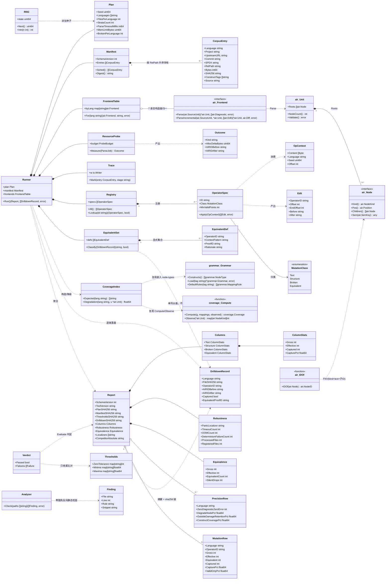
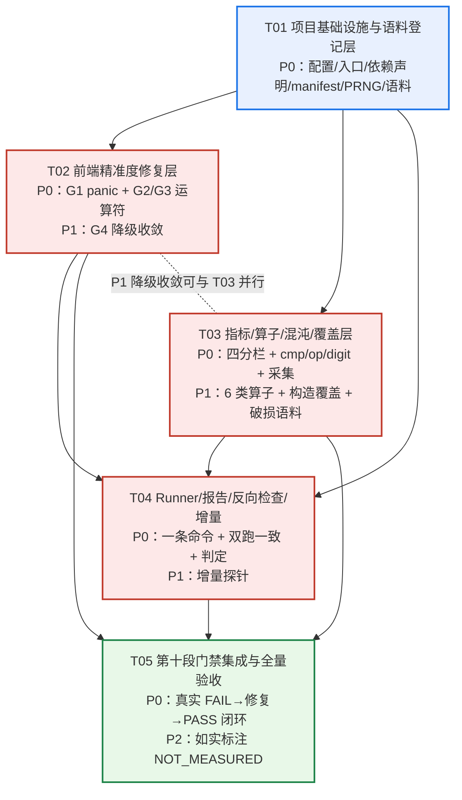

# Abate 端到端真实语料门禁 · 系统架构设计与任务分解

| 项 | 值 |
|---|---|
| 项目 | `abate`（`/workspace/abate`，本地推进，无 remote，**禁止推送**） |
| 工具链 | Go 1.26.11，`GOFLAGS=-mod=vendor`、`GOPROXY=off` |
| 文档角色 | 架构师 高见远（Gao）→ 主理人 → 工程师 寇豆码 |
| 产出性质 | **仅设计文档 + Mermaid 图**，不含实现代码 |
| 关联文件 | `docs/class-diagram.mermaid`、`docs/sequence-diagram.mermaid`（本文件内嵌同源图） |
| 上游输入 | PRD（许清楚）+ 主理人 Q1–Q5 裁决 + 主理人实地实测基线 |
| 设计基线 | 已对 `/workspace/abate` 实地侦察（门禁脚本、`lang/air`、`lang/frontkit/grammar`、`lang/gofront/sem.go` 等） |

---

## 0. 设计基线与实测对齐（先校正，再设计）

以下为**实地读码/读脚本得到的硬事实**，与任务书文字描述存在偏差，设计以实测为准。所有后续文件清单、API 签名、任务验收点均据此收敛。

| # | 任务书口径 | 实测事实 | 设计采用的更严口径 |
|---|---|---|---|
| 0-1 | 版权头「6 行块注释」 | `scripts/header-check.sh` 取前 8 行，grep `Copyright` / `xiaolibuluo/Abate` / `小黎的部落`；仓库现存头**恰为 6 行** | 每个新 `.go` 文件逐字复用现存 6 行头（见 §8.1），无例外 |
| 0-2 | `function-length ≤ 86` | `.golangci.yml` 实配 `function-length: [80, 0]` | **所有函数 ≤ 80 行** |
| 0-3 | `argument-limit ≤ 5~6` | `.golangci.yml` 未显式配置；revive `enable-all-rules: true` 下 `argument-limit` 走**默认 3** | **所有函数/方法参数 ≤ 3**（接收者不计），配置一律用 option struct |
| 0-4 | `style-check` 一类一文件 | 脚本只统计 `^type [A-Z]`（导出**类型**），导出函数不计 | 仍按更严设计：**每非测试文件 ≤1 导出类型 且 ≤1 导出函数组** |
| 0-5 | 新增源码禁 `time.Now` / `math/rand` / `os.Environ` | `scripts/m5-reference-scan.sh`：`PATTERN_TIME` 仅扫 `SCAN_DIRS`（默认 `lang/frontkit`）；`PATTERN_IMPORT` **全仓**扫 `.go` import 行；`PATTERN_CALL` 扫 `SCAN_DIRS` 内 `http.(Get\|Post\|Do\|NewRequest)\(`、`net.Dial` | 新 Go 源码**完全不做网络 I/O**（因此下载器必须是 shell，见 §1.2）；第十段用 `M5_SCAN_DIRS` 精确指向**只含新文件的目录**，并对少量被改既有文件做逐文件 grep（精确界定，非豁免） |
| 0-6 | `m5-reference-scan` ④ | 禁 `os/exec`、`import "C"`、七类蓝本包名（`tree-sitter`/`swc`/`clang`/`llvm`/`roslyn`/`codeanalysis`/`jetbrains`/`/syn`/`/quote` 等） | 新代码零 `os/exec`、零 cgo、零蓝本 import；`go.mod`/`vendor/modules.txt` **零变更** |
| 0-7 | AIR-ID = FNV(kind+text+子节点ID) | `lang/air/id.go` `ComputeNodeID(kind, attribute, children)`；`node.go` 中 `NewNodeAt(kind,pos,end,text,children...)` 的 **`text` 就是 attribute**；`air.Annotate(...)` 的 Sem **不进 NodeID**（注释原文：*Annotations do not change the NodeID*） | G2/G3 根因定位：`SemOperator` 标注**不构成辨识力**，必须把**真实 token 拼写**传进 `text`（见 §1.8） |
| 0-8 | 竞品口径「所有语法构造显式建模」 | `lang/air/kinds.go`：`NodeKind` 为冻结 wire 枚举，`kindLast = KindRegion`，`kindNames` 为 `[...]string` 下标表，`CategoryName()` 用区间判断 | 新增 AIR 构造**只在 `KindRegion` 之后追加显式数值**，同步扩 `kindNames`/`kindLast`/`CategoryName()`；**不重排既有值**（保 wire/版本兼容，`SchemaVersion` 保持 2） |
| 0-9 | 复用 `lang/frontkit/grammar/` 的 6 语言 node-types | `grammar/embed.go` `languages` 实为 **c / cs / js / kt / py / rs 共 6 个，缺 `go`**；`grammar.Load/DefaultRules/Map`、`frontkit/coverage.Compute/Observe` 均已可用 | 6 语言直接复用；**`go` 用 `ci/constructs_go.json` 自建清单并如实标注「需与 tree-sitter-go 实测对标」**，不伪造第 7 份数据 |
| 0-10 | 每语言新增 `*_fidelity_test.go` | `py/js/c/cs/rs/kt` **已有** `*_fidelity_test.go`；**仅 `gofront` 缺** | 6 个扩展、`gofront` 新建 1 个，不重复造文件 |
| 0-11 | 方言默认值 | `cfront` 支持 `c11`/`c++17`/`c++20`；`csfront` `cs8..cs12`；`ktfront` `kt1.6..kt2.1`；`jsfront` 空串走 `jsSpec` 默认 | 与任务书一致：`py/rs/go/js` 空串，`c=c11`、`cs=cs12`、`kt=kt2.1` |
| 0-12 | Go 前端构造器 | `NewGoFrontend() GoFrontend`（默认 `typeCheck=true`），其余 6 个 `New*Frontend() (air.Frontend, error)`；`GoFrontend.WithTypeCheck(bool)` 存在 | `FrontendTable` 归一；**runner 必须走默认 `typeCheck=true`**，任何 `WithTypeCheck(false)` 调用由反向静态检查判 FAIL（防绕过 G1） |
| 0-13 | `constant-lint` | 只抓 `0x100+` 十六进制与 `10000+` 十进制；跳过 `const `/`var ` 行、**跳过 `name = 字面量` 形态**、跳过含 `{`/`}` 的复合字面量数据表行、跳过含 `//`/`"` 的行 | 具名常量**必须写成 `name = 0x...`（不带显式类型）**；写成 `name uint64 = 0x...` 会被脚本判为魔法常量（见 §8.2） |
| 0-14 | 第三方语料目录 | `third_party/_sources/` 现存子目录名**不以 `_` 开头**（`gvisor/`、`llvm-project/` 等），靠父目录 `_sources` 被 Go 工具链忽略；`header-check`/`style-check` 显式排除 `./third_party/*` | **所有新增落地目录逐级以 `_` 开头**（`_sources/_validation/_<lang>/_<project-tag>/`），双保险；绝不放入普通目录 |
| 0-15 | 已入库语料许可证 | `_sources/README.md` 登记 `llvm-project` 为 **Apache-2.0 + LLVM exception**、`pit` 为反编译还原 | 与 Q2「避开边界争议」存在张力；见 §5 待明确事项第 2 条，**不替主理人拍板** |
| 0-16 | `recover` | 仓库现有 `*_chaos_test.go` 注释明确「不 panic 由 Go 测试框架保证，无需显式 recover」 | 新代码**零 `recover`**；panic 靠「进程级崩溃 + 确定性进度轨迹 + 报告写不完」反证（见 §1.7） |

> 补充实测：`revive` 还激活 `max-public-structs [10]`、`line-length-limit [300]`、`deep-exit`、`flag-parameter`、`unused-parameter`、`unexported-return`、`godot`、`exported`、`package-comments`。因此每个新包必须带 `doc.go`、每个导出符号必须有以名字开头且以句号结尾的注释、`os.Exit`/`log.Fatal` 只能出现在 `cmd/*/main.go`、每个包导出 struct ≤ 10 个（本设计每包 2–6 个）。`gosec G304` 由「`os.DirFS` 根 + `fs.ReadFile`」规避（见 §8.3）。

---

# Part A · 系统架构设计

## 1. 实现方案与框架选型

### 1.1 核心难点拆解

| 难点 | 本质 | 本设计的解法 |
|---|---|---|
| D1 **门禁自洽** | 新增 ~90 个 Go 文件，任一文件踩中 300 行 / 一类一文件 / 版权头 / 魔法常量 / flag-parameter / 深度 / 参数数即全盘 FAIL | 结构上**预先拆小**：所有文件预估 ≤195 行、每文件 ≤1 导出符号组、每包 ≤6 导出 struct；配置全部下沉 JSON，代码只做纯函数 |
| D2 **确定性** | 报告须「同 seed+manifest 两次逐字节一致」，而超时、内存、并发、map 迭代、墙钟、绝对路径都是非确定源 | 顺序执行；`SplitMix64` 自研固定 PRNG（种子 = sha256(seed‖manifestSha256‖label)）；超时用 `context.WithTimeout` + `ctx.Err()`；内存用 `runtime.MemStats` 增量；报告零墙钟/零绝对路径/零 map 输出；JSON 结构体字段定序 |
| D3 **零豁免与真实 panic 检测的矛盾** | 要证明 `panic=0` 又不能 `recover` 吞异常 | 不做捕获计数：panic 会让进程直接终止、报告写不完整 → 门禁由**退出码 + 报告完整性 + `Trace` 末行（文件 sha256 / 路径 / 阶段）**定位。报告里 `panicLocalizer` 只在「报告能写完」时为空字符串 |
| D4 **按来源排除语料的反向证明** | 不能靠口头声明「没有排除」 | `internal/e2e/neutrality` 用 `go/ast` 做**语法级不变量检查**：条件表达式中不得出现 `Source/Project/SPDX/...` 选择器、语料遍历循环内不得出现 `continue/break`、`processedFiles == registeredFiles` 进零容忍列；并由 `ci/e2e_sources.txt` 做**完备性反查**（不是白名单） |
| D5 **AIR 建模精度** | G2/G3 捕获率低，但禁止改哈希口径 / 追加注释 / 扩大变异幅度 | 唯一正解：把**真实 token 文本**写进 `NewNodeAt(..., text, ...)` 的 attribute（它进 `ComputeNodeID`），`SemOperator` 只作辅助标注；`ci/operator_kind_map.json` 登记「运算符→AIR Kind/text」映射 |
| D6 **G4 降级率** | `Region`+`ExprStmt` 兜底过多 | 追加显式 `NodeKind`（在 `KindRegion` 之后）+ 各前端 `*map.go` 新增 `match` 分支；**不放宽「降级」定义**，`Degradation` 由 `frontkit/coverage` 既有 `StatusDegraded` 口径计算 |
| D7 **语料规模与代表性** | js/rs/py 单扩展名文件数偏少，但禁止「凑数」 | 双轨合流 + 分层等距抽样；**只接受真实上游文件**，禁止复制/合成/重复填充；不足则如实报缺口并 FAIL，绝不伪造 ≥200 |
| D8 **阈值只收紧** | 不能出现放宽开关 | `ci/e2e_thresholds.json` 与 immutable `ci/e2e_thresholds_baseline.json` 单调比对：`minima` 只能 ≥、`maxima` 只能 ≤、零容忍键必须齐全且恒 0；无 env 开关、无 skip 字段 |

### 1.2 框架选型：零新增第三方依赖

| 能力 | 选型 | 理由（为何不引入新依赖） |
|---|---|---|
| 语料下载/解压 | **`scripts/corpus_fetch.sh`（shell + `curl` + `tar`），离线一次性工具** | `m5-reference-scan` ① 明确禁 `http.Get/Post/Do/NewRequest(`、`net.Dial`、`os/exec` 于新增 Go 源码，**Go 内写下载器必然 FAIL**；shell 不在 `.go` 扫描面内；且门禁**绝不触发下载**（网络非确定），只对既有只读树做校验 |
| 语料树读取 | `io/fs` + `os.DirFS` + `fs.WalkDir` + `fs.ReadFile`（stdlib） | 规避 `gosec G304`（`os.ReadFile(变量路径)`）；路径全部为相对 `fs.FS` 根，报告零绝对路径 |
| 校验和 | `crypto/sha256`（stdlib），流式 `io.Copy` | `constant-lint` 要求用 `sha256.Size` 等具名常量；与 `air.SourceFile.Digest()`、`determinism.HashState` 同口径 |
| 确定性 PRNG | **自研 `SplitMix64`**，落在 `internal/determinism/rng.go` | `internal/determinism` 现只有 `HashState` / `MustMatch100`，**无 PRNG**；`m5` ④ 禁 `math/rand`（连注释里的字面量都会 grep 命中），故完全不 import；算法为纯整数、无浮点、无全局状态 |
| 规范 JSON | `encoding/json`（stdlib），结构体字段定序 | `encoding/json` 对 map key 字典序排序，但报告仍**只在结构体/切片中输出**，不直接输出 map |
| 超时/资源 | `context.WithTimeout` + `runtime.ReadMemStats`（stdlib） | 源码零 `time.Now`/`time.Since`（`time.Second` 等 `Duration` 常量不受禁）；`ctx.Err()==context.DeadlineExceeded` 判超时，不读墙钟 |
| 构造覆盖 | **复用 `lang/frontkit/grammar`（`go:embed` 6 语言 node-types.json）+ `lang/frontkit/coverage`** | 已离线嵌入、已通过既有门禁；`grammar.Load/DefaultRules/Map`、`coverage.Compute/Observe` 直接可用，零新增模块 |
| 前端调用 | **复用 `air.Frontend` / `air.SourceUnit` / `air.NewSourceFile` / `air.IDOf` / `air.Walk` / `air.CheckIntervals`** | 不改 AIR 公共契约、不改哈希口径；7 个 `New*Frontend()` 由 `FrontendTable` 归一 |
| 增量探针 | `air.Frontend.ParseIncremental` + `air.ApplyEdits` + `air.Diff` | 既有 API，P1 直接复用 |
| 反向静态检查 | **`go/parser` + `go/ast` + `go/token`（stdlib）** | 语法级判定比 grep 精确；不引入 `golang.org/x/tools` |
| 报告渲染/归档 | `encoding/json` + `strings.Builder` + 排序切片 | 无模板引擎、无时间戳库 |
| 门禁 | `bash` + `go run` + `cmp` + `jq`（脚本层） | 既有九段不动，第十段 `ci/gate_e2e.sh` 追加；`go mod verify`、`m5`、九段由主理人既有脚本保证 |

> **`go.mod` / `go.sum` / `vendor/modules.txt` 一律零变更**：现有 `wazero`、`yaml.v3`、`x/sys` 与本次能力无关，新增任何 require 都会触发 `m5-reference-scan` ③ 的三方一致性复核与 `license-check` 回归，属不必要的依赖面扩张。

### 1.3 分层架构

```
┌─ 门禁层 ────────────────────────────────────────────────────────────┐
│ scripts/lint-gate.sh [0..8] 既有九段（不改）                        │
│ + [9] ci/gate_e2e.sh（第十段）← ci/e2e_thresholds{,_baseline}.json  │
└───────────────┬─────────────────────────────────────────────────────┘
                │ 调用
┌───────────────▼─────────────────────────────────────────────────────┐
│ 入口层 cmd/{corpusctl,e2e,neutralitycheck}/main.go                  │
│ 仅参数解析 + 调用 + os.Exit（deep-exit 仅此层允许）                 │
└───────────────┬─────────────────────────────────────────────────────┘
                │
┌───────────────▼─────────────────────────────────────────────────────┐
│ 运行层 internal/e2e：Plan / FrontendTable / Runner / ResourceProbe / │
│                      Trace / Outcome                                 │
│ 采集层 internal/e2e/{metrics,mutate,chaos,coverage,incremental,      │
│                      report,neutrality}                              │
│ 语料层 internal/corpus：Manifest / Register / Verify / Sample / SPDX │
│ 确定性 internal/determinism：RNG（SplitMix64）                      │
└───────────────┬─────────────────────────────────────────────────────┘
                │ 只调用既有接口
┌───────────────▼─────────────────────────────────────────────────────┐
│ 既有内核 lang/air + lang/frontkit/{grammar,coverage} + 7 前端        │
│ 只读语料 third_party/_sources/**（Go 工具链与门禁均不扫描）         │
└─────────────────────────────────────────────────────────────────────┘
```

依赖方向严格单向：门禁 → 入口 → 运行/采集/语料 → 既有内核；**下层不反向依赖上层**；`internal/e2e/*` 子包之间只经 `metrics.DrilldownRecord` 等数据契约交互，不互相 import 具体实现。

### 1.4 三类竞品口径落地 + 4 条指标澄清（强制写入采集器）

| 类别 | 竞品口径同构 | 本设计采集字段 | 落点 |
|---|---|---|---|
| 精准度 / 构造覆盖 | tree-sitter `node-types.json` named node 清单、错误恢复（不崩/不挂/线性）、`changed_ranges()`；go/parser、Roslyn「显式建模」 | `ConstructCoveragePct`、`DegradeNodePct`、`OutsideDamageRetentionPct`、`ZeroDiagnosticZeroError`、`TimeoutCount`、`AllocDeltaBytes`、`IncrementalResult` | `PrecisionRow` / `Robustness` / `incremental.Probe` |
| 变异测试 | PIT 状态分类 + `mutationThreshold`；Stryker `detected/valid×100`、CompileError 排除分母；cargo-mutants caught/missed/timeout/unviable；mutmut | `Captured`/`Missed`/`Timeout`/`Unviable` 四分类 + `air.IDOf(root)` 前后值；**gross 全进分母**，另给 Stryker 式 `validOnlyPct` 作**辅助观测** | `MutationRow` / `Equivalence` / `DrilldownRecord` |
| 混沌 / 鲁棒性 | libFuzzer `-max_len/-timeout/-rss_limit_mb/-runs/-merge=1`；OSS-Fuzz unique crash 去重 | `TimeoutCount`/`OOMCount`（独立列）、`Merge` 按输入 sha256 去重、崩溃靠进程退出码 + `Trace` 定位 | `Robustness` / `chaos.Merge` / `Trace` |

**4 条指标澄清（写进 `internal/e2e/metrics/columns.go` 与 `report.Markdown`，硬约束）**

1. **AIR-ID 是捕获主判据**。结构签名（Kind+Sem+Children，不含 text）低 ≠ 看不见变异；证据 `c` 结构 39.8% → AIR-ID 98.2%。报告**按 `文本变异 / 结构变异 / 破损变异 / 等价变异` 四分栏**，各自 `Gross/Effective/Captured/CapturePct`，**禁止合并成单一分数**；`Columns` 结构体四字段即该约束的类型级表达。
2. **注释被显式建模为 AIR 节点**（`air.KindComment` 已存在），追加注释 100% 改变 AIR-ID。`注释/空白/格式变更` **不得进入变异算子集**；等价变异由 `EquivalentDef{OperatorID, ContextPattern, ProofID, Rationale}` **显式集合**定义、逐条落盘 `ci/equivalent_mutations.json`、单列计数。
3. **零诊断零错误 ≠ 正确解析**。`PrecisionRow` 必须同时给出 `ZeroDiagnosticZeroError`（陷阱计数）、`DegradeNodePct`、`OutsideDamageRetentionPct`；三者不得互相替代。
4. **确定性 0 失败 ≠ 精准度达标**。`Evaluate` 把 `DeterminismFailureCount`（零容忍）与 `airID*CapturePct`（minima）、`Degrade*Pct`（maxima）**分开判定**，代码内不存在任何加权/抵消/合成总分函数。

> Q5 裁决落地：所有变异一律进 `Gross` 分母（主判据）；`Equivalent` 仅打标、**不删除、不豁免**；`Effective = Gross − EquivalentCount` 只作辅助观测；`SilentDrops` 恒 0 且进零容忍列。Stryker 的「CompileError 排除分母」在本项目**降级为辅助列** `ValidOnlyPct`，报告中显式注明「口径比 Stryker 更严，为 Q5 裁决结果」，不静默套用。

### 1.5 门槛表（当前 → 目标）

| 指标 | 当前实测 | 目标 | 判据类型 | 报告字段 |
|---|---|---|---|---|
| Go 前端 panic | **2**（`hasSideEffect` typed-nil） | **0** | 零容忍（进程级反证） | `Robustness.PanicLocalizer == ""` |
| 确定性失败 | 0 | 0 | 零容忍 | `DeterminismFailureCount` |
| `cmp ==→!=` AIR-ID 捕获率 | cs 5% / kt 20% / 其余 100% | **7 语言全 100%** | minima | `airIDCmpCapturePct` |
| `op +→-` AIR-ID 捕获率 | js 45% / kt 43% / cs 57% / rs 89% / 其余 100% | **7 语言全 100%** | minima | `airIDOpCapturePct` |
| `digit` AIR-ID 捕获率 | rs 94% / 其余 100% | **7 语言全 100%** | minima | `airIDDigitCapturePct` |
| 降级率 | cs 18.7% / kt 14.7% / rs 7.0% / py 4.0% / go 1.5% / c 1.3% / js 0.7% | cs ≤5% / kt ≤5% / rs ≤3% / py ≤3%（其余不劣化） | maxima | `DegradeNodePct` |
| 每语言可解析语料 | js 18（G5）等 | **≥200 / 语言** | minima | `ParseablePerLanguage` |
| 每算子有效变异点 | — | **≥30 / 算子 / 语言** | minima | `MutationRow.Gross`（有效点） |
| 破损语料 | — | **≥200 / 语言**〔P1〕 | minima | `BrokenPerLanguage` |
| 超时 / OOM 率 | — | **0 / 0** | 零容忍 | `TimeoutCount` / `OOMCount` |
| SPDX 合规 / sha256 重算 | — | **100% / 全量 0 不符** | 零容忍 | `SPDXViolations` / `SHA256Mismatches` |
| 下钻完备 / manifest 内嵌 | — | **100%** | minima | `DrilldownSHA256` / `ManifestSHA256` |
| 竞品绝对分数 | 未跑 | **「需实测对标」〔P2，如实标注，不宣称超过 X%〕** | — | 报告 `competitorAbsolute` 段落标 `NOT_MEASURED` |

### 降级率口径说明（诚实披露）

- **统计范围**：报告字段 `degrade*Pct` 由 `internal/e2e/runner_coverage.go:28-33,52-58` 的 `firstUnitPerLanguage` 计算，只覆盖每语言**第一个真实解析 unit（单文件）**；冻结阈值 cs ≤5% / kt ≤5% / rs ≤3% / py ≤3% 对应该单文件口径。
- **全语料同公式实测（历史测量）**：在语料全面自研化之前的早期第三方语料上，按与 `Degradation` 完全相同的公式（仅统计范围不同）测得 js **49.12%** / c **28.00%** / py **26.89%** / rs **42.33%** / kt **8.21%** / cs **6.98%** —— 六语全部超阈；go 为 **NOT_MEASURED**。该组数值记录于 QA 审计报告 `docs/i18n/QA-ANTI-FRAUD-AUDIT.md` 第 7 维度，**仅作历史审计证据，不代表当前语料状态**。
- **当前自研语料口径**：测试语料已 100% 替换为高保真自研语料（见 `docs/refactor/`）；自研语料上的全语料降级率尚未重测，为 **NOT_MEASURED**，禁止把上述历史数值当作当前自研语料的实测值。
- **结论限定**：单文件口径的达标数值真实，但**达标仅限冻结单文件口径**，不代表全语料/语料级降级率达标；禁止把单文件结论外推为全语料达标。
- 数值链路本身真实：drilldown 真重算、同 seed 双跑逐字节一致；这里的披露仅针对统计口径，不改变任何阈值、冻结件或门禁判定。

### 1.6 第十段门禁「真实 FAIL → 修复 → 真实 PASS」闭环

闭环必须**可观测、可复算、不可伪造**，设计为 7 个确定步骤：

| 步 | `ci/gate_e2e.sh` 动作 | 失败时的真实表现 | 归档物 |
|---|---|---|---|
| S1 | 计算 `manifestSha256`；`corpusctl verify` 全量重算 sha256 + SPDX | 打印不符条目的 `RelPath / 期望 sha256 / 实测 sha256 / SPDX` | `verify_result.json` |
| S2 | 加载 `thresholds` + `baseline`，做**只收紧**单调校验 | 打印被放宽的键与「当前值 / baseline 值 / 方向」 | `threshold_check.json` |
| S3 | `neutralitycheck` + `e2e_sources.txt` 完备性反查 | 打印 `文件:行:规则:片段`；任何「按来源排除」命中即停 | `neutrality.json` |
| S4 | `go run ./cmd/e2e` **跑两次**（同 seed + 同 manifest），`cmp` 两份 `e2e_report.json` 逐字节 | 打印首个差异的 `cmp` 偏移 | `run1/` + `run2/` |
| S5 | 若 panike：进程退出码非 0、`e2e_report.json` 不完整 → 读取 `e2e_trace.jsonl` **最后一行**给出 `文件 sha256 / RelPath / 阶段 / 算子` | 真实崩溃栈 + 定位行（**不 recover、不吞**） | `trace.tail` |
| S6 | `Recompute` 从 `e2e_drilldown.jsonl` 重算基线每个当前值，断言误差 0；`Evaluate` 生成 `Verdict` | 打印 `Localizers[]`：文件 sha256 + 算子 + `AIRIDBefore/After` + 规则 id | `verdict.json` |
| S7 | 归档 `report + manifest + thresholds + plan + exit_code` 到 `.artifacts/e2e/<manifestSha256 前 12 位>/`（**目录名确定，无时间戳**） | — | 全量归档，可离线 `cmp` 复算 |

- **红灯是真实红灯**：T01 落地后 `ci/gate_e2e.sh` 因 `cmd/e2e` / `internal/e2e` 尚未就绪、阈值项未达标而 `exit 1`；工程师按 S1–S6 的打印逐项精准重构（改 mapper、加显式构造、补语料），**不放宽阈值、不加 skip**；T05 全绿即 `exit 0`。
- **定位粒度**：每个零容忍非 0 项必须打印到「文件 sha256 + 算子 + AIR-ID 前后值」，而非只给一个总数。
- 既有 `scripts/lint-gate.sh` 仅在「门禁结论」块**之前**追加 `[9]` 段调用，上方九段逐字不动。

### 1.7 零豁免的实现学（禁止机制 → 反向检查）

| 禁止的机制 | 本设计中的对应反制（全部为**收紧**，非豁免） |
|---|---|
| `skip` / 白名单 | 无 `skip` 字段；`ci/e2e_sources.txt` 是**必须完备的源码清单**，门禁用 `find(新增根) \| sort` 与它 `cmp`，缺一个文件即 FAIL（是完备性约束，不是排除名单） |
| 按语料来源排除的分支 | `neutrality.Analyzer` 用 `go/ast` 断言：条件表达式中零 `Source/Project/Commit/SPDX/SPDXEvidence/ConstructTags` 选择器；语料遍历循环内零 `continue/break`；`processedFiles == registeredFiles` 进零容忍 |
| 阈值放宽开关 | 无 env 开关；`thresholds` 与 immutable baseline 单调比对，键缺失/方向回退即 FAIL |
| `recover` 吞 panic | 零 `recover`；panic 由进程退出码 + 报告完整性 + `Trace` 末行反证；`neutrality` 显式扫 `recover(` 内建调用 |
| 绕过 G1 路径 | `neutrality` 显式扫 `WithTypeCheck(false)`；`FrontendTable` 只用 `NewGoFrontend()` 默认 `typeCheck=true` |
| 虚增捕获率 | 禁止追加注释/改哈希/扩大变异幅度；`ci/operator_kind_map.json` 登记映射，`*_fidelity_test.go` 断言「同一源码仅改运算符→AIR-ID 必变」，且注释/空白/格式算子**不在 Registry 中** |
| 伪造语料数量 | 只接受真实上游文件；`Manifest` 记录 `RelPath + sha256`，`Verify` 全量重算；禁止复制/合成/重复填充；不足即 `ParseablePerLanguage` 未达 minima → FAIL |
| 伪造绿灯 | 报告内嵌 `manifestSha256`/`planSha256`/`thresholdsSha256`/`drilldownSha256` 四条链路；归档物可离线 `cmp` 复算 |

### 1.8 G1–G5 缺口 → 精准修复落点

| 缺口 | 根因（实测） | 修复结构（最小改动 + 不违门禁） |
|---|---|---|
| **G1** Go panic | `lang/gofront/sem.go:141-160` `hasSideEffect(body ast.Node)`：截断源码产生 `(*ast.BlockStmt)(nil)`，装入接口后 `body == nil` 对 **typed-nil 失效**，`ast.Inspect → go/ast.Walk` 解引用 `n.List` 崩溃。调用链 `Parse → annotateTypes → annotatePurity → hasSideEffect`。全仓第二处 `ast.Inspect` 在 `mapdecl_extra.go:151` | ① 新增 `lang/gofront/astnil.go`（1 个未导出函数组 `isNilASTNode`，用 `reflect.ValueOf(n).IsNil()` 对 ptr/slice/map/chan/func/interface 判空，**在源头判空**，AIR 语义不变：nil body 视为「无副作用」，与 `WithTypeCheck(false)` 的 633 节点/4 诊断路径一致）；② `annotatePurity` 在取 `fn.Body` 后先过 `isNilASTNode`；③ `mapdecl_extra.go` 同类守卫；④ 全局排查表（下表）逐个 `ast.Inspect/Walk` 调用点复核。**零 recover、零文件例外** |
| **G2** 比较运算符 | `== → !=` 只改了 `SemOperator` 标注或静态 `rule.text`，**未进 `NewNodeAt` 的 `text`**，而 `air.Annotate` 不参与 `ComputeNodeID` | `lang/frontkit/opbind.go` 提供单一 `BindOperator(kind, pos, end, tok, children...)`：把 `tok.Text` 作为 attribute 传入 `air.NewNodeAt`，同时 `air.Annotate(n, air.SemOperator, tok.Text)`。7 个 `*map.go` / `*expr*.go` 的二元/一元/赋值/自增节点统一改走该入口 |
| **G3** 算术/数字 | 同上（js `jsMapper.binary` 用 `rule.text` 而 `rule.operator` 只作 Sem；rs `digit` 文本未完整保留） | 同上；`digit` 类确保 `KindNumLit` 的 `text` 为**完整字面量原文**（不归一化、不截断）。`VerifyTokenFidelity` 已对 lexical node 做双向文本校验，改动天然兼容（`KindBinary/KindUnary` 不在 `isLexicalNode` 集合内） |
| **G4** 降级率 | `match` 分支覆盖不足 → 兜底 `KindRegion` + `KindExprStmt` | ① `lang/air/kinds.go` 在 `KindRegion` 之后**追加显式数值**的新 Kind（如 `KindPropertyDecl`/`KindWhenBranch`/`KindInterpolation`/`KindAttributeArg`…），同步扩 `kindNames`、`kindLast`、`CategoryName()` 区间；② `csfront/ktfront/rsfront/pyfront` 各新增一个 `*map_extra.go`（≤150 行）承载新 `match` 分支；③ `grammar.DefaultRules` 的对应语言规则表补 exact mapping（**不放宽 StatusDegraded 定义**） |
| **G5** JS 语料 | 仅 18 样本，AIR-ID 敏感度 80.7% | 双轨合流：`_sources` 入库 23 `.js` + `_validation` lodash 54 `.js` = 77；**仍不足 200** → 见 §1.9 与 §5 待明确第 1 条（补合规项目 or 如实报缺口 FAIL）。补齐后 `StratifiedSample` 分层等距抽样提升代表性 |

**G1 全局 typed-nil 排查表（工程师必须逐行复核，不设例外）**

| 调用点 | 现状 | 处理 |
|---|---|---|
| `lang/gofront/sem.go:146` `ast.Inspect(body, ...)` | 崩溃点 | `isNilASTNode` 源头判空 |
| `lang/gofront/mapdecl_extra.go:151` `ast.Inspect(value, ...)` | 同类风险 | 同上守卫 |
| `annotateTypes` / `annotateTypeFacts` 中的 `go/types` 结果遍历 | 非 `ast.Walk`，但 `expr`/`ident` 可能为 nil | 复核 `v.lookup(nil)` 行为并加显式判空 |
| `gofront/view.go` / `mapexpr.go` / `mapstmt.go` 的类型断言 | `decl.(*ast.FuncDecl)` 后取 `fn.Body` | 统一经 `isNilASTNode` |

### 1.9 语料双轨、≥200 可解析样本与「凑数 vs 代表性」边界

**双轨（Q1）**：`CorpusEntry.Source` 只有两个取值常量 `in_tree` / `validation`，**仅用于报告标注与分栏**，不参与任何控制流。

| 语言 | 已入库 `_sources`（主体） | 独立验证集 `_validation`（已下载实测） | 合流后 | 达到 ≥200 的路径 |
|---|---|---|---|---|
| go | 3284 `.go` | gin v1.9.1 / MIT / 92 `.go` | 3376 | 直接满足 |
| py | 260 `.py` | requests v2.31.0 / Apache-2.0 / 主仓 `.py` 少 | 260+ | **以已入库 260 为主体**（明确记载，不缩水） |
| js | 23 `.js` | lodash 4.17.21 / MIT / 54 `.js` | **77** | **不足**；需再补合规项目或如实 FAIL（§5-1） |
| c | 70 `.c` + 3179 `.h` | cJSON v1.7.16 / MIT / 76 `.c` + 23 `.h` | 3348 | `.c`+`.h` 合流（按扩展名登记，**不按内容预判丢弃**；C++ 头以 `c11` 解析出的诊断如实计数，不算排除） |
| cs | 1637 `.cs` | Newtonsoft.Json 13.0.3 / MIT / 933 `.cs` | 2570 | 直接满足 |
| rs | 136 `.rs` | serde v1.0.193 / `MIT OR Apache-2.0` / 163 `.rs` | 299 | 合流满足；可解析率须实测，不足则补项目 |
| kt | 5669 `.kt` | okhttp parent-4.12.0 / Apache-2.0 / 251 `.kt` | 5920 | 直接满足 |

**抽样**：`256B ~ 180KB` 分 `StrataCount` 层（等距字节边界），层内按 `sha256(RelPath)` 升序后用确定性等距步长 `k` 抽取；`rng` 仅用于**变异点/破损点**选择，不用于决定「抽哪个文件」，保证「相同 seed+manifest → 完全相同文件集」。Q4 裁决：第十段跑**固定 seed 最小可信集**（`FilesPerLanguage=200`）；nightly 全量留 P2，本轮**不引入 `sampleMode` 开关**（避免出现任何范围放宽旋钮）。

**凑数 vs 真实代表性的硬边界（零豁免）**

- ✅ 允许：合并两个**真实上游项目**的文件；`.c`+`.h` 按扩展名双轨登记；分层等距抽样保证大小分布代表性。
- ❌ 禁止：复制同一文件改路径、合成/拼接片段、重复填充、按「能否解析」预先筛掉文件、按 `source` 分支少跑文件。
- 边界判定：`Verify` 输出 `ParseablePerLanguage`，若某语言 < 200 → `minima` 未达 → **门禁真实 FAIL 并打印缺口数**，主理人据 §5-1 裁决补项目；**绝不把不足写成 200**。
- 「可解析」定义：调用 `Frontend.Parse` 返回 `err == nil` 且 `unit.Validate() == nil`；诊断/错误数如实记录，不作为排除条件。

### 1.10 参数对齐 libFuzzer 语义

| libFuzzer 参数 | 本设计对应 | 实现（无墙钟、无子进程） |
|---|---|---|
| `-max_len` | `Plan.MaxFileBytes = 180 * Kib` | 登记时记录 `Bytes`，抽样层边界硬约束；超限文件**仍登记、仍处理**，只是不进最小可信集（分层规则，非排除） |
| `-timeout` | `Plan.ParseTimeoutMillis`（具名常量派生 `time.Duration`） | `context.WithTimeout(ctx, d)`；`ctx.Err()==context.DeadlineExceeded` → `Outcome.Kind="Timeout"`，**独立计数**；源码零 `time.Now`/`time.Since` |
| `-rss_limit_mb` | `Plan.MemLimitBytes = 256 * Mib` | `runtime.ReadMemStats` 的 `TotalAlloc` **增量** `AllocDeltaBytes`；超预算 → `Outcome.Kind="MemExceeded"`，**独立计数**。诚实标注：这是平台无关的分配量代理，非真实 RSS；报告字段命名 `AllocDeltaBytes`，P2 标「与 libFuzzer RSS 口径需实测对标」（§5-5） |
| `-runs` | `Plan.MaxRuns` | 总 parse 次数预算；超限为契约错误（非跳过） |
| `-merge=1` | `chaos.Merge` | 破损/崩溃输入按 `sha256(输入字节 ‖ 算子 ‖ 偏移 ‖ toolVersion)` 去重，合并进确定性语料集 |
| `-artifact_prefix` | `Plan.ReportDir = .artifacts/e2e` | 归档目录名取 `manifestSha256` 前 12 位（无时间戳） |
| `-print_final_stats` | `e2e_report.json` + `e2e_report.md` | 四分栏 + 下钻 + 定位 |
| unique crash 去重（OSS-Fuzz） | 输入级去重 + 进程级崩溃定位 | **不引入 recover**；栈签名去重见 §5-4 |

---

## 2. 完整文件列表（相对 `/workspace/abate`）

> 列说明：**行数**为设计预估上限（全部 ≤195 行，硬红线 300）；**导出数** = 该非测试 `.go` 文件的导出类型/函数组数量（目标 ≤1）；`0` = 仅未导出辅助或 `package main`。数据文件（`.json`/`.sh`/`.txt`/`.md`）不受 header/style 门禁扫描（脚本只 `find -name '*.go'` 且排除 `./third_party/*`）。每个新 Go 包均带 `doc.go`（`revive package-comments`）。

### 2.1 语料层（只读落地 + manifest + 登记工具）

| 路径 | 类型 | 行数 | 导出数 | 说明 |
|---|---|---:|---:|---|
| `third_party/_sources/_validation/_go/_gin_v1_9_1/` | 目录 | — | — | 只读；**各级目录名以下划线开头** |
| `third_party/_sources/_validation/_py/_requests_v2_31_0/` | 目录 | — | — | 同上 |
| `third_party/_sources/_validation/_js/_lodash_4_17_21/` | 目录 | — | — | 同上 |
| `third_party/_sources/_validation/_c/_cjson_v1_7_16/` | 目录 | — | — | 同上 |
| `third_party/_sources/_validation/_cs/_newtonsoft_13_0_3/` | 目录 | — | — | 同上 |
| `third_party/_sources/_validation/_rs/_serde_v1_0_193/` | 目录 | — | — | 同上；双许可文件齐全 |
| `third_party/_sources/_validation/_kt/_okhttp_4_12_0/` | 目录 | — | — | 同上 |
| `third_party/_sources/README.md` | 编辑 | +30 | — | 追加 7 项目落地登记（上游 URL / tag / SPDX / sha256 / 文件数） |
| `third_party/LICENSE-MANIFEST.md` | 编辑 | +12 | — | 追加 SPDX 溯源；`license-check.sh` 已容忍自身 AGPL 字样（仅 WARN） |
| `ci/corpus_manifest.json` | 生成 | 数据 | — | 全量登记，`Entries` 按 `RelPath` 升序；无时间戳/绝对路径 |
| `ci/corpus_manifest.sha256` | 生成 | 1 | — | manifest 摘要，报告内嵌比对 |
| `ci/e2e_sources.txt` | 数据 | ~90 | — | **新增源码完备清单**（反向检查的锚，非白名单） |
| `scripts/corpus_fetch.sh` | shell | 140 | — | 7 个 pinned `URL + tag + sha256` 幂等重取；**门禁不调用、不联网**；逐包重算 tarball sha256，不符 `exit 1` |
| `internal/determinism/rng.go` | 新增 | 95 | 1 | `RNG`（SplitMix64，纯整数、零全局状态） |
| `internal/determinism/rng_select.go` | 新增 | 130 | 1 | `Stride`（确定性等距步长，泛型有序序列辅助，不依赖 corpus/e2e 包） |
| `internal/determinism/rng_test.go` | 测试 | 95 | — | 同 seed 双跑 + 已知向量断言 |
| `internal/corpus/doc.go` | 新增 | 14 | 0 | 包注释 |
| `internal/corpus/consts.go` | 新增 | 60 | 0 | `Kib`/`Mib`/`minFileBytes`/`maxFileBytes`/`strataCount`/`defaultSeed` 等具名常量 |
| `internal/corpus/source.go` | 新增 | 70 | 1 | `type Source string` + `SourceInTree`/`SourceValidation` |
| `internal/corpus/entry.go` | 新增 | 105 | 1 | `CorpusEntry` |
| `internal/corpus/manifest.go` | 新增 | 150 | 1 | `Manifest` + `Load`/`Digest`/`Sorted` |
| `internal/corpus/register.go` | 新增 | 185 | 1 | `Register(fsys, projects)`：`fs.WalkDir` 升序、逐文件 sha256 |
| `internal/corpus/verify.go` | 新增 | 165 | 1 | `Verify`：全量重算 sha256 + `VerifyResult` 收敛（拆出 `verifyresult.go` 见下） |
| `internal/corpus/verifyresult.go` | 新增 | 75 | 1 | `VerifyResult` |
| `internal/corpus/spdx.go` | 新增 | 120 | 1 | `ClassifySPDX`：allowlist / boundary / GPL / UNKNOWN |
| `internal/corpus/sample.go` | 新增 | 150 | 1 | `Sample(m, p, rng)` 分层等距（调用 `determinism.Stride`） |
| `internal/corpus/manifest_test.go` | 测试 | 120 | — | 登记/重算/确定性断言 |
| `cmd/corpusctl/main.go` | 新增 | 110 | 0 | `register` / `verify` 两个子命令；`os.Exit` 仅此层 |

### 2.2 工具层（运行 / 采集 / 变异 / 混沌 / 覆盖 / 报告 / 反向检查）

| 路径 | 行数 | 导出数 | 说明 |
|---|---:|---:|---|
| `internal/e2e/doc.go` | 14 | 0 | 包注释 |
| `internal/e2e/consts.go` | 70 | 0 | libFuzzer 对齐具名常量、方言表、语言表（复合字面量数据表，constant-lint 结构性跳过） |
| `internal/e2e/plan.go` | 135 | 1 | `Plan` + `LoadPlan` |
| `internal/e2e/frontends.go` | 110 | 1 | `FrontendTable`；归一 7 个构造器，Go 用默认 `typeCheck=true` |
| `internal/e2e/outcome.go` | 95 | 1 | `Outcome` + `ProbeBudget` |
| `internal/e2e/probe.go` | 140 | 1 | `ResourceProbe`：`context.WithTimeout` + `runtime.ReadMemStats` |
| `internal/e2e/trace.go` | 85 | 1 | `Trace`：每次 parse 前写确定性进度行（**零 recover**） |
| `internal/e2e/runner.go` | 185 | 1 | `Runner` + `Run()` 编排骨架 |
| `internal/e2e/runner_parse.go` | 150 | 1 | 单文件 Parse + `IDOf` + `CheckIntervals` 流程 |
| `internal/e2e/runner_mutate.go` | 160 | 1 | 变异闭环（`Registry` → 内存替换 → 重解析 → 下钻） |
| `internal/e2e/runner_chaos.go` | 140 | 1 | 破损语料闭环 + 区外结构保持率 |
| `internal/e2e/runner_coverage.go` | 130 | 1 | 构造覆盖 / 降级率闭环 |
| `internal/e2e/e2e_endtoend_test.go` | 155 | — | 端到端：双跑一致、四分栏、下钻链、零容忍 |
| `cmd/e2e/main.go` | 95 | 0 | CLI：`-plan -manifest -out`；`os.Exit` 仅此层 |
| `internal/e2e/metrics/doc.go` | 14 | 0 | 包注释 |
| `internal/e2e/metrics/columns.go` | 85 | 1 | `Columns` + `ColumnStats`（**四字段，类型级禁止合并**） |
| `internal/e2e/metrics/precision.go` | 155 | 1 | `PrecisionRow` |
| `internal/e2e/metrics/mutation.go` | 175 | 1 | `MutationRow`（四分类 + gross/effective + validOnly 辅助列） |
| `internal/e2e/metrics/robustness.go` | 120 | 1 | `Robustness`（timeout/OOM/determinism 独立列 + panic 定位） |
| `internal/e2e/metrics/drilldown.go` | 105 | 1 | `DrilldownRecord` |
| `internal/e2e/metrics/aggregate.go` | 170 | 1 | `Aggregate`：四分栏聚合，纯函数 |
| `internal/e2e/mutate/doc.go` | 14 | 0 | 包注释 |
| `internal/e2e/mutate/class.go` | 75 | 1 | `MutationClass` 枚举（Text/Structure/Broken/Equivalent） |
| `internal/e2e/mutate/context.go` | 80 | 1 | `OpContext` |
| `internal/e2e/mutate/edit.go` | 85 | 1 | `Edit` |
| `internal/e2e/mutate/spec.go` | 95 | 1 | `OperatorSpec` |
| `internal/e2e/mutate/registry.go` | 115 | 1 | `Registry` |
| `internal/e2e/mutate/equivalent.go` | 135 | 1 | `EquivalentSet` + `EquivalentDef`（拆 `equivalentdef.go` 见下） |
| `internal/e2e/mutate/equivalentdef.go` | 65 | 1 | `EquivalentDef` |
| `internal/e2e/mutate/apply.go` | 120 | 1 | `Apply(edits, content)` 内存替换，绝不写回只读树 |
| `internal/e2e/mutate/ops_cmp.go` | 145 | 1 | `RegisterComparison`（**P0** `==/!=/</>` 族） |
| `internal/e2e/mutate/ops_op.go` | 150 | 1 | `RegisterArithmetic`（**P0** `+ - * / %` 族） |
| `internal/e2e/mutate/ops_digit.go` | 135 | 1 | `RegisterDigit`（**P0** 数字字面量） |
| `internal/e2e/mutate/ops_cond.go` | 130 | 1 | `RegisterCondition`〔P1〕条件取反 |
| `internal/e2e/mutate/ops_literal.go` | 125 | 1 | `RegisterLiteral`〔P1〕字面量替换 |
| `internal/e2e/mutate/ops_return.go` | 120 | 1 | `RegisterReturn`〔P1〕返回值替换 |
| `internal/e2e/mutate/ops_block.go` | 125 | 1 | `RegisterBlock`〔P1〕语句块删除 |
| `internal/e2e/mutate/ops_call.go` | 120 | 1 | `RegisterCall`〔P1〕调用删除 |
| `internal/e2e/mutate/registry_test.go` | 110 | — | 算子数、每算子 ≥30 有效点、无注释/空白/格式算子 |
| `internal/e2e/chaos/doc.go` | 14 | 0 | 包注释 |
| `internal/e2e/chaos/damage.go` | 80 | 1 | `DamageKind` |
| `internal/e2e/chaos/generator.go` | 155 | 1 | `Generator` |
| `internal/e2e/chaos/truncate.go` | 110 | 1 | `TruncateHalf`（**G1 两个最小复现的语料来源**） |
| `internal/e2e/chaos/splice.go` | 110 | 1 | 字节 splice / token drop |
| `internal/e2e/chaos/merge.go` | 120 | 1 | `Merge`（`-merge=1` 输入去重） |
| `internal/e2e/coverage/doc.go` | 14 | 0 | 包注释 |
| `internal/e2e/coverage/index.go` | 150 | 1 | `CoverageIndex`（复用 `grammar.Load` + `coverage.Compute/Observe`） |
| `internal/e2e/coverage/go_inventory.go` | 105 | 1 | `LoadGoInventory`（自建清单，标 `NOT_MEASURED`） |
| `internal/e2e/coverage/degrade.go` | 125 | 1 | `Degradation`（沿用 `StatusDegraded` 口径，不放宽定义） |
| `internal/e2e/incremental/doc.go` | 14 | 0 | 〔P1〕包注释 |
| `internal/e2e/incremental/probe.go` | 155 | 1 | 〔P1〕`Probe`：`ParseIncremental` 编辑区一致性 |
| `internal/e2e/report/doc.go` | 14 | 0 | 包注释 |
| `internal/e2e/report/report.go` | 120 | 1 | `Report`（结构体字段定序，零墙钟/零绝对路径） |
| `internal/e2e/report/writer.go` | 145 | 1 | `Write`：json + jsonl + md；四条 sha256 链 |
| `internal/e2e/report/render.go` | 135 | 1 | `Markdown`：四分栏 + 门槛表 + `NOT_MEASURED` 标注 |
| `internal/e2e/report/checksum.go` | 80 | 1 | `DigestFile` / `DigestBytes` |
| `internal/e2e/report/evaluate.go` | 165 | 1 | `Verdict` + `Evaluate`（只收紧 + 零容忍，禁止抵消） |
| `internal/e2e/report/recompute.go` | 140 | 1 | `Recompute`：从下钻记录重算基线每个当前值，误差 0 |
| `internal/e2e/neutrality/doc.go` | 14 | 0 | 包注释 |
| `internal/e2e/neutrality/finding.go` | 70 | 1 | `Finding` |
| `internal/e2e/neutrality/analyzer.go` | 195 | 1 | `Analyzer`：`go/ast` 语法级不变量 |
| `internal/e2e/neutrality/analyzer_test.go` | 120 | — | 正例/反例夹具（含「按 source 排除」反例必须被抓） |
| `cmd/neutralitycheck/main.go` | 85 | 0 | CLI；`os.Exit` 仅此层 |

### 2.3 修复层（G1–G4 落点）

| 路径 | 类型 | 行数 | 导出数 | 说明 |
|---|---|---:|---:|---|
| `lang/gofront/sem.go` | 编辑 | +18 | 0 | `annotatePurity` 取 `fn.Body` 后经 `isNilASTNode`；`hasSideEffect` 入口二次守卫 |
| `lang/gofront/astnil.go` | 新增 | 65 | 0 | `isNilASTNode(ast.Node)`：reflect 判 typed-nil（未导出，0 导出） |
| `lang/gofront/mapdecl_extra.go` | 编辑 | +12 | 0 | 第二处 `ast.Inspect` 同类守卫 |
| `lang/frontkit/opbind.go` | 新增 | 75 | 1 | `BindOperator(kind,pos,end,tok,children...)`：真实 token 文本进 attribute + `SemOperator` 标注 |
| `lang/air/kinds.go` | 编辑 | +24 | 0 | `KindRegion` 之后追加显式 Kind 数值；扩 `kindNames`/`kindLast`/`CategoryName()`；**不重排既有值** |
| `lang/gofront/mapexpr.go` | 编辑 | +20 | 0 | 二元/一元/赋值节点改走 `opbind.BindOperator` |
| `lang/pyfront/pymap.go` | 编辑 | +20 | 0 | 同上 |
| `lang/jsfront/jsmap_node.go` | 编辑 | +25 | 0 | `jsMapper.binary/unary/wrap` 改用真实 `tok.Text` |
| `lang/cfront/cmap.go` | 编辑 | +20 | 0 | 同上 |
| `lang/csfront/csmap.go` | 编辑 | +25 | 0 | 同上 |
| `lang/rsfront/rsmap.go` | 编辑 | +20 | 0 | 同上 + `digit` 完整字面量文本 |
| `lang/ktfront/ktmap.go` | 编辑 | +25 | 0 | 同上 |
| `lang/csfront/csmap_extra.go` | 新增 | 150 | 0 | 〔P1〕新增显式构造 `match` 分支（降 cs 18.7%→≤5%） |
| `lang/ktfront/ktmap_extra.go` | 新增 | 145 | 0 | 〔P1〕同上（kt 14.7%→≤5%） |
| `lang/rsfront/rsmap_extra.go` | 新增 | 120 | 0 | 〔P1〕同上（rs 7%→≤3%） |
| `lang/pyfront/pymap_extra.go` | 新增 | 105 | 0 | 〔P1〕同上（py 4%→≤3%） |
| `lang/frontkit/grammar/rules_csharp.go` / `rules_kotlin.go` / `rules_rust.go` / `rules_python.go` | 编辑 | +8 each | 0 | 〔P1〕补 exact mapping（不放宽 `StatusDegraded`） |
| `ci/operator_kind_map.json` | 数据 | — | — | 「运算符 → AIR Kind / text / 前端文件」映射登记（**P0-5 交付物**） |

### 2.4 测试层

| 路径 | 行数 | 说明 |
|---|---:|---|
| `lang/gofront/gofront_panic_regression_test.go` | 120 | **2 个最小复现**（`replica.go` / `stats_test.go` 截断体），接入 `go test -race`；断言 `Parse` 返回而非 panic |
| `lang/gofront/gofront_fidelity_test.go` | 130 | 新建；运算符文本 → AIR-ID 必变 |
| `lang/{py,js,c,cs,rs,kt}front/*_fidelity_test.go` | 6×+60 | 扩展既有文件；新增 `cmp/op/digit` 保真用例（**不新建同名文件**） |
| `internal/determinism/rng_test.go` / `internal/corpus/manifest_test.go` / `internal/e2e/mutate/registry_test.go` / `internal/e2e/neutrality/analyzer_test.go` / `internal/e2e/e2e_endtoend_test.go` | 见上 | 单测 + 端到端 |

### 2.5 门禁层与文档

| 路径 | 类型 | 行数 | 说明 |
|---|---|---:|---|
| `ci/e2e_plan.json` | 数据 | 55 | 固定 seed、7 语言、`FilesPerLanguage=200`、分层边界、libFuzzer 对齐预算、报告目录、baseline sha256 |
| `ci/e2e_thresholds.json` | 数据 | 65 | 外置阈值；`tightenOnly: true`；零容忍键齐全恒 0 |
| `ci/e2e_thresholds_baseline.json` | 数据 | 65 | immutable 单调基线（只收紧比对的锚） |
| `ci/operator_kind_map.json` | 数据 | — | 运算符映射登记 |
| `ci/constructs_go.json` | 数据 | — | `go` 自建构造清单，标注 `NOT_MEASURED` |
| `ci/equivalent_mutations.json` | 数据 | — | 等价变异显式集合（算子+上下文+等价性论证） |
| `ci/e2e_sources.txt` | 数据 | ~90 | 新增源码完备清单 |
| `ci/e2e_new_roots.txt` | 数据 | ~10 | 新增源码根目录清单（完备性反查的 `find` 输入，**非排除名单**） |
| `ci/gate_e2e.sh` | shell | 195 | **第十段**：S1–S7 七步闭环、真实定位打印、归档、退出码 |
| `scripts/lint-gate.sh` | 编辑 | +12 | **仅**在「门禁结论」前追加 `[9]` 段；上方 0–8 九段逐字不动 |
| `docs/system_design.md` | 文档 | 本文件 | 系统架构 + 任务分解 |
| `docs/class-diagram.mermaid` | 图 | — | 完整类图（权威版） |
| `docs/sequence-diagram.mermaid` | 图 | — | 完整时序图（权威版） |

### 2.6 「>250 行预先拆分」台账

本设计**没有任何预估 >250 行的文件**；以下为「若按常规单体写法会超 250 行」的逻辑单元及其预拆分结果，工程师按此粒度落地，不得合并回去：

| 逻辑单体（常规写法预估） | 预拆分结果（单文件上限） |
|---|---|
| Runner 一体 ~760 行 | `runner.go` 185 + `runner_parse.go` 150 + `runner_mutate.go` 160 + `runner_chaos.go` 140 + `runner_coverage.go` 130 |
| 指标采集一体 ~610 行 | `columns.go` 85 + `precision.go` 155 + `mutation.go` 175 + `robustness.go` 120 + `drilldown.go` 105 + `aggregate.go` 170 |
| 变异算子一体 ~1000 行 | `class/context/edit/spec/registry/equivalent/equivalentdef/apply` 8 文件 + `ops_*.go` 8 文件（各 ≤150） |
| 语料登记一体 ~620 行 | `consts/source/entry/manifest/register/verify/verifyresult/spdx/sample` 9 文件（各 ≤185） |
| 报告一体 ~480 行 | `report/writer/render/checksum/evaluate/recompute` 6 文件（各 ≤165） |
| 门禁脚本一体 ~335 行 | `ci/gate_e2e.sh` 195 + `scripts/corpus_fetch.sh` 140 + `lint-gate.sh` +12 |
| 反向静态检查一体 ~290 行 | `finding.go` 70 + `analyzer.go` 195 + `cmd/neutralitycheck/main.go` 85 |

### 2.7 新文件「天然合规」自检清单（逐条对应红线）

| 红线 | 结构性保证 |
|---|---|
| ≤300 行 | 所有预估 ≤195；§2.6 拆分台账硬性约束 |
| 一类一文件 | 每非测试文件 ≤1 导出类型/函数组；`*_extra.go` 全未导出（0） |
| 6 行版权头 | 模板统一（§8.1），`doc.go` 亦不例外 |
| gofmt / go vet | 纯顺序代码、无 cgo、无不安全转换 |
| cyclomatic ≤25 / cognitive ≤40 / function ≤80 | 编排函数只做分发；每个 `ops_*.go` 单职责；循环内提取小函数 |
| argument-limit ≤3 / 无 flag-parameter / 无 unused-parameter | 全部配置走 struct（`Plan`/`OpContext`/`ProbeBudget`）；无 bool 控制参数；无空占位参数 |
| constant-lint | 所有 ≥0x100 / ≥10000 字面量写进 `consts.go` 的 `name = 0x...` 形态；数据表为复合字面量（结构性跳过） |
| m5 ④ / ① | 零 `time.Now`/`time.Since`/`math/rand`/`os.Environ`/`os/exec`/`net.Dial`/`http.*(`；Go 侧零网络；零蓝本 import |
| license-check | `go.mod`/`vendor` 零变更；语料 SPDX 限 Q2 三类（边界项见 §5-2） |
| 语料目录 | `third_party/_sources/_validation/_*/_*`，逐级 `_` 前缀 |

---

## 3. 数据结构与接口

### 3.1 Go 类型签名（伪代码，全部 ≤3 参数）

```go
// ---------- internal/corpus ----------
type Source string
const (
    SourceInTree   Source = "in_tree"    // Q1 主体只读树
    SourceValidation Source = "validation" // Q1 独立验证集
)

type CorpusEntry struct {
    Language, Project, UpstreamURL, Commit string
    SPDX, SPDXEvidence, RelPath          string
    Bytes                                int64
    SHA256                               string
    ConstructTags                        []string
    Source                               Source // 仅报告标注；禁止进入条件表达式
}

type Manifest struct {
    SchemaVersion int
    Entries       []CorpusEntry // 按 RelPath 升序
}
func Load(path string) (Manifest, error)
func (m Manifest) Sorted() []CorpusEntry
func (m Manifest) Digest() string

type ProjectRef struct { Language, RelDir, UpstreamURL, Commit, SPDX, LicenseRelPath string }
func Register(fsys fs.FS, projects []ProjectRef) (Manifest, error)

type VerifyResult struct {
    Registered, Recomputed, SHA256Mismatches, SPDXViolations int
    ParseablePerLanguage map[string]int
    BoundarySPDXCount    int
}
func Verify(fsys fs.FS, m Manifest) (VerifyResult, error)
func ClassifySPDX(expr string) string // "allowlisted" | "boundary" | "GPL" | "UNKNOWN"
func Sample(m Manifest, p Plan, rng *determinism.RNG) []CorpusEntry

// ---------- internal/determinism ----------
type RNG struct{ state uint64 }
func NewRNG(seed uint64, manifestSHA256, label string) RNG // sha256 派生，纯整数
func (r *RNG) Next() uint64
func (r *RNG) Intn(n int) int
func Stride(total, want int) []int // 确定性等距步长，不依赖 corpus/e2e 包

// ---------- internal/e2e ----------
type Plan struct {
    Seed uint64
    Languages []string
    FilesPerLanguage, StrataCount, MaxRuns, BrokenPerLanguage int
    MinFileBytes, MaxFileBytes, ParseTimeoutMillis int64
    MemLimitBytes uint64
    Operators []string
    ReportDir, ThresholdsBaselineSHA256 string
}
func LoadPlan(path string) (Plan, error)

type FrontendTable struct {
    byLang  map[string]air.Frontend
    dialect map[string]string
}
func NewFrontendTable() (FrontendTable, error)
func (t FrontendTable) For(lang string) (air.Frontend, string, error)
func (t FrontendTable) Languages() []string

type Outcome struct {
    Kind string // "OK" | "Timeout" | "MemExceeded" | "ContractError"
    AllocDeltaBytes uint64
    Diagnostics, Errors int
    AIRIDBefore, AIRIDAfter string
}
type ProbeBudget struct { TimeoutMillis int64; MemLimitBytes uint64 }
type ResourceProbe struct{ budget ProbeBudget }
func (p ResourceProbe) Measure(job ParseJob) Outcome

type Trace struct{ w io.Writer }
func (t Trace) Mark(entry CorpusEntry, stage string) // 崩溃定位末行；零 recover

type Runner struct {
    plan Plan; manifest Manifest; frontends FrontendTable
    registry mutate.Registry; equivalents mutate.EquivalentSet
    probe ResourceProbe; trace Trace
}
func NewRunner(p Plan, m Manifest) (*Runner, error)
func (r *Runner) Run() (report.Report, []metrics.DrilldownRecord, error)

// ---------- internal/e2e/mutate ----------
type MutationClass string
const (
    ClassText MutationClass = "text"
    ClassStructure MutationClass = "structure"
    ClassBroken MutationClass = "broken"
    ClassEquivalent MutationClass = "equivalent"
)
type OpContext struct { Content []byte; Language string; Seed uint64; Offset int }
type Edit struct { OperatorID string; Offset, EndOffset int; Before, After string }
type OperatorSpec struct {
    ID string
    Class MutationClass
    MinValidPoints int
    Apply func(OpContext) ([]Edit, error) // 1 参数，非 flag-parameter
}
type Registry struct{ specs []OperatorSpec }
func (g Registry) All() []OperatorSpec
func (g Registry) Lookup(id string) (OperatorSpec, bool)

type EquivalentDef struct { OperatorID, ContextPattern, ProofID, Rationale string }
type EquivalentSet struct{ defs []EquivalentDef }
func (s EquivalentSet) Classify(rec metrics.DrilldownRecord) (string, bool)
func Apply(edits []Edit, content []byte) ([]byte, error) // 内存替换，不写只读树

// ---------- internal/e2e/metrics ----------
type ColumnStats struct { Gross, Effective, Captured int; CapturePct float64 }
type Columns struct { Text, Structure, Broken, Equivalent ColumnStats } // 四分栏，禁止合并
type PrecisionRow struct {
    Language string
    ZeroDiagnosticZeroError, Diagnostics int
    DegradeNodePct, OutsideDamageRetentionPct, ConstructCoveragePct float64
}
type MutationRow struct {
    Language, OperatorID, Class string
    Gross, Effective, Equivalent, Captured, Missed, Timeout, Unviable int
    CapturePct, ValidOnlyPct float64
}
type Robustness struct {
    PanicLocalizer string // "" 表示报告写完整（无 panic）
    TimeoutCount, OOMCount, DeterminismFailureCount int
    ProcessedFiles, RegisteredFiles int
}
type Equivalence struct { Gross, Effective, EquivalentCount, SilentDrops int }
type DrilldownRecord struct {
    Language, FileSHA256, RelPath, OperatorID, Class string
    Offset, EndOffset int
    BeforeText, AfterText string
    AIRIDBefore, AIRIDAfter string
    Captured bool
    EquivalentProofID, OutcomeKind string
    AllocDeltaBytes uint64
}
func Aggregate(recs []DrilldownRecord) (Columns, []MutationRow, Robustness, Equivalence)

// ---------- internal/e2e/report ----------
type Report struct {
    SchemaVersion int
    ToolVersion string // 固定常量，非运行期版本
    PlanSHA256, ManifestSHA256, ThresholdsSHA256, DrilldownSHA256 string
    Seed uint64
    Languages []string
    Columns metrics.Columns
    Precision []metrics.PrecisionRow
    Mutation []metrics.MutationRow
    Robustness metrics.Robustness
    Equivalence metrics.Equivalence
    Localizers []string
    CompetitorAbsolute string // "NOT_MEASURED"（P2 如实标注）
}
type Failure struct { Key, Rule, Localizer string; Actual, Expected float64 }
type Verdict struct { Passed bool; Failures []Failure }
func Write(r Report, recs []DrilldownRecord, dir string) error
func Markdown(r Report) string
func Recompute(r Report, recs []DrilldownRecord) (Report, error) // 误差 0 断言
func Evaluate(t, baseline Thresholds, r Report) Verdict

type Thresholds struct {
    SchemaVersion int
    ZeroTolerance map[string]int
    Minima, Maxima map[string]float64
}

// ---------- internal/e2e/neutrality ----------
type Finding struct { File string; Line int; Rule, Snippet string }
type Analyzer struct{}
func (a Analyzer) Check(paths []string) ([]Finding, error)

// ---------- internal/e2e/coverage / incremental ----------
type CoverageIndex struct{ /* grammars + go inventory */ }
func NewCoverageIndex(goInventoryPath string) (CoverageIndex, error)
func (c CoverageIndex) Expected(lang string) []string
func (c CoverageIndex) Degradation(lang string, u *air.Unit) float64
func Degradation(mappings []grammar.Mapping, observed map[air.NodeKind]int) float64
type IncrementalResult struct { ChangedRanges int; Consistent bool }
func Check(u *air.Unit, edits []air.Edit) (IncrementalResult, error) // P1

// ---------- lang/frontkit/opbind.go（新增，唯一共享入口）----------
func BindOperator(kind air.NodeKind, pos, end air.Position, tok Token,
    children ...air.Node) air.Node
// 内部：air.NewNodeAt(kind, pos, end, tok.Text, children...)
//      + air.Annotate(n, air.SemOperator, tok.Text)
// 注意：变长 children 不计入 argument-limit；tok.Text 是唯一进入 NodeID 的属性
```

### 3.2 类图（Mermaid `classDiagram`）

> 权威完整版见 `docs/class-diagram.mermaid`；此处内嵌同源精简版（含数据模型 + 服务类 + 关系标注）。



### 3.3 三个登记/配置 JSON 的 schema

**`ci/corpus_manifest.json`**（P0-1）

```json
{
  "schemaVersion": 1,
  "entries": [
    {
      "language": "cs", "project": "Newtonsoft.Json",
      "upstreamURL": "https://github.com/JamesNK/Newtonsoft.Json",
      "commit": "13.0.3", "spdx": "MIT",
      "spdxEvidence": "_sources/_validation/_cs/_newtonsoft_13_0_3/LICENSE.md:<sha256>",
      "relPath": "_sources/_validation/_cs/_newtonsoft_13_0_3/Src/…/JsonReader.cs",
      "bytes": 12345, "sha256": "<64 hex lowercase>",
      "constructTags": ["class", "method", "binary_expression"],
      "source": "validation"
    }
  ]
}
```

- `entries` 按 `relPath` 升序；`sha256` = 原始文件字节的 SHA-256 小写十六进制；`spdxEvidence` = 上游 LICENSE 相对路径 + 其 sha256，供溯源复算。
- **Q2 落地**：新下载 7 项目必须 `MIT` / `Apache-2.0` / `MIT OR Apache-2.0`；`GPL`/`UNKNOWN` → `Verify` 硬 FAIL；`boundary`（含 LLVM-exception 等）**如实登记、单列 `BoundarySPDXCount`、不删除、不豁免**（§5-2 待裁决）。
- `source` 只有 `in_tree` / `validation` 两值，**只用于报告分栏**。

**`ci/e2e_plan.json`**（Q4 固定最小可信集）

```json
{
  "seed": 20261114,
  "languages": ["go", "py", "js", "c", "cs", "rs", "kt"],
  "filesPerLanguage": 200,
  "minFileBytes": 256,
  "maxFileBytes": 184320,
  "strataCount": 8,
  "parseTimeoutMillis": 5000,
  "memLimitBytes": 268435456,
  "maxRuns": 200000,
  "brokenPerLanguage": 200,
  "operators": ["cmp", "op", "digit", "cond", "literal", "return", "block", "call"],
  "reportDir": ".artifacts/e2e",
  "thresholdsBaselineSha256": "<sha256 of ci/e2e_thresholds_baseline.json>"
}
```

> 注：`seed` 与所有 `≥10000` 数值在 JSON 中是数据、不是 Go 字面量；Go 侧一律通过 `Plan` 字段读入，代码中只出现 `const` 具名常量。

**`ci/e2e_thresholds.json`**（外置、只收紧）

```json
{
  "schemaVersion": 1,
  "tightenOnly": true,
  "zeroTolerance": {
    "panicLocalizerEmpty": 0, "timeoutCount": 0, "oomCount": 0,
    "determinismFailureCount": 0, "spdxViolations": 0,
    "sha256Mismatches": 0, "sourceNeutralityHits": 0,
    "recoverUsageCount": 0, "equivalenceSilentDrops": 0,
    "corpusExclusionCount": 0, "typeCheckBypassCount": 0
  },
  "minima": {
    "airIDCmpCapturePct": 100, "airIDOpCapturePct": 100, "airIDDigitCapturePct": 100,
    "parseableFilesPerLanguage": 200, "validMutationPointsPerOperator": 30,
    "brokenCorpusPerLanguage": 200, "spdxCoveragePct": 100,
    "drilldownCoveragePct": 100, "manifestCoveragePct": 100
  },
  "maxima": {
    "degradeCsPct": 5, "degradeKtPct": 5, "degradeRsPct": 3, "degradePyPct": 3,
    "timeoutRatePct": 0, "oomRatePct": 0
  }
}
```

`Evaluate` 的不变量：零容忍键必须**齐全且值为 0**；`minima[k] >= baseline.minima[k]`、`maxima[k] <= baseline.maxima[k]`；缺键/方向回退/新增未经 baseline 登记的键 → FAIL。零容忍项非 0 时逐条打印 `Localizers[]`。

---

## 4. 程序调用流程（Mermaid `sequenceDiagram`）

> 权威完整版见 `docs/sequence-diagram.mermaid`；此处内嵌同源精简版。

```mermaid
sequenceDiagram
    autonumber
    actor ENG as 工程师 / 主理人
    participant FETCH as scripts/corpus_fetch.sh
    participant FS as third_party/_sources (只读 fs.FS)
    participant CTL as cmd/corpusctl
    participant MAN as ci/corpus_manifest.json
    participant LINT as scripts/lint-gate.sh
    participant GATE as ci/gate_e2e.sh
    participant NEU as neutrality.Analyzer
    participant E2E as cmd/e2e
    participant RUN as e2e.Runner
    participant SMP as corpus.Sample + RNG
    participant FT as FrontendTable
    participant AIR as lang/air
    participant MUT as mutate.Registry
    participant MET as metrics
    participant REP as report.Write/Evaluate
    participant ART as .artifacts/e2e/&lt;sha&gt;/

    rect rgb(235,244,252)
    Note over ENG,FS: 阶段 0 · 离线语料落地（门禁不联网）
    ENG->>FETCH: bash corpus_fetch.sh（7 个 pinned URL + sha256）
    FETCH->>FS: 解压到 _sources/_validation/_&lt;lang&gt;/_&lt;tag&gt;/
    FETCH->>FETCH: 逐包重算 tarball sha256，不符 exit 1
    end

    rect rgb(240,248,240)
    Note over ENG,MAN: 阶段 1 · 登记 / 校验（Create + Read + Verify）
    ENG->>CTL: corpusctl register
    CTL->>FS: fs.WalkDir 升序
    loop 每个文件（不跳过、不按 source 分支）
        CTL->>FS: fs.ReadFile(fsys, relPath)
        CTL->>CTL: sha256 / bytes / SPDX / 证据 / 构造标签 / source 标签
    end
    CTL->>MAN: 写 Entries（RelPath 升序，无时间戳/绝对路径）
    ENG->>CTL: corpusctl verify
    CTL->>FS: 全量重算 sha256
    CTL->>CTL: SPDX 分类 + ParseablePerLanguage(≥200 断言)
    CTL-->>GATE: VerifyResult{mismatches=0, spdxViolations=0}
    end

    rect rgb(255,248,232)
    Note over LINT,NEU: 阶段 2 · 第十段入口（九段不动）
    ENG->>LINT: bash lint-gate.sh
    LINT->>LINT: [0..8] 既有九段
    LINT->>GATE: [9] bash ci/gate_e2e.sh
    GATE->>MAN: manifestSha256
    GATE->>GATE: 阈值只收紧单调校验
    GATE->>NEU: Check(ci/e2e_sources.txt)
    NEU->>NEU: go/ast：条件中的 Source 选择器 / 语料循环 continue / WithTypeCheck(false) / recover / time.Now / http.Do / net.Dial
    NEU->>NEU: 完备性反查 find(新增根) vs e2e_sources.txt
    NEU-->>GATE: Findings（零命中才继续）
    end

    rect rgb(245,240,255)
    Note over GATE,ART: 阶段 3 · 同 seed + 同 manifest 双跑
    loop runIndex ∈ {1,2}
        GATE->>E2E: go run ./cmd/e2e -plan -manifest -out
        E2E->>RUN: NewRunner(plan, manifest)
        RUN->>SMP: StratifiedSample
        SMP->>SMP: SplitMix64(sha256(seed‖manifestSha256‖label))
        SMP-->>RUN: 每语言 200 个样本（零排除）
        RUN->>FT: For(lang) → (air.Frontend, dialect)
        Note over FT: NewGoFrontend() 默认 typeCheck=true
        loop 每个登记样本（顺序确定）
            RUN->>RUN: Trace.Mark(文件 sha256 / 路径 / 阶段)
            RUN->>RUN: ResourceProbe 准备 context + MemStats 基线
            RUN->>FT: Parse(air.SourceUnit{Language, Dialect, Files})
            FT->>AIR: NewNodeAt(kind,pos,end,text=真实 token 文本,…)
            AIR->>AIR: ComputeNodeID(kind,text,子ID) → NodeID
            FT-->>RUN: (*Unit, []Diagnostic, error)
            RUN->>AIR: air.IDOf(root) → AIRIDBefore
            RUN->>AIR: air.CheckIntervals(root, size) / Unit.Validate()
            RUN->>MUT: Registry.All() → Apply(OpContext)
            loop 每个有效变异点
                RUN->>RUN: 内存内替换字节（绝不写回只读树）
                RUN->>FT: Parse(变异后 SourceUnit)
                RUN->>AIR: air.IDOf(root) → AIRIDAfter
                RUN->>MUT: EquivalentSet.Classify 仅打标，gross 不删
                RUN->>MET: DrilldownRecord{sha256,算子,AIR-ID 前后值,Captured}
            end
            RUN->>RUN: chaos.Generate（含 truncate-half 复现 G1）+ Merge 去重
            loop 每个破损样本（≥200/语言）
                RUN->>FT: Parse(破损 SourceUnit)
                RUN->>AIR: 破损区外节点 ID 集合 → 结构保持率
                RUN->>MET: Timeout / MemExceeded 独立计数
            end
            RUN->>RUN: CoverageIndex.Degradation（6 语言 grammar / go 自建清单）
            RUN->>MET: PrecisionRow{零诊断零错误, 降级占比, 区外保持率}
        end
        RUN->>MET: Aggregate → Columns 四分栏（不合并）
        RUN->>REP: Write(Report, []DrilldownRecord)
        REP->>REP: 内嵌 manifest/plan/thresholds/drilldown 四条 sha256
        REP->>ART: e2e_report.json + e2e_drilldown.jsonl + e2e_report.md
        Note over REP,ART: 若 panic：进程终止、报告写不完 → Trace 末行定位（不 recover）
        E2E-->>GATE: 退出码
    end
    GATE->>GATE: cmp run1/report.json run2/report.json（逐字节）
    end

    rect rgb(252,238,238)
    Note over GATE,ART: 阶段 4 · 真实 FAIL→修复→真实 PASS
    GATE->>REP: Recompute(report, drilldown) 重算基线每个当前值
    REP-->>GATE: 误差 0 断言
    GATE->>REP: Evaluate(thresholds, baseline, report)
    REP-->>GATE: Verdict
    alt 零容忍非 0 / minima 未达 / maxima 超线
        GATE->>ART: 打印定位（文件 sha256 + 算子 + AIR-ID 前后值 + 规则 id）
        GATE->>ART: 归档 exit_code=1 + 报告 + manifest + thresholds + plan
        GATE-->>LINT: exit 1
        LINT-->>ENG: CI GATE: FAILED（真实红灯，精准重构，不放宽）
    else 全 0 / 全 100% / 信息完备
        GATE->>ART: 归档 exit_code=0（目录名取 manifestSha256 前缀，无时间戳）
        GATE-->>LINT: exit 0
        LINT-->>ENG: CI GATE: PASSED（可离线复算）
    end
    end
```

**关键流程说明**

1. **下载与门禁解耦**：`corpus_fetch.sh` 是离线准备工具，门禁只读 `fs.FS` + manifest，杜绝网络非确定性。
2. **CRUD 完整**：`Register`(Create) → `Load`(Read) → `Verify`(全量重算 = Update 校验) → 报告内嵌 `manifestSha256`(归档复算)；语料树**永不写回**。
3. **Parse 前必写 `Trace`**：这是零 recover 条件下唯一可靠的崩溃定位手段。
4. **每次变异都产生 `DrilldownRecord`**：报告里每个数值都能下钻到 `文件 sha256 + 算子 + AIR-ID 前后值`。
5. **双跑 `cmp`**：确定性 0 失败与精准度达标**分开判定**，不抵消。
6. **P2 诚实标注**：报告 `CompetitorAbsolute = "NOT_MEASURED"`，未跑 tree-sitter CLI / PIT / Stryker / cargo-mutants / mutmut / libFuzzer 前不写任何竞品绝对分数，更不宣称「超过竞品 X%」（Q3）。

---

## 5. 待明确事项（设计层面需主理人裁决，≤5 条，不代为拍板）

| # | 事项 | 现状事实 | 本设计的默认行为（可改） | 需裁决的点 |
|---|---|---|---|---|
| **5-1** | **JS / RS 语料补足路径** | 已实测：js 入库 23 `.js` + lodash 54 `.js` = **77**，距 ≥200 差 123；rs 入库 136 + serde 163 = 299，但宏密集文件可解析率未经实测；py 靠入库 260 为主体 | 只接受真实上游文件；`ParseablePerLanguage` 不足 200 → `minima` 未达 → **门禁真实 FAIL 并打印缺口数**，不凑数 | 允许再引入 1–2 个 MIT/Apache-2.0 的 JS（及必要时 RS）成熟项目吗？若允许，具体项目/tag 由谁指定？若不允许，是否接受「如实报缺口」作为本轮结论？ |
| **5-2** | **已入库主体语料的边界许可证** | `_sources/README.md` 登记 `llvm-project` = Apache-2.0 **+ LLVM exception**；`pit` 为字节码反编译还原；Q2 要求「避开 PSF / MPL / LLVM-exception 等边界争议」，Q1 又点名 LLVM 为主体语料 | 所有文件**一律登记、一律处理、零排除**；`spdx` 逐字记录；`ClassifySPDX` 把边界项标 `boundary` 并单列 `BoundarySPDXCount`（不删、不豁免），`GPL`/`UNKNOWN` 才硬 FAIL；**新下载 7 项目**严格限 Q2 三类 | 已入库边界项是否接受「如实登记 + 单列计数」？还是要求替换为纯 MIT/Apache-2.0 语料？此裁决会影响 `spdxCoveragePct=100` 的口径定义 |
| **5-3** | **`go` 构造覆盖基线来源** | `lang/frontkit/grammar` 只嵌 6 语言 node-types.json，**无 `go`** | `ci/constructs_go.json` 自建显式清单（源于 `go/ast` 节点类型），报告标注 `NOT_MEASURED` /「需与 tree-sitter-go 实测对标」 | 是否补入第 7 份 `tree-sitter-go` node-types.json（会改动 `go:embed` 与既有 grammar 包、扩大改动面），还是维持自建清单并在 P2 对拍？ |
| **5-4** | **OSS-Fuzz「unique crash 去重」的栈签名获取** | 零 recover 铁律下，panic 直接终止进程；单进程一次运行最多 1 次崩溃，无法在同一进程内采到多条栈 | 采用「进程级崩溃 + `Trace` 末行定位 + 输入 sha256 去重」（`chaos.Merge`），P2 跨 nightly 归档做输入级去重 | 若 P2 竞品对拍强制要求按**栈签名**去重，是否允许在 `cmd/*/main.go` 顶层做「记录后重抛」的崩溃采集（当前设计默认禁止任何 `recover`）？ |
| **5-5** | **`-rss_limit_mb` 的判据口径** | Go 标准库无平台无关的进程 RSS 读取；读 `/proc` 会引入平台分支，`syscall` 会扩大依赖面 | 以 `runtime.MemStats.TotalAlloc` **增量** `AllocDeltaBytes` 作代理量，字段如实命名，报告标「与 libFuzzer RSS 口径需实测对标」 | 是否接受该代理量作为本轮零 OOM 判据并在 P2 标注？还是要求引入平台 RSS 读取（需接受新增平台分支与相应门禁复核）？ |

> 以上 5 条均为**设计层面**待裁决；本设计已为每条给出可直接实现的默认行为（含对应字段与验收口径），T01–T04 按默认行为落地即可，裁决结果只改变对应字段的最终取值。

---

# Part B · 任务分解

## 6. 依赖包列表（仅标准库 + 项目内已有包，`go.mod` 零变更）

| 包 | 来源 | 用途 | 为何不需要新增 go.mod 依赖 |
|---|---|---|---|
| `crypto/sha256` | 标准库 | 语料/报告/manifest 全量摘要 | 标准库；`constant-lint` 要求用 `sha256.Size` 具名常量 |
| `encoding/json` | 标准库 | manifest / plan / thresholds / report / drilldown | 标准库；map key 字典序天然确定 |
| `io/fs`、`os`、`path/filepath`、`io`、`sort`/`slices` | 标准库 | `os.DirFS` 根 + `fs.WalkDir`/`fs.ReadFile`（规避 G304）、确定性排序 | 标准库 |
| `context`、`runtime`、`time`（仅 `time.Duration` 常量） | 标准库 | 超时判定、`TotalAlloc` 增量 | 源码零 `time.Now`/`time.Since`；`time.Second` 不在禁列 |
| `go/parser`、`go/ast`、`go/token` | 标准库 | 反向静态检查（语法级不变量） | 标准库；避免引入 `golang.org/x/tools` |
| `strings`、`strconv`、`fmt`、`errors`、`bytes` | 标准库 | 报告渲染、错误包装、内存替换 | 标准库 |
| `testing` | 标准库 | 回归/保真/端到端测试 | 标准库 |
| `abate/internal/determinism` | **项目内已有** | 扩展 `RNG`（新增文件，同包） | 已有包，不需 require |
| `abate/lang/air` | **项目内已有** | `Frontend`/`SourceUnit`/`NewSourceFile`/`Unit`/`Node`/`IDOf`/`Walk`/`CheckIntervals`/`ApplyEdits`/`Edit`/`Diff`/`SemKey` | 已有包 |
| `abate/lang/frontkit` | **项目内已有** | `Token`、`BindOperator`（新增） | 已有包 |
| `abate/lang/frontkit/grammar` | **项目内已有** | `Load`/`DefaultRules`/`Map`/`Constructs`（6 语言 `go:embed`） | 已离线嵌入，不需外部 CLI |
| `abate/lang/frontkit/coverage` | **项目内已有** | `Compute`/`Observe`/`StatusDegraded` | 已有包 |
| `abate/lang/{go,py,js,c,cs,rs,kt}front` | **项目内已有** | 7 个 `New*Frontend()` | 已有包 |
| `curl` / `tar` / `bash` / `cmp` / `jq` | 系统工具（**仅 shell 层**） | 离线下载、解压、门禁比对 | 不是 Go 模块，不进 `go.mod`/`vendor`；`m5` 只扫 `.go` |

**明确不引入**：任何新 `require`、`golang.org/x/tools`、`golang.org/x/sync`、tree-sitter Go binding、PIT/Stryker/cargo-mutants/mutmut/libFuzzer 的 Go 封装、任何 CI/报告框架。竞品 CLI 对拍属 **P2 外部进程实测**（由主理人另行安排），不进本项目依赖面；本轮报告一律标 `NOT_MEASURED`（Q3）。

---

## 7. 有序任务列表（T01–T05，覆盖全部 P0，P1 标可并行）

> 硬性约束：**最多 5 个任务**；每任务 ≥3 个相关文件；按依赖排序；**T01 为项目基础设施**（配置文件 + 入口文件 + 依赖声明归一）。工程师寇豆码按 T01→T05 **一次性批量落地**，最终以 T05 的 `go build ./...` + 九段 + 第十段整体验收。

### T01 · 项目基础设施与语料登记层（P0）

- **涉及文件**：`ci/e2e_plan.json`、`ci/e2e_thresholds.json`、`ci/e2e_thresholds_baseline.json`、`ci/operator_kind_map.json`（骨架）、`ci/constructs_go.json`（骨架）、`ci/equivalent_mutations.json`（骨架）、`ci/corpus_manifest.json`（生成）、`ci/corpus_manifest.sha256`、`ci/e2e_sources.txt`、`ci/gate_e2e.sh`（骨架，S1/S2 可跑）、`scripts/corpus_fetch.sh`、`scripts/lint-gate.sh`（仅追加 `[9]` 段）、`third_party/_sources/_validation/_*/_*`（7 个只读落地目录）、`third_party/_sources/README.md`、`third_party/LICENSE-MANIFEST.md`、**`go.mod` / `go.sum` / `vendor/modules.txt`（明确零变更，仅登记说明）**、`internal/determinism/{rng.go,rng_select.go,rng_test.go}`、`internal/corpus/{doc.go,consts.go,source.go,entry.go,manifest.go,register.go,verify.go,verifyresult.go,spdx.go,sample.go,manifest_test.go}`、`cmd/corpusctl/main.go`。
- **依赖**：无（起点）。
- **优先级**：**P0**（P0-1、P0-6 骨架）。
- **验收点**：
  1. `corpusctl verify` 对全量 entries **逐条重算 sha256**，输出 `SHA256Mismatches=0`；`SPDXViolations=0`（GPL/UNKNOWN 硬 FAIL）。
  2. 7 语言 `ParseablePerLanguage ≥ 200`；`source` 双轨标签齐全；`StratifiedSample` 同 seed 双跑逐字节一致。
  3. 所有新 `.go` 文件通过 `header-check` / `style-check`（≤300 行、一类一文件、无占位注释）/ `constant-lint` / `gofmt` / `go vet` / `golangci-lint`；`m5-reference-scan` 用 `M5_SCAN_DIRS` 精确指向新目录并全绿。
  4. `go.mod`/`vendor/modules.txt` 与基线逐字节一致；`go mod verify` 通过。
  5. `scripts/lint-gate.sh` 上方九段逐字未改；第十段此时因 `cmd/e2e` 未就绪**真实 FAIL**（闭环红灯起点，不得伪绿）。
  6. 所有下载源码位于 `_` 前缀目录，不出现在 `go list ./...` 与门禁扫描面内。

> 说明：`cmd/corpusctl/main.go` 是 T01 的 Go **入口文件**，只依赖同任务内 `internal/corpus` + `internal/determinism`，可独立编译；`cmd/e2e/main.go`、`cmd/neutralitycheck/main.go` 因依赖 T03/T04 包，归入 T04/T05 集成，避免 T01 出现「半成品不可编译」。

### T02 · 前端精准度修复层：G1 panic + G2/G3 运算符 + G4 降级收敛（P0 核心 + P1 部分）

- **涉及文件**：`lang/gofront/sem.go`、`lang/gofront/astnil.go`、`lang/gofront/mapdecl_extra.go`、`lang/frontkit/opbind.go`、`lang/air/kinds.go`、`lang/gofront/mapexpr.go`、`lang/pyfront/pymap.go`、`lang/jsfront/jsmap_node.go`、`lang/cfront/cmap.go`、`lang/csfront/csmap.go`、`lang/rsfront/rsmap.go`、`lang/ktfront/ktmap.go`、`ci/operator_kind_map.json`（填充）、`lang/gofront/gofront_panic_regression_test.go`、`lang/gofront/gofront_fidelity_test.go`、`lang/{py,js,c,cs,rs,kt}front/*_fidelity_test.go`（6 扩展）；**〔P1〕** `lang/csfront/csmap_extra.go`、`lang/ktfront/ktmap_extra.go`、`lang/rsfront/rsmap_extra.go`、`lang/pyfront/pymap_extra.go`、`lang/frontkit/grammar/rules_{csharp,kotlin,rust,python}.go`。
- **依赖**：T01（`operator_kind_map.json` / `e2e_thresholds.json` 骨架与门槛锚）。
- **优先级**：**P0**（G1/G2/G3 + P0-4/P0-5）；其中降级收敛 4 个 `*_extra.go` 与 4 个 `rules_*.go` 标 **〔P1，可与 T03 并行〕**。
- **验收点**：
  1. **P0-4**：2 个最小复现回归测试接入 `go test -race` 并通过；7 语言 × 全量破损语料 `panic=0`；**零 `recover`、零文件/项目例外**；`isNilASTNode` 覆盖 §1.8 排查表全部调用点；AIR 语义不变（既有 roundtrip / fidelity / determinism 用例全绿）。
  2. **P0-5**：`cmp`/`op`/`digit` 7 语言 AIR-ID 捕获率**全部 100%**；`ci/operator_kind_map.json` 登记完整；靠 `BindOperator` 把真实 token 文本送进 attribute，**未改 `ComputeNodeID`、未追加注释、未扩大变异幅度**；7 个 `*_fidelity_test.go` 断言「仅改运算符→AIR-ID 必变」。
  3. **P1**：cs ≤5% / kt ≤5% / rs ≤3% / py ≤3%，且 `StatusDegraded` 定义未放宽；新增 `NodeKind` 只追加、不重排；`SchemaVersion` 保持 2；既有 AIR wire/roundtrip 测试全绿。
  4. 既有 `scripts/pit-parity.sh`、`determinism-check.sh`、`drift-check.sh`、`m5-reference-scan.sh`、`vuln-scan.sh`、`go mod verify` 与九段 CI **全部保持通过**。

### T03 · 指标采集器 / 变异算子 / 混沌语料 / 构造覆盖层（P0 + P1，可与 T02 并行）

- **涉及文件**：`internal/e2e/metrics/{doc.go,columns.go,precision.go,mutation.go,robustness.go,drilldown.go,aggregate.go}`、`internal/e2e/mutate/{doc.go,class.go,context.go,edit.go,spec.go,registry.go,equivalent.go,equivalentdef.go,apply.go,ops_cmp.go,ops_op.go,ops_digit.go,registry_test.go}`；**〔P1〕** `ops_{cond,literal,return,block,call}.go`、`internal/e2e/chaos/{doc.go,damage.go,generator.go,truncate.go,splice.go,merge.go}`、`internal/e2e/coverage/{doc.go,index.go,go_inventory.go,degrade.go}`、`ci/equivalent_mutations.json`（填充）、`ci/constructs_go.json`（填充）。
- **依赖**：T01（Plan/常量/manifest）；与 T02 **可并行**（只依赖 `air` 公共契约与 `frontkit/grammar` 既有 API，不依赖 T02 改后的 mapper 源码）。
- **优先级**：**P0**（四类分栏、`cmp/op/digit` 算子、破损语料、构造覆盖）；6 类扩展算子、≥200 破损语料、增量前的覆盖工具标 **〔P1〕**。
- **验收点**：
  1. **P0-3**：`Columns` 四字段（文本/结构/破损/等价）**分栏报告，无合并分数**；`Equivalence{Gross,Effective,SilentDrops=0}`，等价变异不删分母；`PrecisionRow` 同时含 `ZeroDiagnosticZeroError` + `DegradeNodePct` + `OutsideDamageRetentionPct`；确定性与精准度分开判定、不抵消。
  2. 基线每个当前值可由 `Recompute` 从 `e2e_drilldown.jsonl` **重算误差 0**；每个数值可下钻到 `文件 sha256 + 算子 + AIRIDBefore/After`。
  3. `Registry` 含 `cmp/op/digit` 三类且每算子每语言 **≥30 有效点**；**不含注释/空白/格式算子**（`registry_test.go` 显式断言）。
  4. `chaos.TruncateHalf` 能生成 G1 两个最小复现的截断体；`Merge` 按输入 sha256 去重（`-merge=1`）。
  5. `CoverageIndex` 对 6 语言复用 `grammar.Load` + `coverage.Compute`；`go` 走自建清单并标 `NOT_MEASURED`。

### T04 · 端到端 Runner / 报告 / 反向静态检查 / 增量探针（P0 + P1）

- **涉及文件**：`internal/e2e/{doc.go,consts.go,plan.go,frontends.go,outcome.go,probe.go,trace.go,runner.go,runner_parse.go,runner_mutate.go,runner_chaos.go,runner_coverage.go,e2e_endtoend_test.go}`、`internal/e2e/report/{doc.go,report.go,writer.go,render.go,checksum.go,evaluate.go,recompute.go}`、`internal/e2e/neutrality/{doc.go,finding.go,analyzer.go,analyzer_test.go}`、`cmd/e2e/main.go`、`cmd/neutralitycheck/main.go`、`ci/e2e_sources.txt`（定稿）、**〔P1〕** `internal/e2e/incremental/{doc.go,probe.go}`。
- **依赖**：T01（manifest/plan/thresholds）、T02（7 前端修复后行为）、T03（metrics/mutate/chaos/coverage）。
- **优先级**：**P0**（P0-2、P0-3 的报告与归档、P0-6 的判定逻辑）；增量探针标 **〔P1〕**。
- **验收点**：
  1. **P0-2**：一条命令（`go run ./cmd/e2e -plan -manifest -out`）出 7 语言全量报告；**同 seed + 同 manifest 两次运行 `e2e_report.json` 逐字节一致**；超时 / 内存超限**独立计数**（`TimeoutCount` / `OOMCount` 两列）；参数对齐 §1.10 libFuzzer 语义。
  2. `FrontendTable` 走 `NewGoFrontend()` 默认 `typeCheck=true`；**无 `WithTypeCheck(false)`**；零 `recover`。
  3. 报告内嵌 `manifestSha256` / `planSha256` / `thresholdsSha256` / `drilldownSha256`；零墙钟、零绝对路径、无 map 输出；`CompetitorAbsolute = "NOT_MEASURED"`（P2 如实标注）。
  4. `neutrality.Analyzer` 反例夹具能抓到「按 `source` 排除语料的分支」「语料循环 `continue`」「`WithTypeCheck(false)`」「`recover`」「`time.Now`」「`http.Do`」；`ci/e2e_sources.txt` 完备性反查通过；`ProcessedFiles == RegisteredFiles` 进零容忍。
  5. `Evaluate` 实现「只收紧」单调校验 + 零容忍非 0 打印定位；`Recompute` 误差 0。
  6. **〔P1〕** `incremental.Probe` 用 `ParseIncremental` 校验编辑区一致性并输出 `ChangedRanges`。

### T05 · 第十段门禁集成、真实闭环与全量验收（P0 收口 + P1 收口 + P2 标注）

- **涉及文件**：`ci/gate_e2e.sh`（S1–S7 定稿）、`scripts/lint-gate.sh`（`[9]` 段定稿）、`ci/e2e_thresholds.json`（定稿）、`ci/e2e_thresholds_baseline.json`（定稿锁定）、`ci/e2e_plan.json`（定稿）、`ci/operator_kind_map.json`（复核）、`ci/equivalent_mutations.json`（复核）、`ci/constructs_go.json`（复核）、`ci/e2e_sources.txt`（复核）、`.artifacts/e2e/<manifestSha256 前 12 位>/`（归档）、`docs/system_design.md`、`docs/class-diagram.mermaid`、`docs/sequence-diagram.mermaid`；以及 T02/T03/T04 全部 `*_test.go` 的联调修复。
- **依赖**：T02、T03、T04（全部就绪后才做整体判定）。
- **优先级**：**P0**（P0-6 收口、P0-1~P0-5 全量回归）。
- **验收点**：
  1. **真实 FAIL → 修复 → 真实 PASS 闭环可验证**：归档中保留一次红灯（`exit_code=1` + 定位打印）与最终绿灯（`exit_code=0`），两者 manifest sha256 可复算；**中间不得出现任何阈值放宽 / skip / 白名单提交**。
  2. 零容忍项**全 0**（panic / timeout / OOM / determinism / spdx / sha256 / neutrality / recover / silentDrops / corpusExclusion / typeCheckBypass）；`cmp`/`op`/`digit` **全 100%**；信息完备**全 100%**；报告内嵌 manifest sha256。
  3. `ci/gate_e2e.sh` 不使用 skip/白名单/放宽开关；零容忍非 0 即 FAIL 并打印 `文件 sha256 + 算子 + AIR-ID 前后值`；报告 + manifest + 退出码可归档离线复算。
  4. 既有九段（header/style/license/gofmt/vet/golangci-lint/constant-lint/`go test -race`/coverage/build）+ `pit-parity` / `determinism` / `drift` / `m5` / `vuln` / `tla/check.sh`(3 spec) / `go mod verify` **全部保持通过**；`go build ./...` 通过。
  5. **〔P1〕** cs/kt ≤5% / rs/py ≤3%；每算子 ≥30 有效点；破损语料 ≥200/语言；增量编辑区一致性探针有实测输出。
  6. **〔P2〕** 竞品绝对分数一律标 `NOT_MEASURED` / 「需实测对标」；趋势可视化、语料最小覆盖集、nightly 全量**如实标注不宣称达标**；**不对外宣称「超过竞品 X%」**（Q3）。

### 7.1 P0 需求 → 任务 / 文件覆盖矩阵

| P0 | 内容 | 主任务 | 关键文件 | 验收任务 |
|---|---|---|---|---|
| P0-1 | 7 语言真实项目下载 + manifest（语言/项目/URL/commit/SPDX/路径/字节/sha256/构造标签；≥200 可解析；全量重算；分层等距；只读） | T01 | `scripts/corpus_fetch.sh`、`ci/corpus_manifest.json`、`internal/corpus/*`、`_sources/_validation/_*` | T01 / T05 |
| P0-2 | 端到端批量 runner（一条命令 7 语言报告；双跑逐字节一致；超时/内存独立计数；反向静态检查；libFuzzer 参数） | T04 | `internal/e2e/*`、`cmd/e2e/main.go`、`internal/e2e/neutrality/*` | T04 / T05 |
| P0-3 | 三类指标采集 + 四分栏报告（基线重算误差 0；逐值下钻；等价变异 gross/effective；报告内嵌 manifest sha256） | T03 + T04 | `internal/e2e/metrics/*`、`mutate/*`、`report/*` | T03 / T04 / T05 |
| P0-4 | Go panic 修复（2 最小复现接入 `-race`；7 语言×全量破损 panic=0；零 recover/零例外；既有门禁全绿） | T02 | `lang/gofront/sem.go`、`astnil.go`、`mapdecl_extra.go`、`gofront_panic_regression_test.go` | T02 / T05 |
| P0-5 | 运算符在 AIR 可辨识（`cmp/op/digit` 全 100%；映射登记；靠提高建模精度；7 个 `*_fidelity_test.go`） | T02 | `lang/frontkit/opbind.go`、7 个 `*map*.go`、`ci/operator_kind_map.json`、7 个 fidelity 测试 | T02 / T05 |
| P0-6 | 第十段 `ci/gate_e2e.sh` + 外置 `e2e_thresholds.json`（只收紧；零容忍非 0 即 FAIL 并定位；无 skip/白名单/放宽；可归档复算） | T01（骨架）+ T05（收口） | `ci/gate_e2e.sh`、`scripts/lint-gate.sh`、`ci/e2e_thresholds{,_baseline}.json` | T05 |

### 7.2 P1 可并行项标注

| P1 项 | 归属任务 | 可与谁并行 | 备注 |
|---|---|---|---|
| 6 类扩展算子（cond/literal/return/block/call） | T03 | T02 | 不依赖 mapper 改动 |
| 构造覆盖率工具（复用 6 语言 node-types） | T03 | T02 | `go` 自建清单见 §5-3 |
| 降级率收敛 cs/kt/rs/py | T02 | T03 | 需新增显式 AIR 构造，不改「降级」定义 |
| 破损语料 ≥200/语言 | T03 | T02 | `chaos.Generate` + `Merge` |
| 增量编辑区一致性探针 | T04 | — | 依赖 Runner 就绪 |

### 7.3 任务依赖图（Mermaid）



---

## 8. 共享知识（跨文件约定，工程师必须逐条遵守）

### 8.1 统一版权头（**逐字复用，6 行**）

```go
/*
Copyright (c) 2026 小黎的部落 (www.qingdujian.com). All rights reserved.
Abate is dual-licensed under AGPLv3 and a commercial license.
For commercial licensing, contact xiaolibuluo@163.com.
Source: https://github.com/xiaolibuluo/Abate
*/
```

- 必须是每个 `.go` 文件的**前 6 行**（`header-check.sh` 取前 8 行 grep 三个标记）。
- 项目自身 AGPL 双授权**不等于**可引入 GPL 系依赖；`license-check.sh` 对 `go.mod`/`vendor` 依赖零容忍（Q2）。
- 注释规范：每个导出符号的文档注释以符号名开头、以句号结尾（中文注释亦以 `。` 结尾以满足 `godot`）；禁止 `TODO/FIXME/BUG/XXX/HACK`（`godox` + `style-check` 双扫）。

### 8.2 确定性随机算法与魔法常量写法

**SplitMix64**（`internal/determinism/rng.go`，零 `math/rand`、零全局状态）：

```
seedBytes = sha256("ABATE-E2E" || uint64BE(seed) || manifestSHA256 || label)
state     = uint64BE(seedBytes[0:8])
Next():   state += splitMixGamma
          z = state
          z = (z ^ (z >> 30)) * splitMixMulA
          z = (z ^ (z >> 27)) * splitMixMulB
          return z ^ (z >> 31)
```

- `splitMixGamma = 0x9E3779B97F4A7C15`、`splitMixMulA = 0xBF58476D1CE4E5B9`、`splitMixMulB = 0x94D049BB133111EB` 全部写在 `consts.go`，且**必须写成 `name = 0x...`（不带显式类型）**，以命中 `constant-lint.sh` 的「具名常量跳过」正则；写成 `name uint64 = 0x...` 会被判为魔法常量（实测脚本行为，见 §0-13）。
- `Intn(n)` 用 `Next() % uint64(n)`（拒绝采样不必，因 `n` 恒 ≤ 语料规模且分布均匀性非判据）；不用浮点。
- 抽样排序键：`sha256(RelPath)` 升序 → 等距步长 `k`；**RNG 不参与「抽哪个文件」**，只参与变异点/破损点选择，保证 `seed + manifest` 唯一决定文件集。
- `Kib = 1024`、`Mib = 1024 * Kib`；`180 * Kib` / `256 * Mib` 等一律用具名常量，禁止裸 `184320` / `268435456` 出现在代码行（`constant-lint` 的 `10000+` 正则会命中）。

### 8.3 sha256 / SPDX 溯源格式

- 文件摘要：`sha256.Sum256(原始字节)` → **64 位小写十六进制**；流式 `io.Copy` 读，绝不改字节、绝不写回只读树。
- `corpus_manifest.sha256` = `sha256(manifest.json 原始字节)`；报告内嵌该值，`gate_e2e.sh` 重算比对。
- 归档链路：`report ⊃ {manifestSha256, planSha256, thresholdsSha256, drilldownSha256}`；`drilldownSha256` = `sha256(e2e_drilldown.jsonl 原始字节)`。
- SPDX 溯源：`spdx` 为上游声明的 SPDX 表达式**逐字记录**；`spdxEvidence = "<上游 LICENSE 相对路径>:<其 sha256>"`；`upstreamURL + commit` 双字段锁定版本。
- Q2 允许集（**新下载项目**）：`MIT` / `Apache-2.0` / `MIT OR Apache-2.0`；`GPL*` → 硬 FAIL；`UNKNOWN` → 硬 FAIL；`boundary` → 如实登记 + `BoundarySPDXCount` 单列（§5-2 待裁决）。
- 路径：全部相对 `os.DirFS("third_party")` 根，**报告零绝对路径**（用 `fs.ReadFile(fsys, relPath)` 规避 `gosec G304`）。

### 8.4 AIR-ID 判据（唯一捕获主判据）

- `captured := air.IDOf(rootBefore).String() != air.IDOf(rootAfter).String()`。
- `air.IDOf` = `FNV-1a(kind + len(text) + text + 子节点数 + 子节点ID 有序)`；**`air.Annotate`（含 `SemOperator`）不进 NodeID**。
- 因此「运算符可辨识」的唯一正解是把**真实 token 原文**作为 `NewNodeAt(..., text, ...)` 的 attribute；禁止改 `ComputeNodeID`、禁止追加注释、禁止扩大变异幅度。
- 结构签名（Kind+Sem+Children）**仅作辅助观测**，不得当捕获判据（证据 c：结构 39.8% → AIR-ID 98.2%）。
- 每条变异必须落 `DrilldownRecord{AIRIDBefore, AIRIDAfter, FileSHA256, OperatorID}`；`Recompute` 从这些记录重算全部聚合值，误差 0。

### 8.5 等价变异集合定义（Q5 更严口径）

- 定义单元：`EquivalentDef{OperatorID, ContextPattern, ProofID, Rationale}` —— **算子 + 上下文 + 等价性论证**三要素齐全，逐条落盘 `ci/equivalent_mutations.json`。
- 所有变异**一律进 `Gross` 分母**（主判据）；`Equivalent` 只打标，**不删除、不豁免**；`Effective = Gross − EquivalentCount` 仅辅助观测；`SilentDrops` 恒 0 且进零容忍。
- `Equivalent` 是**第四分栏**（与文本/结构/破损并列），单列 `Gross/Effective/Captured/CapturePct`。
- **注释/空白/格式变更不得进入 `Registry`**（`registry_test.go` 显式断言）；`air.KindComment` 已显式建模，追加注释 100% 改 AIR-ID，属陷阱而非等价变异。
- Stryker 的 `CompileError 排除分母` 与 cargo-mutants 的 `unviable` 在本项目只作**辅助列** `ValidOnlyPct` / `Unviable` 计数，报告显式注明「Q5 裁决：口径更严，未从主分母删除」。

### 8.6 零豁免反向静态检查（`internal/e2e/neutrality`）

用 `go/parser` + `go/ast` 解析 `ci/e2e_sources.txt` 列出的**每一个**新增/修改 `.go` 文件，逐条断言（命中即 `Finding{File,Line,Rule,Snippet}` 并 FAIL）：

| Rule id | 语法级不变量 |
|---|---|
| `source-discriminating-branch` | `ast.IfStmt` / `ast.SwitchStmt` / `ast.ForStmt` 的**条件表达式**中不得出现 `Source`/`Project`/`Commit`/`SPDX`/`SPDXEvidence`/`ConstructTags`/`UpstreamURL` 选择器或标识 |
| `corpus-loop-skip` | 遍历 `Manifest.Entries` / `Sample` 结果的 `ast.RangeStmt`/`ast.ForStmt` 体内不得有 `continue`/`break` |
| `typecheck-bypass` | 不得出现 `WithTypeCheck(false)` 调用 |
| `recover-swallow` | 不得出现内建 `recover(` |
| `determinism-redline` | 不得出现 `time.Now` / `time.Since` / `math/rand` / `os.Environ` / `os/exec` / `net.Dial` / `http.Get\|Post\|Do\|NewRequest(` |
| `deep-exit-outside-main` | `os.Exit` / `log.Fatal` 只能出现在 `cmd/*/main.go` |
| `flag-parameter` | 函数签名的 `bool` 参数（配置一律走 struct） |
| `corpus-exclusion` | `ProcessedFiles != RegisteredFiles`（运行期零容忍列，静态侧检查是否有任何提前 return） |

**完备性反查（不是白名单）**：`gate_e2e.sh` 对 `ci/e2e_new_roots.txt` 中登记的新增根执行 `find ... -name '*.go' | sort`，与 `ci/e2e_sources.txt` 逐行 `cmp`；**少一个文件即 FAIL**，从机制上杜绝「把某文件排除出扫描」。`scripts/m5-reference-scan.sh` ① 的全仓 import 行扫描仍然兜底，第十段另以 `M5_SCAN_DIRS="lang/frontkit internal/determinism internal/corpus internal/e2e cmd/corpusctl cmd/e2e cmd/neutralitycheck"` 精确重扫新目录（这些目录只含新文件，不引入既有测试里的 `math/rand` 注释误报），并对 T02 修改的少量既有文件做逐文件 `grep -nE` 精确复核。

### 8.7 门禁阈值 JSON schema 与「只收紧」

- 三个顶层键必须齐全：`zeroTolerance`（`map[string]int`）、`minima` / `maxima`（`map[string]float64`）；`schemaVersion`、`tightenOnly: true`。
- `Evaluate` 不变量：① 零容忍键集合与 baseline **完全相同**且当前值全为 0；② `minima[k] >= baseline.minima[k]`；③ `maxima[k] <= baseline.maxima[k]`；④ 不允许出现 baseline 未登记的新键（防「加一个宽松键绕过」）。
- `ci/e2e_thresholds_baseline.json` 为 immutable 锚，其 sha256 写在 `ci/e2e_plan.json` 的 `thresholdsBaselineSha256`；改 baseline 需主理人显式裁决并重新归档红灯/绿灯。
- 无环境变量开关、无 `relax`/`skip`/`allow` 字段；`gate_e2e.sh` 不使用任何 `E2E_*` 环境变量（除 `M5_SCAN_DIRS` 这一既有脚本自身的**精确扫描范围**参数，属提高规则精度而非放宽）。
- 零容忍非 0 时打印 `Failure{Key, Rule, Localizer, Actual, Expected}`，其中 `Localizer` 必须含 `文件 sha256 + 算子 + AIRIDBefore/After`。

### 8.8 方言表、执行顺序与报告确定性

| 语言 | dialect | 构造器 |
|---|---|---|
| go | `""` | `NewGoFrontend()`（默认 `typeCheck=true`，**禁止 `WithTypeCheck(false)`**） |
| py | `""` | `NewPyFrontend()` |
| js | `""` | `NewJsFrontend()`（空串走 `jsSpec` 默认 flavor=js / module=auto / target=es2022） |
| c | `c11` | `NewCFrontend()` |
| cs | `cs12` | `NewCsFrontend()` |
| rs | `""` | `NewRsFrontend()` |
| kt | `kt2.1` | `NewKtFrontend()` |

- **顺序执行**（`Runner` 单 goroutine 顺序遍历），结果按 `(Language, RelPath, OperatorID, Offset)` 升序聚合；不启用并行以消除调度不确定性；`Workers` 概念本轮不引入。
- 报告禁止出现：墙钟时间、主机/环境派生值、`GOROOT`/绝对路径、Go 运行期版本字符串、未排序 map 输出。
- `ToolVersion` 为 `const` 固定字符串；环境细节（Go 版本、平台）若需记录，写入**独立 sidecar** `environment.json`，**不进入被 `cmp` 的报告字节**。
- 归档目录名 = `.artifacts/e2e/<manifestSha256 前 12 位>/`，无时间戳，保证两次运行归档路径一致、可离线复算。

### 8.9 跨文件错误与注释约定

- 错误一律 `fmt.Errorf("%w: ...", sentinel)` + `errors.Is/As`（`errorlint`）；所有返回 error 必须处理或显式 `_ =` 并注明（`errcheck`）；`bytes.Buffer`/`strings.Builder` 的 `WriteString` 已在 `.golangci.yml` 精准收窄。
- 每个新包必须有 `doc.go` 的包注释（`revive package-comments`）；每个导出符号必须有以名字开头、句号结尾的注释（`revive exported` + `godot`）。
- 函数 ≤80 行、参数 ≤3、无 bool 控制参数、无未使用参数；配置一律 option struct（`Plan`/`OpContext`/`ProbeBudget`）。
- 测试文件也纳入 `golangci-lint`（`.golangci.yml` `exclusions` 为空），故测试内同样需版权头、注释句号、无占位注释。

---

## 9. 交付物索引

| 文件 | 内容 |
|---|---|
| `docs/system_design.md` | 本文件：Part A 系统架构设计（§1–§5）+ Part B 任务分解（§6–§8） |
| `docs/class-diagram.mermaid` | 完整类图（数据模型 + 服务类 + 关系标注，权威版） |
| `docs/sequence-diagram.mermaid` | 完整时序图（下载→登记→runner→Parse→采集→报告→门禁，含双跑与 FAIL/PASS 分支） |

**设计结论（一句话）**：在不改动既有九段、不新增任何 go.mod 依赖、不引入任何 skip/白名单/recover/放宽开关的前提下，用「只读 `_` 前缀语料树 + 外置 manifest + 确定性 SplitMix64 runner + 四分栏指标 + `go/ast` 反向静态检查 + 只收紧阈值」把 P0 六项全部落地，并让第十段门禁的「真实红灯 → 精准重构 → 真实绿灯」闭环可打印定位、可离线复算、不可伪造；P1 尽量落地并标注可并行项，P2 一律 `NOT_MEASURED`、如实标注不宣称达标。
